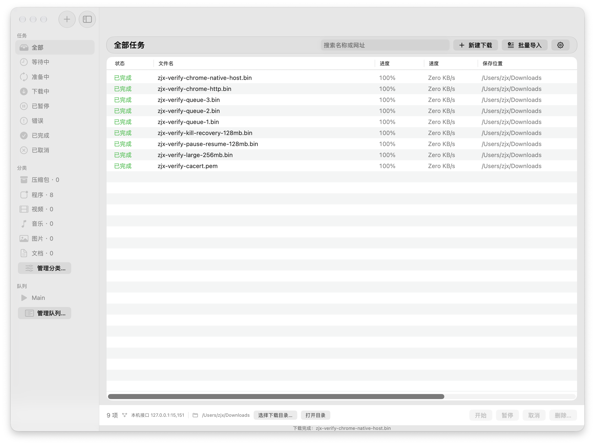
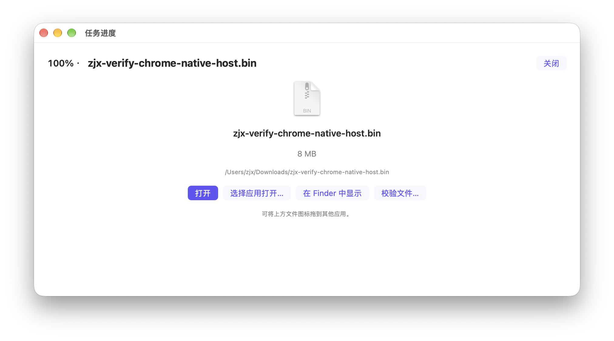

<p align="center">
  
</p>

<h1 align="center">zjx-download</h1>

<p align="center">基于 Swift 6 与 SwiftUI 重构的 macOS 原生多线程下载管理器，配套 Chrome MV3 扩展与无头 CLI。</p>

<p align="center">
  <a href="https://github.com/xxkingstuggle/zjx-download/releases/latest"></a>
  
  
  
</p>

<p align="center">
  <a href="https://github.com/xxkingstuggle/zjx-download/releases/latest">下载 Release</a> ·
  <a href="https://myzjx.com/software/zjx-download/">项目概览</a> ·
  <a href="https://myzjx.com/posts/zjx-download-native-architecture/">架构复盘文章</a> ·
  <a href="docs/native-rebuild/chrome-install.md">Chrome 扩展安装</a> ·
  <a href="docs/README.md">工程文档索引</a>
</p>

## 项目解决什么问题

`zjx-download` 是对跨平台下载器 AB Download Manager 的 **macOS 原生净室重构（Clean-Room Rebuild）**。原版基于 JVM + Compose Desktop，在 macOS 上常驻内存较高且系统材质集成有限；本项目用纯 Swift 6 + SwiftUI/AppKit 重写核心下载引擎与桌面界面，让桌面端 App、命令行 `zjx-download-cli`、`zjx-download-native-host` 与 Chrome MV3 扩展共享同一套任务状态模型和本地回环 API。

| 模块 | 核心职责 |
|---|---|
| `ZJXDownloadCore` | 多分片并发 HTTP/HTTPS 引擎、`.abpart` 分片落盘与检查点恢复、`Accept-Ranges` 探测、未知长度流单连接回退、未加密 HLS (`.m3u8`) TS 媒体流抓取 |
| `zjx-download.app` | macOS 原生主窗口与菜单栏控制，支持窗口后透射毛玻璃工具栏、降低透明度（Reduce Transparency）自动回退、队列调度与全局限速 |
| `zjx-download-cli` | 无头命令行入口，可独立拉起下载或向运行中的桌面实例派发任务（支持 `--start` 静默直接入队） |
| Chrome MV3 扩展 + Native Host | 拦截浏览器下载请求并附带站点 Cookie / Referer / User-Agent 上下文移交桌面端，支持 Native Messaging 与本地回环端口双通道握手 |

## 实际运行界面（macOS 原生版 v2.0.4）

**主窗口与队列视图**



**分片下载完成与详情核对**



## 快速开始

### 1. 安装预编译版本

1. 前往 [Releases (v2.0.4)](https://github.com/xxkingstuggle/zjx-download/releases/tag/v2.0.4) 下载 `zjx-download-2.0.4-macOS.zip` 与 `zjx-download-chrome-extension-2.0.1.zip`，可对照 `SHA256SUMS.txt` 校验摘要。
2. 解压后将 `zjx-download.app` 拖入 `/Applications` 并启动，应用会在本地回环地址启动任务监听服务。
3. 如需浏览器接管，解压 `zjx-download-chrome-extension-2.0.1.zip`，在 Chrome 打开 `chrome://extensions/` 开启「开发者模式」，点击「加载已解压的扩展程序」选择解压目录。详细 Native Messaging 注册步骤见 [Chrome 扩展安装说明](docs/native-rebuild/chrome-install.md)。

### 2. 从源码构建与测试

环境要求：Xcode（含 macOS 26 SDK）、Swift 6.2+、Node.js 与 npm。

```sh
# 1. 运行核心下载引擎与状态机单元测试
swift test

# 2. 构建 macOS 原生桌面端 (.app)
xcodebuild -project zjx-download.xcodeproj \
  -scheme zjx-download \
  -configuration Release \
  -destination 'platform=macOS' \
  CODE_SIGNING_ALLOWED=NO build

# 3. 构建命令行工具与 Native Messaging Host
swift build -c release --product zjx-download-cli
swift build -c release --product zjx-download-native-host

# 4. 构建 Chrome MV3 扩展（输出至 browser-extension/dist/chrome/）
npm --prefix browser-extension run build:chrome
```

## 数据目录与旧版迁移

- 运行时状态、分片检查点与配置保存在 `~/Library/Application Support/zjx-download/`。
- 默认下载目录为 `~/Downloads`，可在设置或新建任务弹窗中通过系统原生文件夹选择器切换；同名文件不冲突时保留原始文件名。
- 支持预览并显式导入旧版 `ABDownloadManager/state.json` 任务列表，导入过程只读不破坏原文件。

## 已知边界与当前状态

- **系统要求**：当前针对 macOS 26 SDK 构建（Universal `arm64` / `x86_64`），使用 Apple Development 签名，未开启 App Sandbox（以便直接读写用户选择的本地下载路径）。
- **流媒体边界**：HLS 下载仅支持未加密的 TS Media Playlist（`.m3u8`）；受 DRM 保护的流、独立音轨混流与直播流录制不在支持范围内。
- **退出演进**：无活跃传输任务时可通过菜单或 CLI 立即退出；存在进行中的分片传输时会弹窗确认，并把已提交分片进度同步到磁盘检查点后再关闭。
- **更多工程文档**：架构决策、API 契约与验收清单见 [`docs/README.md`](docs/README.md)，当前已知阻塞与边界记录见 [`BLOCKED.md`](BLOCKED.md) 与 [`PROGRESS.md`](PROGRESS.md)。

## 开源许可与致谢

本项目采用 [Apache-2.0 License](LICENSE) 开源；浏览器扩展子目录同样遵循 [`browser-extension/LICENSE`](browser-extension/LICENSE)，并保留对上游 AB Download Manager 协议设计及浏览器集成的署名说明。
