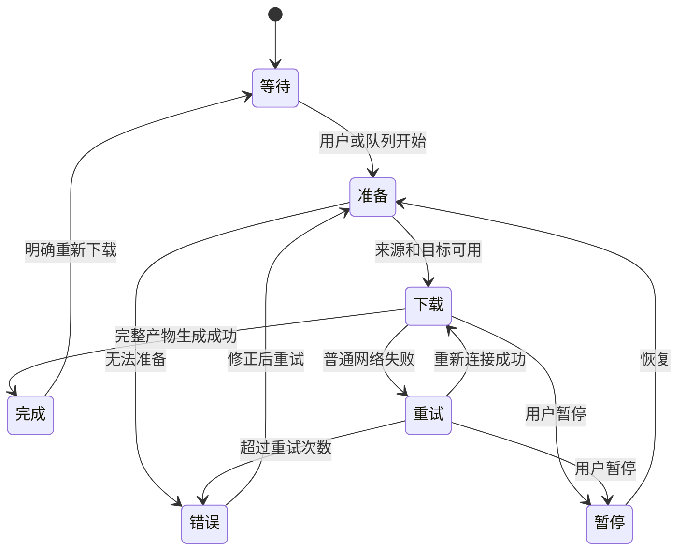

# 下载、队列、网络与集成服务功能规格

> 2026-10-18方向更新：先读[Mac原生独立重建方向](01-native-rebuild-direction.md)。允许看旧源码；[S]原版事实保留，[R]中精确默认、兼容策略、内部设计与新增功能作为候选，不能自动当成用户硬要求。文件与任务正确性仍须满足。

## 范围和证据标记

本文件描述固定官方基线 `e329495b6630b18e4b41d7682da33318b0f9ea18` 中可见的桌面下载行为，不描述当前 Swift 重写实现。所有 `[S]` 是对该提交源码的静态核对，不代表已启动旧版实测；`[R]` 是作者提出的候选方案，按0.2方向选择；`[U]` 是源码不足以确认或需旧版实机复测的行为。证据 ID 由分析者独立保管，不属于执行者的阅读材料。

每项验收先验证可观察行为；不得把代码路径、类型名或算法细节当成产品需求。默认值以应用层设置为准，底层下载组件的默认值只作无应用覆盖时的补充。下载百分比、速度、状态更新是展示数据，不作为文件完整性证明。

## N-001 HTTP/HTTPS 下载创建、请求字段和命名

**入口与前提。** `[S]` 支持从单条/多条添加、REST 导入、CLI 添加 HTTP 下载。下载地址必须是合法 HTTP 或 HTTPS URL；没有 FTP、BT、磁力链接或任意协议处理路径。桌面客户端把出站协议限定为 HTTP/1.1。原客户端保留标准 HTTP 重定向处理；完整重定向链和跨主机认证未实测 `[U]`。重建须支持普通 HTTP(S) 3xx 重定向并保护请求条件（见 N-011 `[R]`）。证据：NS-01、NS-02。

**输入、默认与校验。** `[S]` 核心输入是 `link`；请求头是可选键值对；可选字段包括下载来源页面、建议文件名、用户名、密码和 User-Agent。请求头 `Host` 会被忽略，以免重定向后错误复用原主机名；用户名与密码都非空时使用 HTTP Basic Authorization；只有一个为空时不发送 Basic 认证。自定义单任务 User-Agent 覆盖全局值；全局值为空时使用内置默认值，原内置值固定模拟 Windows Chrome 120：`Mozilla/5.0 (Windows NT 10.0; Win64; x64) AppleWebKit/537.36 (KHTML, like Gecko) Chrome/120.0.0.0 Safari/537.36`。`Accept-Encoding: identity` 会作为最终请求头写入。证据：NS-01、NS-02。

`downloadPage` 是来源/信息字段，不改变下载目标。HTTP 查询前会请求资源信息；文件名优先取响应 `Content-Disposition`，否则取 URL 的 `filename` 查询参数或末段路径，最后退回主机名。网页响应以 HTML 命名；若已声明文件名不是 `.html` 却收到 HTML，下载被当作远端内容已变更而停止。证据：NS-02、NS-03。

`[S]` 新任务默认目录来自应用下载目录（桌面默认下载目录下的 `ABDM` 子目录）；单任务可以指定目录和文件名。添加前检查目录路径合法、可写，检查文件名有效。具体允许字符集合由文件名校验器决定，本文件不虚构规则。证据：NS-04。

**重名结果。** `[S]` 默认策略为编号新增；在已登记任务或磁盘目标重名时按 `_1`、`_2` 等递增后缀生成新名称，保留原扩展名。另有覆盖和中止策略：覆盖会删除同一目标路径的既有任务及其关联数据后再新建；中止返回添加失败。CLI 与 REST 头部创建使用默认编号策略。覆盖任务时是否需要用户二次确认由调用界面决定；核心层不要求确认。证据：NS-04。

**成功、失败与恢复。** `[S]` 创建成功会生成任务 ID 和 Added 状态；开始后可见 Downloading/Preparing/Resuming/Retrying，暂停后 Paused，无法继续时 Error，完成后 Completed。链接、目录、文件名、权限、重名策略或服务端响应校验失败必须可见错误原因；已创建任务可以修正链接或目标路径后重新开始，也可显式重置。证据：NS-03、NS-04、NS-05。

**取消和重启边界。** `[S]` 添加阶段关闭窗口不等于删除已创建的任务；添加到队列后是否开跑取决于启动动作。应用重启会重建未完成任务，但代码只创建任务对象而不自动调用 resume；用户或已启用计划必须再次启动。证据：NS-05、QS-01。

**验收。** `[R]` 覆盖 HTTP 和 HTTPS、普通/重定向 URL、认证头、空用户名/密码组合、Content-Disposition、`filename` query、无文件名回退、非法 URL/目录/文件名、磁盘上已有文件以及数据库中已有同路径任务。验证默认编号、覆盖和中止三种结果；记录重定向头与重定向认证行为为实机待测项。

**新建请求字段的目标规则 `[R]`。**

| 字段 | 默认 | 输入/校验与结果 |
|---|---|---|
| 资源URL | 空，必填 | 合法HTTP/HTTPS绝对地址；保留查询参数，不把来源页当资源地址 |
| 来源页 | 空，可选 | 有值时为可打开的HTTP/HTTPS地址；用于信息与更新来源，不替换目标 |
| 文件名 | 检查后建议名 | 用户可修改；不能包含目录分隔符、空名称、系统禁止字符；错误不丢草稿 |
| 保存目录 | 系统Downloads/zjx-download | 可写目录；分类和逐主机预填后仍允许用户覆盖，不搬移已有文件 |
| 请求头 | 空对象 | 名称与值不得含CR/LF；同名头不区分大小写，最后一次明确输入生效；Host由目标主机确定 |
| 用户名/密码 | 空 | 两者均非空才使用Basic；只填一个时表单标明不会启用Basic，不暗中补值 |
| User-Agent | 空=使用全局/内置 | 单任务显式值优先；空值按N-001默认回退 |
| 分类/队列 | 按表单或记住值 | 无效引用不能悄悄指向另一分类/队列；给出可改选择 |

原版默认目录为Downloads/ABDM；新品牌目录是重建默认值差异，不迁移或改名用户既有文件。

## N-002 Range、并发分片、断点恢复与重试

**入口与前提。** `[S]` 首次启动下载时会发起带 `Range: bytes=0-255` 的资源探测；探测路径实际使用 GET，而不是 HEAD。若服务器对 256 字节探测返回不规范响应或失败，客户端再发不带 Range 的 GET 探测。判定支持断点/并发需要响应为 206，且同时有可解析的 Content-Length 和 Content-Range 全文件长度。证据：NS-02、NS-06。

**分片与默认。** `[S]` 默认每任务请求 8 个连接，默认最小分片为 512 KiB。支持 Range 且有长度时按目标连接数建立连续字节区间；小文件可以只建立较少分片。动态分片默认开启：有可用连接且现有区间足够大时可继续拆分；关闭后不新拆分。服务器不支持 Range 时退化为单连接首次下载。证据：NS-06、NS-07。

任务连接数优先取该任务的显式值，否则取全局线程数。在线改任务线程数会调整当前活动连接数；减少连接数时停止较高偏移的活动分片，保留其已写入进度以便稍后续传。全局线程设置更新后会触发所有任务重新应用连接数。证据：NS-06、NS-07。

**断点恢复。** `[S]` 已完成分片状态及当前偏移定期保存；活动下载约每秒保存并刷新输出。暂停会停止重试计时和活动分片、保存状态，并把正常取消标为 Paused；磁盘上已落地的有效分片可在后续手动恢复。应用重启不自动开跑，但任务可再次启动并校验远端信息。证据：NS-05、NS-08。

服务器不支持 Range 时可以单连接完整下载，但中断后从非零偏移请求通常无法可靠恢复；兼容目标应明确标记为不支持断点续传，并允许从头重置。未知总长任务采用单个无结束偏移的请求。由于恢复时输出有效性仍要求文件长度等于已知输出长度，而未知长度为 -1，未知总长任务的部分文件无法通过该恢复校验，重启后会从头重下。该结论是 `[S]` 静态推导，需旧版实测确认；新实现按 `[R]` 必须保证用户看见“从头重下”或提供安全续传能力，不得误报续传成功。证据：NS-06、NS-09。

**远端内容变化。** `[S]` 恢复时若已知总长度发生变化，或旧、新 ETag 都存在且不相等，会以文件变化错误停止，不自动把旧分片拼进新文件。若旧或新端缺 ETag，只能比较长度；同长度、缺 ETag 时无法证明内容相同。已支持多分片的服务器后来报告不支持 Range 时，会产生可重试错误；在手动重启/重置前不会自动抹掉旧状态。证据：NS-06、NS-10。

**重试和失败恢复。** `[S]` 应用默认最大重试数 3，UI/schema 可配 0–1024。一次启动请求算一次尝试；连接失败后固定等待 3 秒再试。若期间有新增字节，连续失败计数清零；无进度错误才累计。达到次数后任务转 Error。首次恢复阶段的网络/响应错误有特殊路径：在首次失败且计数为零时直接暂停，不能据默认值假设必定重试 3 次。关键校验错误、空间不足和目标文件准备失败立即停止，不进入普通重试。证据：NS-10、NS-11。

**取消和重启边界。** `[S]` 用户暂停保留已保存偏移；重置清空分片、长度、ETag、开始/完成时间并回到 Added。重置本身不立即删除目标文件，下一次准备会按新长度覆盖/截断/重建。删除未完成任务会删掉其部分输出；删除完成任务则默认保留最终文件，显式删除文件才删除最终输出。证据：NS-05、NS-09、NS-12。

**验收。** `[R]` 使用支持 Range、拒绝 Range、忽略 Range、缺 Content-Length、缺 Content-Range、未知长度、可变 ETag、缺 ETag、同长度内容替换和多后端 Range 能力不一致的服务端夹具。至少验证 2/8 连接、动态分片开关、改变连接数、暂停/进程退出/重启、三秒重试、进度后重置计数和安全拒绝拼接远端变化文件。

## N-003 输出文件、剩余空间、时间戳和部分文件

**目标路径与占位。** `[S]` 目标目录会递归创建；不是目录、不可写或准备失败会让任务失败。已知总长下载在开始写入前查询剩余空间：新文件要求可用空间至少等于完整长度；已有较短文件只要求补齐差额。已有文件比目标长度长会截短。支持稀疏文件且开关启用时尝试稀疏分配，否则实际填充文件；稀疏分配也先通过剩余空间检查。未知长度不预分配，不做完整长度的提前空间检查，实际写入失败仍可能发生。证据：NS-09、NS-11。

**最终文件与未完成命名。** `[S]` 默认直接在最终文件名写入未完成内容。可选“未完成文件附加扩展名”默认关闭；打开后未完成名为 `{name}.dl-{downloadId}.abdm.part`，完成时把该文件移动到最终路径；若最终路径已有文件，完成时先删除它。文件名过长时会被截短以留出后缀空间。设置在目标对象创建时读取；已存在任务变更开关后是否立即迁移其正在使用的文件名没有被实测，标 `[U]`。新实现建议 `[R]` 对每个未完成任务固定目标临时名，设置变更不得导致已有字节丢失或暴露为完整文件。证据：NS-09、NS-13。

**时间戳。** `[S]` 默认不采用服务器 Last-Modified。打开后，在服务器返回可解析 Last-Modified 的情况下设置输出文件时间；无法设置时静默忽略。ETag 用于内容变化比较，不作为输出时间。该选项在线变更对现存任务的影响点未通过旧版实测，按“下次准备输出文件”作为 `[R]` 验收约定。证据：NS-06、NS-14。

**取消、重置、删除。** `[S]` 默认取消单任务时暂停并保存，不清空字节；全局“取消时删除部分文件”默认关闭，打开后该 UI 取消动作会重置任务状态。重置清空任务分片元数据但不立即删除实际目标文件；因此仅看文件系统可能仍能看到未完成字节，任务下次开始时会重新准备目标。删除未完成任务会删除目标和中间文件；删除已完成任务默认仅移除任务记录，`remove-file` 明确为真时才删除最终文件。证据：NS-08、NS-12。

**成功和失败。** `[S]` 下载成功会完成所有分片、清理部分文件/临时碎片、写入完成时间并标记 Completed。空间不足及输出准备失败会立即停为 Error；空间清理后用户可手动恢复。未完成文件名模式移动失败会保留 `.part`，并报告准备/完成错误。证据：NS-05、NS-09、NS-11、NS-13。

**验收。** `[R]` 验证已知/未知长度、稀疏/非稀疏、剩余空间不足、已有等长/短/长文件、不可写目录、自动创建目录、时间戳开关、部分名开关、临时名冲突、完成时最终目标冲突、取消/重置/删除、进程重启的字节保留情况。输出文件已存在的兼容行为不得只靠状态显示验收，需逐字节检查。

## N-004 HLS 下载范围和限制

**入口与前提。** `[S]` 支持显式 HLS 下载入口，输入为播放列表 URL，可带请求头、来源页面、建议名、User-Agent、连接数、限速与校验值。播放列表响应须为成功 HTTP 响应；内容类型允许 `application/x-mpegurl` 或 `application/vnd.apple.mpegurl`；缺类型或类型不符时，只有在内容长度已知且不超过 2 MiB 时继续尝试解析。解析后必须至少有一个媒体分段；源码只校验首段 URL 扩展名为 `.ts`，并拒绝任一媒体段含非 NONE 加密键。后续分段类型是否一致未验证，记为 `[U]`。证据：NS-15。

**确定支持与明确不支持。** `[S]` 当前只解析 Media Playlist，不接受没有媒体分段的 Master Playlist；没有变体质量、独立音轨或字幕的选择 UI/请求字段。AES 或其他加密 HLS 明确不支持。完成时按媒体序号直接拼接分段字节，未见转码、封装或音视频 mux 步骤。虽然代码检查首段为 `.ts`，后续段可能混入其它格式；此类输入能否被接受以及输出是否可播放 `[U]`。验收目标应固定为未加密、同格式 TS Media Playlist。证据：NS-15、NS-16。

**分段、并发与续传。** `[S]` 首次添加时读取播放列表并把当前媒体段列表作为下载任务；分段请求相对播放列表 URL 解析，可按任务连接数并发下载，默认连接数沿用全局 8。每段写独立临时数据；暂停后已完成段可复用，缺失的已完成段会重新下载，未完成段中断后从该段开头重下。完成后按分段序号拼接为单个输出文件并清理临时目录。分段请求仅构造目标 URL，没有把播放列表上的 headers/User-Agent/用户名密码复制到每个分段请求；带鉴权头的分段站点是否因此失败属于源码推导 `[S]`，需旧版实测。证据：NS-16、NS-17。

**直播边界。** `[S]` 恢复时若已有已保存分段，不会自动再次读取或轮询播放列表；源码没有持续刷新 live playlist 的循环。可以把当下有分段的媒体清单视作有限快照下载，但不得承诺持续追随直播、录制固定时长、自动发现新增分段或音轨选择。接受某些无 ENDLIST 的有限快照并不等于支持直播录制。证据：NS-16、NS-18。

**名称、错误和恢复。** `[S]` HLS 内容总长度在下载完成后取最终拼接文件长度；暂停/恢复保存分段状态。清单解析失败、空清单、非 TS 首段、加密清单或分段 HTTP 失败必须显示失败状态和原因。用户更新清单可重新整理分段；分段索引相同但时长变化时源码尝试重置分段状态。如何选择新输出文件名仍使用通用编号规则。证据：NS-04、NS-15、NS-16。

**验收。** `[R]` 准备 VOD media playlist、master-only、TS、非 TS、空清单、错误内容类型（小于/大于 2 MiB）、AES-128、SAMPLE-AES、相对段 URL、带鉴权头清单、段鉴权、过期段 URL、暂停恢复和动态更新夹具。新产品只把 TS media playlist VOD 作为目标支持范围；master/多音轨/加密/mux/live 需单列产品决策后才能扩展。

## N-005 全局与单任务速度、连接和重试设置

**应用默认和边界。** `[S]` 全局应用默认：连接数 8；未入队手动并发下载数 3；最大重试 3；动态拆分开；Last-Modified 关；未完成后缀关；稀疏分配按平台默认（桌面开）；最小分片 512 KiB；全局限速关闭，保存的限速值为 262,144 B/s（界面按单位格式显示为 256 KiB/s）；用户代理为空；忽略 TLS 证书关。连接数 UI 可设 1–256（超过 32 有高值提示）；最小分片 1 KiB–2 GiB；重试 0–1024；未入队并发 `0` 表示不限。任务连接数 `0` 代表用全局值；任务限速 `0` 表示不限、正整数以 B/s 表示，UI 未声明的上界 `[U]`。队列自身的并发范围另见 Q-002。证据：NS-19、NS-20。

| 设置 | 默认/单位 | 范围与校验 | 生效时机 |
| --- | --- | --- | --- |
| 全局连接数 | 8 个连接 | UI 1–256 | `[S]` 保存变更约 500 ms 后调整现有活动任务；新建任务继承最新值。 |
| 最小分片大小 | 512 KiB | 1 KiB–2 GiB | `[S]` 500 ms 后更新；已保存区间不重切，后续动态拆分/新任务可读新值。 |
| 动态拆分 | 开 | 布尔 | `[S]` 500 ms 后更新现有任务可用的拆分策略。 |
| 全局重试数 | 3 次 | 0–1024 | `[S]` 500 ms 后更新；下一次失败读取当前值。首次启动网络/响应错误有 N-002 特例。 |
| 未入队并发 | 3 个；0=不限 | UI 0–Int.MAX，持久化上限 1024 | `[S]` 500 ms 后扩充或裁剪当前活动集合；被裁剪任务保留手动待处理资格。 |
| 全局速度模式 | 关闭 | 关闭 / 始终开启 / 应用在后台且用户仍与系统交互时开启 | `[S]` 约 500 ms 后生效；模式条件变化也重算当前全局限速。 |
| 全局速度数值 | 262,144 B/s（256 KiB/s） | 正整数 B/s，最小 1；关闭时不限制 | `[S]` 值和模式更新后即时应用到全局流量整形。 |
| 单任务速度 | 0 B/s=不限 | 正整数 B/s；0 可清除限制；UI 未声明上界 `[U]` | `[S]` 任务配置更新后给该任务套用；HLS 各分段共享任务级限速。 |
| 最后修改时间 | 关闭 | 布尔 | `[S]` 新一次目标文件准备使用返回的 Last-Modified；默认不改。 |
| 未完成后缀 | 关闭 | 布尔 | `[S]` 目标对象建立时选定路径；现有任务即时迁移未确认。 |
| 稀疏分配 | 桌面开启 | 布尔、受文件系统能力影响 | `[S]` 新一次文件准备读取最新值；无法创建稀疏文件则回退实际填充。 |

“应用在后台且用户仍与系统交互时开启”的限速模式不是“电脑空闲时限速”。证据：NS-19、NS-20。

**目标输入范围 `[R]`。** 全局连接1–256、单任务连接0–256（0继承）、手动并发0–1024（0不限）、队列并发1–32、重试0–1024、最小分片1KiB–2GiB。全局速度为1至9223372036854775807 B/s；单任务速度额外允许0表示不限。界面换算为所选单位，但不得静默把小数/超界值截为另一个有效值；不能表示的输入给出错误并保留上次有效值。重试0表示不重试，其他重试计数按N-011。这里统一原版UI与持久化范围差异，避免重启后数值被静默改写。

**成功与失败。** `[S]` 限速模式开时，全局速度控制作用于当前下载总量；单任务限速独立作用于任务。关闭全局模式等效为不限速，不会清空保存的限速数值。线程数减少会暂停多余活动分片/任务，不删除任务和数据。证据：NS-06、NS-19、QS-02。

**验收。** `[R]` 分别测 0/1/边界/超界设置、切换模式、后台+用户交互四象限、全局和单任务限速叠加、多任务下总速度、改变连接数与进程重启后默认保存值。单任务与全局限速具体公平分配策略未由源码规范，标 `[U]`，不要把“每条任务等分”写成事实。

## N-006 代理、DNS、TLS、User-Agent 与 HTTP 协议

**代理模式。** `[S]` 桌面支持 Direct、System、Manual、PAC；Android 支持列表仅 Direct 和 Manual。默认 Direct。Manual 支持 HTTP 与 SOCKS，host/port/用户名/密码；HTTP 用户名存在时用 Basic Proxy-Authorization，SOCKS 凭据由平台认证回调提供。手动代理有排除 URL 通配规则，匹配排除项后直连。PAC 使用脚本 URL；URL 无效时回退直连；脚本获取或求值失败的完整回退策略未通过旧版实测。证据：NS-21、NS-22。

**DNS。** `[S]` 默认使用系统 DNS。另支持 DNS-over-HTTPS；地址必须以 `https://` 开头且是合法 HTTP URL，设置损坏/无效时回退系统 DNS。DNS 选项在新连接查询时读取，已建立连接不会迁移。DoH 服务默认地址为空，不代表有内置公共服务。证据：NS-23。

**TLS 和请求身份。** `[S]` 忽略 SSL 证书默认关闭；开启时同时跳过证书链与主机名验证。全局 User-Agent 为空时使用 N-001 的固定内置 UA；任务自定义 UA 优先。单任务请求头覆盖其它普通头，但 Host 由 HTTP 客户端管理。证据：NS-02、NS-24。

**协议边界和错误。** `[S]` URL 入口限制 HTTP(S)，桌面客户端显式只启用 HTTP/1.1；本审计未确认 HTTP/2、HTTP/3、FTP、WebDAV、代理隧道之外协议等支持。TLS 证书拒绝、DNS 解析、代理认证、HTTP 非 2xx 与连接中断分别进入失败/重试判定；错误正文/映射细节以 UI 显示为准，不属于服务器协议契约。证据：NS-02、NS-10、NS-21、NS-23、NS-24。

**验收。** `[R]` 对照实际生效的系统代理、Manual HTTP/SOCKS、用户名密码、排除模式、PAC、系统 DNS/DoH、证书链失效、主机名失配、全局/任务 UA、重定向和 HTTP/1.1。真实系统代理和 DoH 端点属于环境输入，不写死测试账号或密钥。

## N-007 逐主机下载覆盖

**入口和字段。** `[S]` 逐主机规则是下载创建辅助设置，字段包括 host pattern、用户名、密码、User-Agent、线程数和速度限制。规则保存时去掉空 host，并按 host 字符串去重；匹配 URL 的 host（不含 scheme/path）后，将非空字段复制到新任务输入。HTTP 和 HLS 的单条创建及多条选择导入都接入该逻辑。规则只在创建输入/链接变更时应用；已有任务不会因为改表而自动批量重配。REST/CLI 创建绕过该 UI 钩子，是否应应用逐主机规则不能当作已确认。证据：NS-25、NS-26。

**匹配与优先级。** `[S]` 匹配使用通配模式；按 pattern 中 `*` 数量从少到多排序，最具体的首个匹配项胜出。同样 `*` 数量的规则保持保存顺序；通配比较不区分大小写，按子串匹配而非整个主机严格匹配。`*` 是任意字符序列，其余字符按字面。该范围来自共享匹配器的补证 `[S]`，实际 URL 规范化仍需验收。空用户名/密码/User-Agent 不覆盖原值；线程数 `0` 代表不覆盖、采用全局线程数；速度值 `0` 代表不限/清除覆盖。证据：NS-25、NS-26。

**失败和恢复。** `[S]` 主机规则只预填新下载字段，不改变原始 URL，也不把一条任务的敏感凭据推送给其它主机。下载输入若缺少规则，保留用户手工值。有效规则错误（如错误认证）按普通 HTTP 错误显示，用户可以编辑单任务信息后重试。证据：NS-02、NS-25、NS-26。

**验收。** `[R]` 测 exact host、多级子域 wildcard、多个 pattern 冲突、空覆盖值、`0` 恢复全局值、HTTP/HLS 单条及批量创建、保存后再创建、更新现存任务链接。按保存顺序解决同等优先级；测试大写主机与子串规则边界，不把短规则误解为严格相等。

**目标一致性 `[R]`。** 逐主机规则统一用于新建表单、批量、扩展、CLI及headless输入：显式单次输入优先，其次匹配的主机规则，最后全局默认。新表单的自动预填不能覆盖用户随后明确修改的值；编辑现有任务不因规则表变化而自行改值。该一致性是重建改进，不把原版REST/CLI未接UI预填的路径说成已有能力。

## N-008 下载期间防止系统睡眠

**入口与前提。** `[S]` 桌面应用启动后持续观察活动任务数；处于 Downloading、Retrying、Resuming 或 PreparingFile 任一活动状态时请求防睡眠，活动数归零后释放请求。Paused、Error、Added 和 Completed 不触发。没有用户可见开关的证据。证据：NS-27。

**平台边界。** `[S]` macOS 和 Windows 有请求系统保持唤醒及释放的路径；Linux 对该请求没有实际效果。macOS 电池供电、合盖、外接显示器、系统策略对 `caffeinate -s` 的实际影响未做硬件实测，必须 `[U]` 保留；不能承诺所有情形都不会睡眠。证据：NS-28。

**验收。** `[R]` 在 Mac/Windows/Linux 分别验证“无任务→开始→多任务→单任务结束→最后任务暂停/完成→错误”和释放时机；macOS 的电池、合盖及电源策略只记独立实机验收，不在本规格中触发系统睡眠或改变电源设置。

## N-009 文件校验工具

**入口与字段。** `[S]` 完成任务可以手动打开文件校验流程，逐文件计算摘要并显示进度。支持 MD5、SHA-1、SHA-256、SHA-512；默认 SHA-256。保存格式为 `algorithm:value`，值为小写十六进制。用户可保存期望摘要；计算结果为 Matches/NotMatches；没有期望摘要时为 Done（仅表示算完）。任务配置中的摘要不是下载自动校验的保证，源码仅显示单独校验流程。证据：NS-29。

**前提与失败。** `[S]` 只有 Completed 且最终文件存在时可计算；未完成返回 DownloadNotFinished，文件不存在返回 FileNotFound，其它异常显示异常状态。该流程读取整文件，不从网络再次下载。保存或修改期望值可在之后重新计算/比较。证据：NS-29。

**验收。** `[R]` 测四种算法、空期望值、匹配/不匹配、损坏格式、文件不存在、未完成任务、文件替换后再次计算。任务完成时不得在没有显式校验状态的情况下宣称校验通过。

## Q-001 队列模型、默认队列和删除

**默认与持久化。** `[S]` 必有不可删除的 Main 队列（ID 0）；启动时若缺失会创建。命名队列初始最大并发 2，队列项为空，计划开始/结束默认关闭，计划日为周一到周日，日程值默认 02:30/07:30，空队列自动停止关闭。Main 队列可重命名但不能删除。队列项顺序、并发、计划和自动停止设置持久化；队列当前是否 Active 不持久化。证据：QS-01、QS-02。

**加入、移动和移除。** `[S]` 同一任务在队列间唯一；移入新队列会从原队列移除，重复加入相同队列不产生副本。完成或删除任务会从队列清单移除。手工清空队列只清除队列成员关系，不删除下载任务或输出文件。证据：QS-03。

**删除队列。** `[S]` 删除非 Main 队列会撤销该队列与计划；没有显式停止其已运行任务或把等待项移到另一队列的行为。活动项可能继续运行，等待项仍留在下载列表但不再属于命名队列，该运行结果待实测。`[R]` 新产品删除前显示活动/等待项数量，确认后暂停该队列的活动项、解除全部成员归属并保留任务和文件；等待项不自行开跑，用户可重新入队或手动启动。取消不改任何任务。Main 仍不可删除。证据：QS-01。

**验收。** `[R]` 测首次创建、删除 Main 被拒绝、删除含活动/待处理任务的自定义队列、清空队列、跨队列移动、完成移出和重启后队列顺序/设置恢复。

## Q-002 顺序、并发和任务状态流转

**顺序。** `[S]` 队列按持久化顺序寻找第一个尚未活动、未在本轮被用户取消且可恢复的任务；跳过活动项、不可恢复/已完成项；队列满时等空位。用户可调整顺序。完成任务从队列移除后下一个可恢复任务启动。证据：QS-02、QS-03。

**并发。** `[S]` 每个命名队列默认 2，桌面 UI 范围 1–32，修改后约 500 ms 调整活动集合；超出目标时从活动集合末端裁剪任务并暂停，任务仍在队列中，后续可恢复。不同命名队列各自持有本队列并发上限；源码未见统一跨命名队列全局上限。未入队手动启动使用单独的默认 3 并发限制；设为 0 表示不限。改变此上限会扩充或裁剪手动待处理集合。证据：QS-02、QS-04。

**单任务开始/暂停/重下。** `[S]` 开始队列会填充到并发上限；暂停队列会置为非活动并暂停当前活动任务，但保留队列项及顺序。用户在队列运行中单独暂停的项会留在队列，暂时标记为本轮取消，队列不会立即重新启动它；停止后再开始会清除该抑制状态。因并发上限降低而裁剪的项也留在队列并可补位恢复。重置任务把内容与进度重置为 Added；若它仍在队列里，后续队列调度可从头开始。直接手工恢复会绕过命名队列派发。证据：QS-02、QS-04、NS-05。

**成功和恢复。** `[S]` 队列完成项自动出队；不可恢复项在找下一个任务时跳过并从队列移除。下载任务数据和队列项分别持久化。启动应用后队列为非活动状态，需手动或计划启动。证据：QS-01、QS-02、NS-05。

**验收。** `[R]` 用 A/B/C 多任务验证顺序、并发 1/2/上限、改变顺序后下一项、暂停整个队列、单项暂停、降低并发时保留位置、重置、跨队列移动、删除队列和应用重启后的状态。暂停单项的 UI 必须区分“已暂停但仍排队”与“从队列移除”。

## Q-003 周期计划和空队列策略

**字段和默认。** `[S]` 计划以本机时区的星期集合、开始时间、结束时间及两个独立开关组成；星期集合必须非空。默认全周，开始 02:30/结束 07:30，但两者默认都禁用。开始与结束独立寻找下一个符合日历条件的未来时刻；到点后等待约 1 秒再为下一周/日重复安排。证据：QS-05。

**触发结果。** `[S]` 开始时刻到达会启动队列。结束时刻到达会停止队列并暂停当前活动任务；只有到点前队列处于 Active 时才触发队列结束动作（见 Q-004）。当队列变空时默认仍保持 Active；开启“空队列自动停止”才会停止。队列空事件可触发完成动作，不要求先自动停止。证据：QS-02、QS-05、QS-06。

**跨日边界。** `[S]` 开始、结束是两个独立的星期/时刻事件，不把结束自动绑定到开始的下一天。例如只选周一、开始 23:00、结束 01:00：结束事件在周一 01:00，开始事件在周一 23:00，下次结束在下周一 01:00；不是周二 01:00。若选择全周，23:00 开始的任务可在次日 01:00 被当天结束事件停止。`[R]` 新产品保留该独立事件语义，界面明确展示下次开始/结束日期和时间；重新启动只安排未来事件，不补执行已经错过的事件。系统时区变化后重新计算；夏令时不存在的时刻延至该日首个有效时刻，重复时刻只执行第一次。这些 DST 规则是重建约定，原版尚未实测 `[U]`。

**验收。** `[R]` 测全周/单日/周末、多日、今天时刻已过、跨午夜、仅启用开始、仅启用结束、两个都启用、计划修改后重排、队列原本未启动的结束事件、队列空时 auto-stop 开关和夏令时切换。

## Q-004 下载完成动作

**入口与默认。** `[S]` 可为单下载或队列保存完成电源动作配置；默认无动作。桌面界面开关启用时选择 Shutdown。数据模型还列出 Hibernate 和 Sleep，但没有确认桌面设置界面能选它们。单下载在任务实际完成时触发；队列在其变空事件触发。证据：QS-06、QS-07。

**等待与取消窗口。** `[S]` 桌面会打开置顶提示并倒数 30 秒；关闭窗口/取消可以在倒数阶段关闭提醒，另可选择立即执行。倒数归零或立即执行后，执行前停止所有队列、清空手动队列并停止全部下载，再等待约 1 秒后调用系统动作。平台命令成功则关闭提示；异常会显示错误。动作开始后关闭提示不等于撤销已经发出的系统命令。`force` 字段存在但命令是否尊重它未确认 `[U]`。证据：QS-07、QS-08。

**队列时间结束动作。** `[S]` 计划结束时，仅当队列此前 Active 才触发与队列完成相同的电源动作；计划开始事件不执行完成动作。队列为空触发一次“队列完成”动作；若队列因 `stopQueueOnEmpty` 停止，其先后次序不作为新产品保证。证据：QS-05、QS-06。

**平台能力。** `[S]` 配置枚举声明 Shutdown/Hibernate/Sleep；本次静态审计中各桌面平台只实现 Shutdown，Hibernate/Sleep 分支仍未实现。不得在新规格或 UI 中把未实现动作描述成有效功能。Mac/Linux/Windows 的 Shutdown 命令能否在所有权限与系统状态下成功属于 `[U]`，旧版源码调用成功不等于操作系统实测成功。证据：QS-08。

**验收。** `[R]` 使用可替代的无害动作适配器验证默认关闭、单下载完成、队列空、计划到时/队列未活动、30 秒可取消、立即执行、执行前停止下载、OS 调用失败和再次重试。生产系统动作必须作为单独人工实机验收，不能在静态规格任务中触发。

## I-001 本地 REST 服务线协议

**启动、监听和认证。** `[S]` 默认启用本地 API，默认端口 15151；设置值 schema 允许 0–65000。服务只绑定 `127.0.0.1`，配置改变时停止并重新创建；设置更新约 500 ms 后应用。绑定/启动失败会更新失败状态并把 API 开关关闭。端口 0 允许保存，但实际随机端口的发现/广播行为未确认 `[U]`。证据：IS-01、IS-02。

认证默认关闭；启用认证后使用 `X-API-Key` 请求头与设置密钥比较。默认密钥随机 24 位英数，用户可改。缺少或错误密钥时默认响应为 HTTP 401；项目没有自定义该响应正文。若密钥为空，服务把认证值设为空并跳过认证；这是源码确认行为，重构时 `[R]` 应禁止“开启认证但空密钥”成为无认证状态。证据：IS-01、IS-03。

集成服务未声明 CORS 规则。`/queues` 将 JSON 文本作为普通文本响应发送，Content-Type 为 `text/plain`。证据：IS-01、IS-04。

**公开路由。** `[S]` 目前运行时只有下列四条路由，均在同一认证范围内；不提供 REST 任务列表、暂停、恢复、删除、队列管理或配置写入。

| 方法/路径 | 请求体 | 成功响应 | 失败边界 |
| --- | --- | --- | --- |
| `POST /add` | `{ "items": [<source>...], "options": { "silentAdd": false, "silentStart": false } }`。`source` 区分 `type: "http"`/`"hls"`，共有 `link` 必填、`headers`/`downloadPage`/`suggestedName` 可选。兼容旧的裸 HTTP source 数组；裸数组不含 HLS 或 options。 | HTTP 200 文本 `OK`。`/add` 走 GUI 导入流程；静默含义和多条导入边界见 browser spec。 | JSON 解析/导入异常没有自定义错误 schema；具体状态码/正文 `[U]`。 |
| `GET /queues` | 无 | HTTP 200，JSON 文本数组 `[{ "id": 0, "name": "Main" }]`，实际每项只有 id/name；Content-Type 默认文本。 | 仅认证/服务故障；未定制错误 schema。 |
| `POST /start-headless-download` | `{ "downloadSource": <source>, "folder": null, "name": null, "queueId": null, "categoryId": null, "startDownload": false, "startQueue": false }`。除 `downloadSource` 外均可省略；source 同 `/add` 单项。 | HTTP 200 文本 `OK`。默认目录由应用设置给出；缺名时使用建议名，否则取链接最后 `/` 后片段。默认重名按编号添加。 | JSON decode、非法 queue/category 或添加失败无项目级错误 schema，具体 HTTP 状态/正文 `[U]`。 |
| `POST /ping` | 无 | HTTP 200 文本 `pong` | 认证失败或服务异常；没有专属错误格式。 |

`startQueue=true` 且给出 `queueId` 时加入并启动该队列，优先于 `startDownload`；否则只有 `startDownload=true` 才直接手动启动。`startQueue=true` 但没有 `queueId` 时不会启动队列。证据：IS-01、IS-05、IS-06。

**schema 差异和验收。** `[S]` 运行路由代码是线协议权威；仓库 OpenAPI YAML 与运行时代码有路由/字段/响应差异。无 CORS 配置、认证头、`/queues` Content-Type、裸 HTTP 数组兼容和静默导入应以运行时代码及框架默认分别验收。`[R]` 新产品保持 add/headless 的 `text/plain` 成功正文 `OK` 和 ping 的 `text/plain` 正文 `pong`，将 queues 的响应明确为 `application/json`；错误使用下述固定契约，缺失或错误凭证稳定返回 401。这属于重建约定，不冒充原版响应。证据：IS-01、IS-04、IS-07。

**候选兼容契约 `[R]`（尚未冻结）。**

- 服务与扩展端口统一为 1024–65535、默认 15151；拒绝 0、负数、小数、超界值。只监听本机。普通网页不获得宽泛的跨域访问授权；浏览器扩展通过所需权限通信。
- 开启认证必须有非空密钥；空值阻止提交，不静默退回无认证。配置提交成功才保存新值；监听失败恢复上次有效配置并显示错误。无可恢复配置时明确显示服务不可用。
- 非 JSON/损坏 JSON、必填字段缺失、非法 URL/队列/分类引用返回 400；缺失或错误密钥返回 401；同一请求 ID 对应不同内容返回 409；内部未能接受请求返回 500。正文为 `{"error":{"code":"INVALID_REQUEST","message":"可理解的原因"}}`，相应 code 为 `INVALID_REQUEST`、`UNAUTHORIZED`、`REQUEST_CONFLICT`、`INTERNAL_ERROR`。不含真实密钥或凭据。
- `/add` 新增可选顶层 `requestId` 字符串，旧格式保持兼容。配套扩展每次用户操作生成一个 ID，在 HTTP/native 备用尝试中保持不变。同 ID、同内容在十分钟内只接受一次，重试返回同样成功结果，不再创建任务或确认窗口；该十分钟保证覆盖 App 重启。同 URL 的新用户操作使用新 ID，仍可按冲突规则重新下载，不能用 URL 全局去重代替请求去重。
- 成功表示请求已接受进入确认/添加流程，不代表文件已下载完成。批量请求校验字段可解析后才接受；任务级失败在确认或结果列表逐项显示。

## I-002 桌面 CLI 命令与能力范围

**命令总表。** `[S]` 根命令为 `ABDownloadManagerCli`，支持 `--debug` 和自动版本选项；真实命令如下。

| 命令 | 参数/行为 |
| --- | --- |
| `download add http` | 必填 `--link`；可重复 `--header`/`-h`；可选 `--folder`、`--name`、`--download-page`、`--queue`、`--category`、`--start`、`--start-queue`。新增后向 stdout 打印任务 ID。 |
| `download add hls` | 同 HTTP 添加选项，任务类型为 HLS。 |
| `download show ID...` | 支持多个任务 ID；显示 ID、状态、名称和目录；没有结果输出 `No downloads found.`。 |
| `download show ID... --watch` | 持续显示状态、百分比、名称和目录。显示状态包含 Paused、Error、Downloading、Finished、PreparingFile、Resuming、Retrying。 |
| `download pause ID...` | 暂停多个任务。 |
| `download resume ID...` | 恢复多个任务。 |
| `download remove ID... [--remove-file]` | 删除多个任务；默认不删除已完成文件，传 `--remove-file` 才删除完成输出；未完成输出始终随任务删除。 |
| `gui run [--background]` | 启动 GUI；`--background` 请求静默启动。已有实例时输出已有实例提示。 |
| `gui start-if-not-started` | 仅当尚未启动时启动/等待服务；从 IDE 调用会返回错误。 |
| `gui exit` | 请求运行中的 GUI 退出。 |
| `gui integration show` | 输出当前集成服务端口；服务不可用时输出 UNKNOWN 标记。 |
| `native-messaging install` / `uninstall` | 安装/卸载浏览器 Native Messaging host manifest。 |
| `native-messaging run` | 直接运行 host；帮助文本标注仅用于测试。 |

证据：IS-08、IS-09、IS-10。

**输入字段校验。** `[S]` `--link` 必填且必须是合法 HTTP(S) URL；`--download-page` 若给出也必须是合法 URL；`--name` 走文件名校验；`--folder` 使用目录型文件参数；queue/category 用整数 ID。每个header参数使用冒号或等号表达键值；原版分割多个分隔符时可能截断值 `[S]`。目标 `[R]` 只在第一个分隔符处分开，保留值中后续冒号/等号，空名称或缺分隔符是参数错误。CLI 没有独立 username/password、User-Agent、单任务限速、线程数、重试数、checksum 或完整任务列表命令。可用 `Authorization` header 自行表达部分鉴权需求。证据：IS-08。

`--start` 表示直接手动启动下载；`--start-queue` 表示启动指定队列，必须同时给 `--queue` 才有效；同一请求二者同时设置且有 queue 时启动队列而不是直接启动。CLI 请求通过桌面单实例 IPC 提交；并不等同于调用 REST API 服务。证据：IS-05、IS-08、IS-11。

**成功/失败与恢复。** `[S]` 新增命令成功返回新任务 ID；pause/resume/remove 成功不打印每项结构化结果；`show` 是查询唯一用户可见任务状态的 CLI 命令。pause 保留可恢复数据；resume 重新排入未入队并发调度；remove 依 N-003 处理文件。CLI 是否为每种底层添加错误设置独立退出码未逐项实测 `[U]`。证据：IS-08、IS-09、IS-11、NS-08、NS-12。

**新产品CLI约定 `[R]`。** 可执行入口名 `zjx-download-cli`，保持上表适用命令；成功退出0、运行失败1、参数错误2。新增成功时stdout仅打印任务ID和换行；错误写stderr并说明未执行/部分执行的ID，不混入凭据。show无ID或全部ID不存在时显示 `No downloads found.` 并退出0；修改命令遇到不存在ID时报告该ID、继续其他有效ID，最后退出1，不回滚已完成操作。watch由用户中断时停止观察，不暂停下载。原版准确退出状态仍待实测，不能用这些新约定倒推原版。

**验收。** `[R]` 运行所有命令的 `--help` 和有效/无效参数；验证多个 ID、空查询、持续 watch、退出状态、queue/category 不存在、正在运行 GUI、GUI 不存在、port 未启用、header 解析和文件保留。不要添加旧版未提供的 CLI 子命令并声称兼容。

## I-003 原生消息通信与启动交接

**原版契约 `[S]`。** 证据 IS-12。原 host 名称为 `com.abdownloadmanager`；消息为 UTF-8 JSON，前置四字节本机字节序长度。原 host 接收长度范围 1–4 MiB；浏览器自身的收发限制还需按目标浏览器验收。

公开消息字段为 `id` 和 `content`；`content` 包含 `action`、`isError`、`payload`。请求动作 `ping`/`add`；`payload` 是 JSON 字符串，不能发送未经编码的内嵌对象。add 的 payload 与 `/add` 相同，ping 仅探测 host 通道。原版成功回复保留请求 ID、`action=null`、`isError=false`、`payload="true"`。失败为 `isError=true`，payload 是含 `errorType`/`message` 的 JSON 字符串。错误中的原内部类型名不属于新产品兼容要求。

**新产品约定 `[R]`。** 自有 host 名为 `com.zjx.download`；保留上述公开消息格式，不能覆盖原版注册。错误 `errorType` 使用稳定的公开错误码而非私有类名。host 通道可达与 GUI 已启动分开报告；add 时可请求后台启动并等待能接受请求，失败显示可恢复状态。HTTP/native 共享 I-001 的 requestId，避免通道切换导致重复任务。

**验收。** 分别验证正确和损坏长度、空/损坏 JSON、未知动作、错误 ID、add、ping、未注册 host、GUI 关闭、后台启动失败和中途断线。协议输出不能混入普通日志。系统注册与启动的真实效果须在独立测试身份下验证，不能仅看文件已经写入。

## N-010 磁盘文件删除跟踪与缺失项清理

**原版入口和默认 `[S]`。** 证据 NS-30。下载引擎设置“跟踪磁盘删除文件”默认关闭。开启时先检查现有缺失项，随后观察任务目录的删除事件；关闭时停止跟踪。它会自动移除缺失文件对应的任务记录，而非只显示一个缺失标记。

**判定边界 `[S]`。** 已完成项的最终文件不存在可列入清理；未完成项只有已经产生下载进度且目标不存在才算缺失，尚未开始、没有进度的任务不能因未生成文件被清除。收到删除事件后再次核对实际不存在才移除记录，不删除其他文件。Windows 为避免阻止弹出移动盘而跳过某些可移动存储；macOS 外接卷的断开行为未实测 `[U]`。

**重建约定 `[R]`。** 开启时说明会清理记录，先预览本次缺失清单并由用户确认；之后只自动移除确认过的同一监控范围内真实删除项。卷暂不可用、权限拒绝和路径不可达属于“位置不可用”，保留记录，不能推断为用户删文件。临时重命名后目标恢复时不移除记录。关闭开关不恢复已清理记录，界面需说明；记录可由 JSON 凭据重新添加，但不能恢复原进度。

**验收。** 对比完成文件删除、重命名后恢复、未开始任务、已有进度但部分文件丢失、外接卷暂断、目录失权、开关关闭/开启及重启；逐项核对记录数和磁盘内容。手动“清理缺失项”遵守同样的缺失判定。

## N-011 新产品的状态与恢复约定

本节 `[R]` 统一新实现的用户可见结果。原版特殊分支仍保留在前述 `[S]` 描述中，不把它们误当已验证的运行结果。

| 当前状态/事件 | 新产品应有结果 |
|---|---|
| 新建但未开始 | 新增/等待；没有文件不算丢失；等队列或用户开始 |
| 请求开始 | 准备/连接；取得可用信息后下载，不能直接跳到完成 |
| 普通网络失败 | 保留已接收内容，最多再试3次，间隔3秒；有新进度后清零连续失败计数。这里“重试3次”为首发之外3次，是区别于原版计数/首次暂停特例的明确约定 |
| 空间/权限/来源变化/不支持内容 | 进入对应错误，保留记录和可恢复数据；等待用户处理，不无限自动重试 |
| 用户暂停/取消当前传输 | 停止请求并按清理设置保留或重置进度；不显示普通网络错误，不删除任务记录 |
| App退出再打开 | 还原任务和队列配置，传输保持停止；只有未来计划事件或用户操作再启动 |
| 安全续传条件满足 | 复用已确认数据并继续；最终文件内容须与完整源一致 |
| 无法安全续传 | 明确提示从头开始或编辑来源；不自动混合旧字节与新内容 |
| 传输/汇总结束 | 文件准备和媒体合并全部成功后才完成；自动通知/电源动作只从该完成结果触发 |
| 计算摘要 | 单独呈现摘要/匹配结果；下载完成不自动等于摘要校验通过 |
| 重新下载 | 明确告知重置已有进度；按冲突规则处理现有文件，从头取得内容 |
| 删除记录 | 完成文件是否删除遵从显式选择；未完成数据的删除需在确认范围说明 |

HTTP(S) 普通重定向须能完成同一份下载，跨主机跳转不能无条件转发原主机敏感头。HTTP/1.1 是最低互通要求，不把原版只启用 HTTP/1.1 的内部配置变成新实现的技术限制。

HLS 的目标支持范围固定为有限、未加密、TS 媒体清单。浏览器可展开 master 的变体并提交具体 media URL；桌面直接输入 master 时提示选择/取得 media URL，不隐式承诺音轨合并。清单和分段各自应用适用的请求凭据；不能因为清单已能读取就把需要鉴权但请求条件未传递的分段报成完成。对 MIME 参数作正常化；不匹配/缺失类型时仅在已知清单不超过2MiB时尝试读取，这是统一两端边界的重建约定。

源码中记录文件名、临时布局、分段调度和刷新间隔只是原行为取证。新实现可独立选择内部布局与保存机制，只要满足上述文件结果、恢复和可见状态，不要求复刻原实现步骤。

