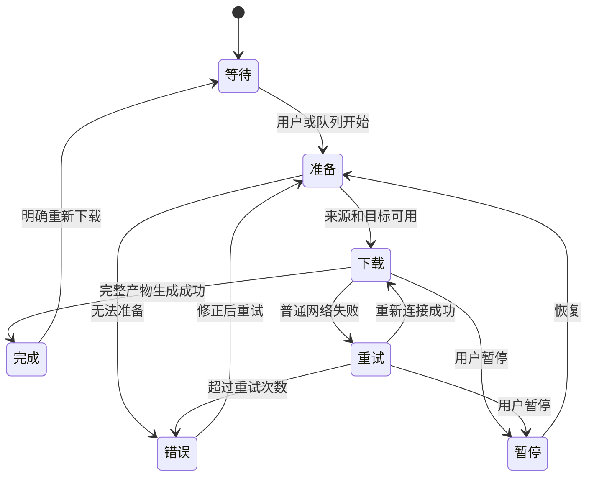

# Mac原生下载器：独立重建规格

方向版本0.2 · 2026-10-18 · macOS + Chrome

**当前方向：允许研究旧项目，独立设计和编写不同实现，按Mac原生方式完成用户任务。** 旧版严格源码隔离和全部R约定冻结不再执行。

先读第一性原理重审和反向拆解，再用80组功能清单与50条场景检查覆盖。S是原版源码级事实，R是作者候选，U是未核实事实；用户目标和基础正确性继续作为约束。原版内部机制不自动成为新实现要求。

本轮修订文档，尚未启动新实现或运行验收。

---

## Mac 原生独立重建：从目标重新推导

方向版本：0.2 · 2026-10-18。用户本轮明确允许查看旧项目，要求独立重新实现，采用不同的实现方式，以 Mac 原生应用为目标。本文件优先于0.1版的严格源码隔离和“所有重建约定已经冻结”的表述。

### 已明确的目标

阅读 AB Download Manager 与现有 zjx-download，理解功能、协议、边界和失败案例；重新设计并独立实现 Mac 下载器。按用户实际能完成的操作判断功能覆盖，以 macOS 的交互和系统能力完成它们。

允许看旧项目。新业务实现独立编写，不拷贝旧模块改名，不逐函数翻译，也不在旧实现上不断补丁后宣称完成重建。标准协议、正确的用户结果和系统API可以相同；不能为了制造差异而换掉正确做法。

既有 macOS + Chrome 范围继续保留，不要求用户重复确认。原版功能清单继续保留，本轮没有替用户删除分类、队列、批量、媒体、CLI等能力。原版的入口、跨平台兼容层和内部技术细节不自动成为新架构的要求。

### 基本事实、假设与约束

| 类别 | 判断 |
|---|---|
| 基本事实 | 下载最终是把指定远端内容可靠地保存到用户指定位置；状态、恢复、调度和文件结果必须一致。界面和浏览器交接都要落到同一个任务事实 |
| 当前事实 | 现有仓库已经使用Swift、SwiftUI/AppKit、URLSession、Keychain与系统目录授权（见[Package.swift](../../Package.swift)、[原生列表](../../Sources/ABDownloadManagerApp/NativeDownloadTaskTable.swift)、[HTTP客户端](../../Sources/ABDownloadManagerCore/Engine/HTTPClient.swift)）。再列一遍这些技术名词，不能证明新实现独立，也不能证明实际体验好 |
| 用户要求 | 独立重写、不同实现、Mac原生；可以研究旧项目；详细掌握原功能，并以功能使用结果为目标 |
| 未验证假设 | 完全不看源码才能独立实现；每一行都必须与旧版不同；照搬所有设置才能完整；先搭三套通信入口才有完整下载器；先跑完50条大回归才能看一次真实效果 |
| 可用资源 | 两套旧实现、原版功能证据、已有可复用的合成测试来源与文件校验方法、Apple原生框架。它们可用于学习和验证，不代表旧业务实现应被搬进新项目 |
| 现实约束 | 服务器决定是否支持Range与安全续传；macOS决定文件权限和系统集成；浏览器有权限与通信限制。更换语言不能消除这些约束 |

### 上一版需要纠正的部分

1. 取消“执行者不得读旧源码/审计资料、读过源码的代理不能实施”的人为门槛。实现独立性看新设计与实际代码来源。
2. 将原版事实、用户目标、基础正确性和作者候选方案分开。0.1版的`[R]`不是用户逐条确认的决定。
3. 解除没有使用依据的精确冻结：十分钟跨重启去重、统一端口范围、自定义错误格式、固定重试节奏、CLI新名称等先作为方案候选。
4. 多画质批量勾选、隐藏设置显性化等新增功能保留为提案，不挤占原功能重建，也不冒充原版已有。
5. 原生程度不以主题、玻璃效果、Swift文件数量或SDK导入数量判断。窗口、列表、键盘、文件操作、后台生命周期与实际资源使用要在运行中检查。
6. 保留80组清单和50条验收作为覆盖索引；不以条目数替代产品判断，也不要求每次改动重跑全部场景。

文件完整、失败不报完成、删除不误伤、明确的暂停/恢复结果等是下载器的基础正确性，继续成立。它们不依赖十分钟缓存、某个状态类或某种临时文件布局。

### 重新推导的实现路径

**先按用户任务组织功能。** 建立任务、选择来源与位置、控制下载、恢复失败、管理多个任务、接收Chrome请求。分类、队列与设置服务这些操作；界面不需要逐页照搬原版。

**原生UI与原生系统集成一起设计。** SwiftUI/AppKit是首选界面组合；窗口、菜单、表格选择、快捷键、文件面板和Finder行为按Mac习惯设计。网络、文件访问、凭据、通知等优先使用适合的Apple框架。AppKit与SwiftUI可混合使用，不把“全SwiftUI”设为纯度指标。[Apple AppKit说明](https://developer.apple.com/documentation/appkit)

**先验证系统能力，再补必要逻辑。** Foundation提供下载与恢复API，但这不证明它已经满足所有多连接、认证、重启恢复和媒体需求。先验证核心使用场景；只有确定缺口后才独立补充逻辑，不把原版分片引擎机械移植过来。[Apple下载恢复说明](https://developer.apple.com/documentation/foundation/pausing-and-resuming-downloads)

**共享任务操作，减少重复路径。** UI、Chrome、将来的CLI等入口应使用同一套任务操作和状态。Chrome先选能满足实际交接要求的最简单通信方案；是否同时保留HTTP和Native Messaging取决于明确的兼容目标。公开能力的覆盖与内部传输数量分开验收。

**按完整操作逐步验收。** 先跑一个真实下载与恢复，再接Chrome，再按清单补齐其余功能。每个阶段都形成可运行结果，后续不能以首个样例通过为由省略剩余功能。新增代码、失败或风险决定补哪些验证。

### 这条路径成立的前提

- 旧源码用于理解和取证；新业务实现的职责、数据流、生命周期与实现理由可以独立解释，而非逐段对应旧函数。
- 所选原生API经过代表性真实任务验证；没有证据就不宣称恢复、认证、媒体或系统操作已经可用。
- 原版兼容、新产品功能和可选增强分开记录。每项原功能最后有“支持、等效实现、待完成或明确差异”的落点，不能静默删项。
- 保留旧项目、已有下载数据和生产安装，当前仍是方向与规格修订阶段，不启动重写、安装或替换。

### 验证方向的第一步

下一次实施先交付一个独立编写、使用真实原生界面的最小下载纵向样例：

1. 输入一个受控HTTP文件地址，选择目录和名称。
2. 开始实际下载，界面显示真实进度。
3. 下载中暂停，退出整个App，再重新打开。
4. 明确恢复任务，取得完整文件。
5. 用文件长度和摘要验证内容，再从界面打开文件和在Finder定位。

同时检查键盘、窗口关闭/重开和错误反馈。这个样例检验原生交互、网络执行、状态恢复与文件操作是否真正接通；它是第一个验证点，不是缩减后的最终范围。本轮尚未实现或运行此样例。

### 后续如何使用既有规格

`[S]`继续表示原版源码级事实；`[U]`表示未核实事实；`[R]`保留为作者在0.1版提出的候选约定。基础正确性和用户明确目标优先；具体默认值、内部设计、兼容策略及新增功能按实际需求选择并记录理由。日后确定的方案不能再被写成“用户先前已经要求”。

功能文档不需要替开发者预先决定每个实现细节。它应把需要达到的结果、重要边界与验收方法说明白，让新实现有独立设计的空间。

---

## 反向拆解：原项目的价值怎样转成Mac原生实现

2026-10-18 · 与[第一性原理重审](#current-direction)配合阅读。

一句话：原项目把分散的下载入口、容易中断的网络传输和大量文件管理，组织为可查看、可控制、可继续的任务。

这里按固定版本的功能事实拆解，不重新重复80组功能目录。`[S]`来自既有源码审计；用户目标和“为什么有效”为基于功能的推断；新实现方向和验收为本次建议，不是原版实测结论，也不是新增功能已经获准。

### 服务对象、结构与目标

适用对象是需要管理多个文件、保留中断进度、按计划下载，以及从网页交接资源的桌面用户。这是依据功能推断的适用人群，不是用户画像调查。

原产品的主流程是：取得来源和请求条件 → 检查名称与位置 → 建立任务 → 手动或按队列执行 → 显示状态并允许干预 → 形成文件并提供后续操作。浏览器、批量与CLI增加入口；分类、计划、设置和工具辅助这条流程。

这个结构有用，因为不同入口提交的内容最后都变成用户能在下载列表里找到的任务。它是否完成，要看任务和最终文件，而不是某个入口是否返回成功。

### 八条核心链路

| 用户要完成的事（推断） | 原版关键选择 `[S]` | 为什么有用（推断） | 新Mac实现保留什么结果、重新设计什么 | 验收结果 |
|---|---|---|---|---|
| 中断后继续下载 | N-002/NS-06：支持Range时分段并保存进度；暂停保留数据，重启不自动开跑 | 避免一次中断使全部等待白费 | 保留安全恢复和明确状态；独立选择原生下载能力与必要补充，不照搬8连接、512KiB或偏移存储格式 | 暂停、退出、重启、恢复后内容正确；不能续传时明确说明从头开始 |
| 一次管理多个任务 | D-002/DS-003：多选、区间选择、排序、可配置列与保存布局 | 让批量动作落到用户实际选中的项目 | 使用Mac原生列表/表格选择、焦点、菜单和键盘；列组合、宽度和原快捷键按使用需要重定 | 暂停/删除只处理预期任务，筛选后选择范围清楚 |
| 让任务按时间安排运行 | Q-003/QS-05：星期和起止时刻控制队列；原版起止是独立事件 | 用户无需守着机器逐项启动 | 保留可解释的日程和开始/停止结果；按Mac界面清楚表达跨日含义，不机械复制原定时器和02:30/07:30默认 | 显示的下一次时间与实际开始/停止一致，跨午夜符合界面承诺 |
| 自动整理来源与保存位置 | D-010/DS-013/DS-037：扩展名和URL规则分类，可指定目录；改分类不搬旧文件 | 减少重复选路径，任务更容易找到 | 保留规则、目录和文件位置的区别；类别数量、优先级与侧栏布局独立设计并说明 | 新任务归类/落盘符合规则，改分类不误移旧文件 |
| 下载浏览器已获授权的资源 | B-011/BS-009：可携带匹配Cookie与观察到的请求头，原版各入口对开关处理不完全一致 | URL之外的请求条件可能决定取得的是文件还是登录页 | 保留取得同一资源的能力和明确的发送范围；重新设计权限、凭据转交与开关一致性 | 受控认证文件从浏览器交到App后内容正确；关闭发送时行为符合说明 |
| 从网页选择HLS质量 | B-014/BS-011：主清单变体成为候选，逐项点击交给App；对TS和加密有明确限制 | 用户能选择具体质量，而非自己解析清单地址 | 保留有证据的质量选择和真实产物；独立选择解析/下载方式；批量多画质勾选仍是可选增强 | 所选变体与产物相符，不支持内容有明确结果、不伪报完成 |
| 改设置后功能确实改变 | B-002/BS-004及D-016：设置保存并有消费路径；扩展变更可作用后台与页面 | 用户能预测下一次操作会怎样执行 | 保留设置→动作→结果和跨重启保存；只提供有实际用途的控制项，不把每个旧字段都变成新开关 | 开关前后真实行为不同且符合说明，重启后仍保留 |
| Chrome交给App后找到任务 | I-001/B-016/BS-010：原版有HTTP/native入口，接受后进入桌面添加流程；成功回复不代表文件完成 | 减少手工复制，交接后仍可在桌面控制任务 | 保留一次操作到一个可找、可恢复任务的结果；根据兼容需要选择传输，不先复制全部通信层 | 能追踪浏览器操作→任务→文件；失联可重试，不重复创建或丢失来源 |

这些例子提炼的是功能因果关系。原项目的类、模块和线程不作为新实现的模板。

### 哪些选择真正影响质量

1. **状态与文件一致。** 显示暂停就停止相应传输，显示完成就有完整产物；重启后仍能解释当前状态。
2. **保留足够的请求条件。** URL相同不保证内容相同，认证、请求头和远端变化都影响恢复和落盘结果。
3. **操作范围明确。** 选中项、当前筛选、队列成员、任务记录和磁盘文件有清楚边界。
4. **每个入口能完成同一套后续操作。** 从Chrome或CLI加入后，也能查看、暂停、修正和继续。
5. **结果决定完成。** 文件内容、可打开性、实际调度和系统反馈比成功提示更能说明功能是否可用。

固定线程数、原版主题、跨平台适配层、特定API端口、500ms刷新、原内部文件格式和新增复选按钮，不是这些质量目标本身。只有明确的兼容或使用需要，才把它们选为新要求。

### 转成Mac原生设计的操作清单

- 为每组功能写一句“用户完成了什么”，保留原证据编号。
- 分开记结果约束和实现候选；对不确定细节直接读旧源码，仍不确定再做定向运行验证。
- 让窗口、菜单、表格多选、文件选择、Finder操作与后台生命周期按Mac使用方式组合。
- 新业务实现从这些职责出发独立编写；优先验证系统API，缺口明确后再补逻辑。
- 用最短完整场景检查结果，随后按功能清单补齐；不以最短样例替代最终完整范围。

最值得先尝试的练习是[当前方向中的下载—暂停—退出—重启—恢复—打开文件样例](#first-validation)。它把原生界面、真实传输、持久状态和文件操作放到同一条链路上，能比继续增加规格细枝末节更早发现设计是否成立。本轮没有启动这项实现或验收。

---

## Mac原生独立重建：范围、术语与通用要求

规格版本：0.2 · 2026-10-18（北京时间）

当前方向以[第一性原理重审](#current-direction)为准：允许研究旧项目，独立重新实现；0.1版的严格源码隔离和作者约定全部冻结已取消。

### 1. 这次要重建什么

用户要先把 AB Download Manager 的原始功能拆清，再按这些功能重新开发。当前阶段只分析和写规格。现有 zjx-download 的实现、测试通过数和旧版功能差距不决定新产品的功能。

本次功能参考版本已固定，后续上游更新不会自动改变本规格。参考版本身份由审计目录保存；执行者可结合本目录、旧项目源码与审计资料理解功能，按Mac目标重新设计实现。

| 层级 | 本次范围 |
|---|---|
| 原产品功能盘点 | 原桌面应用、下载系统、分类、队列、计划、设置、工具、CLI、桌面与浏览器通信、官方扩展 |
| 重建交付的平台 | 延续已确认的macOS桌面+Chrome扩展；原生SDK优先，具体架构从用户任务重新设计 |
| 原项目的平台专有功能 | Windows/Linux 专有安装、桌面入口和电源动作保留为差异记录；转换为 macOS 上对应的用户目标 |
| 本轮不扩展的产品 | Android App、Firefox 成品、官网、云同步、远程下载服务器 |
| 既有数据与安装 | 旧数据兼容、数据迁移、覆盖安装、替换当前 App、发布更新不属于本次文档工作的授权范围 |

这里的“完整”指本次固定参考版本中的桌面适用功能和扩展适用功能。每个条目都要能追踪到证据或明确标注为重建约定。不能把外部网站声称的能力、旧重写拥有的能力、常见下载器通常拥有的能力直接算进原产品。

### 2. 如何读规格

| 标记 | 含义 | 开发和验收方式 |
|---|---|---|
| `[S]` | 固定原版本的源码、界面声明或调用链确认 | 可作为功能依据；仍需按验收步骤验证新实现的真实行为 |
| `[R]` | 作者提出的候选约定 | 不等于用户逐条要求；基础正确性继续成立，精确默认、兼容策略和新增功能按当前方向选择 |
| `[U]` | 原版运行效果、环境行为或细节尚未确认 | 不猜值、不补代码来掩盖；记录核验方法及是否阻塞对应模块 |

`[S]` 不等于“已在原版上运行通过”。本轮没有安装或运行原版，没有改日常浏览器配置，也没有执行任何真实关机、睡眠、更新安装或账户操作。

功能编号：`D` 桌面交互与设置；`N` 下载与网络；`Q` 队列与计划；`I` 集成接口与命令行；`B` 浏览器扩展；`G` 通用要求；`A` 跨模块验收。证据编号用于审计追踪；执行者可阅读证据与旧实现，但须独立设计新业务代码。

规格中的“支持”至少要回答五件事：从哪里进入、输入什么、何时执行、看到什么结果、失败后怎么继续。只显示一个按钮、保存一个设置或返回一条成功响应不算完成对应功能。

### 3. 术语

| 术语 | 定义 |
|---|---|
| 下载任务 | 保存一份远端资源获取请求及其状态的记录，包含来源、请求条件、目标位置及进度；记录和文件是不同对象 |
| 直接下载 | 不等待普通队列轮次、受直接下载并发规则约束的执行方式；不等于无限并发 |
| 队列 | 包含有序任务的执行组，有独立的启动、并发、计划和完成动作；普通队列与直接下载分开理解 |
| 暂停／停止 | 停止当前传输、保留可恢复资料。不同入口的叫法以领域规格为准，不能默认等同于删除任务 |
| 重新下载 | 重新获取任务内容；与从已保存字节继续的“恢复”区分 |
| 删除记录 | 从任务管理中移除条目，是否删除磁盘文件由明确选项决定 |
| 完成文件 | 已成功生成的最终产物；进度 100% 本身不证明产物完整、可打开或已通过校验 |
| 临时数据 | 为尚未完成任务保留的下载数据；是否删除受任务操作和设置约束 |
| 分类 | 对任务的标签与默认保存位置规则；修改分类不自动等于搬移已经存在的文件 |
| 连接成功 | 对端能按协议响应；不能据此宣称真实下载、落盘和恢复均已成功 |
| 静默添加／静默启动 | 分别控制是否弹确认界面、是否请求开始；两个开关不能混为一个 |

### 4. 跨模块要求

#### G-001 `[R]` 功能入口必须形成完整闭环

入口 → 校验 → 实际动作 → 可观察结果 → 错误恢复必须连通。验收从桌面、Chrome 或公开 CLI 入口发起；不能用直接写内部状态替代用户操作。文件类操作同时核对文件系统结果。

#### G-002 `[R]` 任务记录与文件分别处理

删除、取消、重新下载、清理完成项必须说明对任务记录、完成文件、临时数据三个对象各自的影响。确认界面给出真实范围和是否删除文件。取消确认后两者均不变；部分失败时报告失败条目。

#### G-003 `[R]` 执行状态与磁盘事实一致

下载失败不显示完成，取消不显示传输错误，缺失文件不能伪装为可打开。最终产物必须来自本次任务，内容错误不得通过修改任务状态或预填已有文件掩盖。未知总长度不得显示精确百分比或精确剩余时间。

#### G-004 `[R]` 所有设置都有实际作用和生效范围

每个设置须说明默认值、可输入范围、单位、生效时机及作用对象。验收至少执行一次能区分开关前后行为的操作，并在退出重启后检查保存结果。声明存在但没有消费路径的字段不得算作功能。

#### G-005 `[R]` 表单取消与失败可恢复

取消表单不新建任务、不启动下载、不改变已有任务或默认目录。输入错误时保留草稿，指出具体字段。多项导入若存在部分失败，显示成功、失败、未执行各项，不能仅给出整批成功提示。

#### G-006 `[R]` 重启有明确结果

任务、分类、队列、设置及所承诺的界面偏好按各领域条目持久化。恢复时区分可续传、必须重新下载、缺少源或目标位置三类情况。不能把重启后任务重新出现当作已经验证了续传。

#### G-007 `[R]` 批量命令遵守可见范围和选择范围

筛选、排序前后以任务身份保持选择关系。当前筛选结果、全部记录、所选项、已完成、未完成、文件缺失的范围互相区分。批量动作执行前明确范围，命令完成后更新计数；无资格执行的条目不应被隐式转换。

#### G-008 `[R]` 浏览器接管有可验证的交接结果

能区分“不符合接管条件”“用户绕过”“桌面不可用”“桌面拒绝”“已打开确认”“已添加”“已开始”“最终完成”。接管失败和用户取消分别按扩展规格处理。传递成功不能算下载完成。

#### G-009 `[R]` 请求凭据限定在下载用途

请求头、Cookie、身份认证和 API 密钥只作用于对应下载及集成连接。错误提示、日志、导出的常规报告不得直接暴露真实凭据。对复制为 cURL／JSON、导出任务可能携带凭据的行为须逐项核对，并采用各领域明确的规则。

#### G-010 `[R]` 平台操作采用 macOS 可用行为

打开文件、选择其他应用打开、显示所在位置、登录启动、通知、状态栏、退出确认和电源动作采用目标平台可完成的操作。不能保留一个 Windows/Linux 开关却没有实际作用。系统拒绝权限时给出可恢复状态。

#### G-011 `[R]` 先证实协议范围

HTTP 文件、HLS 点播、直播、独立音轨、加密流、受保护媒体、FTP、种子和磁力链接分开判断。一个格式能被解析或一个链接以某后缀结尾，不证明可以完整下载或正确封装。没有证据的格式不加入“已支持”。

#### G-012 `[R]` 错误必须指向下一步操作

至少区分输入错误、来源拒绝、网络断开、来源变更、空间不足、目标不可写、文件缺失、校验不符、通信失败。提供重试、编辑来源、重新选位置或退出确认等适用动作。错误不能通过丢弃原记录消失。

#### G-013 `[R]` 易用性按真实任务验证

简体中文与英文、系统明暗、键盘访问、合理窄窗、长文件名、长 URL、多选和大量记录均有可用路径。性能验收报告记录设备、数据量、下载数与实测值。本规格不把旧任务中的 100ms、200MiB 或既有测试通过数当作新产品硬指标。

#### G-014 `[R]` 本轮完成文档，不启动开发

本次产出是可审阅的功能规格及证据。后续开发另起执行上下文，按冻结的功能条目验收；不在本次任务中创建新实现、替换安装、改变现有运行数据或发布版本。

#### G-015 `[S/R]` 同一份用户数据只由一个应用实例管理

证据 GS-001。原版具有单实例约束及连接既有实例的入口。`[R]` 新产品重复打开时进入当前应用，不创建第二套互相争用的任务执行；浏览器/CLI 发起请求时与桌面看到同一份任务状态。验收：连续打开两次，再从浏览器添加一项，最终只创建一项任务和一份文件；核对没有两个下载进程同时写同一任务的文件。

#### G-016 `[S/R]` 普通启动、后台启动和重新显示主窗分别定义

证据 GS-002。`[S]` 原版普通启动显示主窗，后台启动可不打开主窗；macOS 点击应用图标可激活主窗。状态栏提供显示下载列表、从剪贴板导入、限速、设置和退出入口。`[R]` 新产品无论是否显示主窗都能接收已启用的集成请求，用户能重新找到主窗；关闭主窗、停止下载和退出进程按桌面规格区分。验收分别从普通启动、后台启动及已运行的隐藏窗口状态测试。

#### G-017 `[S/R]` 应用异常有独立于下载错误的反馈

证据 GS-003。`[S]` 原版的应用级异常可显示错误窗口，用户可查看、选择和复制包含版本、平台及错误详情的信息，并关闭窗口；无法继续启动时关闭错误窗口会结束进程。诊断启动开关见 CLI 规格。`[R]` 新产品保持可复制诊断信息的用途，先去除请求密钥和真实凭据；常规下载失败仍留在对应任务中，不把每个 HTTP 错误升格为应用崩溃。验收以可控异常触发错误反馈，并确认复制内容和关闭行为。

### 5. 独立实现的工作边界

1. 允许分析者和执行者阅读原项目、当前Swift实现、历史及审计资料，理解功能、协议与失败案例。
2. 新业务代码独立编写，不拷贝旧模块改名，不逐函数翻译，不用旧核心套一层原生界面作为重新开发的交付。
3. 不以“读过旧代码”排除代理；来源相同的标准协议、Apple API与正确用户结果无需人为改成不同。
4. 旧项目作为参考保留，不覆盖旧数据、生产安装或未完成工作。独立实现的代码组织和测试环境在真正实施时建立，本轮不创建仓库或安装工具。
5. 功能规格规定用户目标、输入输出与重要边界；线程模型、状态组织、临时布局、通信层数量等由新设计根据需要选择。
6. 遇到`[U]`可直接查源并做必要的定向验证，不要求等所有原版环境全部实测后才开始已明确的模块。

本次称为“Mac原生独立重建”。目录中的历史“净室”名称不再代表禁止查阅源码。

### 6. 本产品为什么有效：反向拆解结论

它解决的是反复下载、网络不稳定、任务多且来源分散时，用户难以控制任务顺序、保存位置和恢复过程的问题。

1. **把入口连到同一个任务对象。** 手工输入、剪贴板、批量、浏览器和 CLI 都应进入同一套可查看、可暂停、可恢复的任务管理流程。
2. **分开处理组织与执行。** 分类回答“放在哪里、如何找到”，队列回答“何时、以什么顺序运行”，网络设置回答“如何取得内容”。验收不能让其中一个设置代替另一个。
3. **把恢复能力交给用户验证。** 暂停、进程退出、网络断开和来源改变是不同场景，必须能看出已保留什么、还能继续什么。
4. **浏览器交接保留下载条件。** 登录资源、请求头和来源信息影响能否取得同一份内容；只复制 URL 不足以覆盖浏览器下载场景。
5. **以落盘结果定义完成。** 列表、通知、队列和浏览器应对同一结果给出一致反馈，不能只验证按钮或 API 返回。

可迁移的是这些任务闭环和状态边界。原版视觉风格、主题名、控件排列、平台安装器、原站推广链接及内部实现不必照搬。原产品限制或疑似缺陷若影响体验，须在规格中标为已知差异或重建约定，不能静默改写原事实。

### 7. 后续执行清单

- 阅读本目录所有规格和待核验表，确认功能与验收范围。
- 先完成会影响公开协议、下载正确性及数据删除的待核验项；不阻塞的外观细节单独追踪。
- 分清用户目标、原版事实、基础正确性与候选方案；确定实现选择时记录理由与影响。
- 独立编写新实现；可查阅旧源码和审计资料，避免逐函数移植与沿用旧业务核心。
- 先打通一个普通 HTTP 文件的创建 → 暂停 → 退出 → 重启 → 恢复 → 打开闭环。
- 再按领域补齐功能，每完成一个领域跑对应验收；最后跑跨模块验收。
- 交付时逐项报告实现、真实验收、未验和已知差异，不用源码存在代替功能完成。

最先尝试的小练习是使用受控的可续传文件，走完上述 HTTP 闭环，并用最终文件长度和内容摘要证明恢复结果。此练习属于后续开发验收，本次尚未执行。

---

## 桌面功能规格

> 2026-10-18方向更新：先读[Mac原生独立重建方向](#current-direction)。允许看旧源码；[S]原版事实保留，[R]中精确默认、兼容策略、内部设计与新增功能作为候选，不能自动当成用户硬要求。文件与任务正确性仍须满足。

规格版本：0.1 · 2026-10-17（北京时间）  
适用范围：固定基线中的桌面界面、桌面操作流程、桌面专属设置和桌面工具。  
证据标记：`[S]` 固定源码确认；`[R]` 净室重建约定；`[U]` 原版运行或环境结果待验证。DS 编号仅供审计追溯；执行行为以本规格正文为准。

下载协议、分片、续传、重试、全局与单项速度、请求头、代理、DNS、逐主机下载策略由下载领域规格定义。桌面入口保留，具体行为交叉引用 `N-001` 至 `N-007`。队列调度、计划和队列完成动作交叉引用 `Q-001` 至 `Q-004`。浏览器 API 与命令行交叉引用 `I-001`、`I-002`。以下规格写用户可见行为，不指定控件框架、程序结构或内部算法。

### 页面、窗口和对话框清单

| 页面 / 窗口 | 进入方式 | 主要工作 |
|---|---|---|
| 主下载页 | 应用启动；状态栏托盘“显示下载列表” | 分类、队列、筛选、下载列表、命令和状态汇总（D-001～D-003） |
| 输入网址 | 文件菜单、工具栏或快捷键“新建下载”；剪贴板导入 | 单条网址输入和下载器类型选择（D-004） |
| 添加下载 | 单条网址确认、拖放/剪贴板凭据导入；编辑现有下载 | 保存位置、名称、分类、重复解决和下载请求选项（D-006～D-008） |
| 批量网址生成 | 文件菜单“批量下载” | 按数字区间展开通配符网址（D-005） |
| 批量添加 | 导入多条 URL/凭据 | 多选、筛选、逐项设置分类/目录/请求选项（D-009） |
| 分类新建/编辑 | 分类栏添加，或分类上下文菜单编辑 | 图标、名称、扩展名/URL 规则、分类目录（D-010） |
| 新建队列 | 队列栏菜单或添加任务的队列选择器 | 创建带名称的队列；详细调度见 Q 规格（D-011） |
| 队列详情 | 队列栏“编辑” | 队列配置、计划、结束动作；字段和调度见 Q 规格 |
| 下载进度 / 完成窗口 | 双击下载、查看属性、开始或完成时自动打开 | 进度、分片、单项速度/线程、完成后的任务设置（D-012） |
| 编辑下载 | 下载行上下文菜单或快捷键 | 修改已有任务 URL、名称和该下载器允许修改的字段（D-008） |
| 逐主机设置 | 设置页入口、添加页高级选项 | 为匹配主机保存下载策略，详细字段见 N-007（D-018） |
| 文件校验 | 下载行菜单“文件校验” | 计算已完成文件摘要、比较/编辑保存摘要（D-019） |
| 下载错误 | 下载错误通知、添加/编辑页检查错误 | 查看错误原因、建议和 URL，复制错误数据（D-020） |
| 设置 | 工具菜单、工具栏、快捷键、托盘菜单 | 外观、下载引擎、浏览器集成三个页面（D-013～D-017） |
| 更新提示 | 帮助菜单手动检查发现新版本 | 阅读版本/更新说明，选择更新或取消（D-021） |
| 关于/致谢 | 帮助菜单 | 版本信息、网站/源码/捐赠/社区入口、译者致谢与第三方许可（D-022） |
| 退出确认 | 退出菜单/快捷键/关闭主窗口等触发 | 确认退出或返回应用（D-023） |
| 电源动作提醒 | 单个下载或队列结束动作达到触发条件 | 倒计时、立即执行或取消，失败展示原因（D-024） |
| 新建桌面快捷方式 | Linux 工具菜单 | 创建桌面入口；平台限制见 D-025 |

源码能确认窗口内容与调用条件，但没有运行原版。本规格所有可执行验收均针对新实现；不可写成原版实测结果。

### D-001 主页面、入口和筛选

**状态**：主页面的布局、菜单项、筛选和拖放由源码确认 `[S]`；界面像素与各系统桌面管理器上的呈现待原版运行核验 `[U]`。**证据**：DS-001、DS-002、DS-003。

- **入口与前提**：应用启动后进入主下载页；托盘菜单“显示下载列表”可重新显示主窗口。主窗口可切换原生系统菜单栏（仅 macOS 有此开关）或应用内菜单栏。分类区可拖动边界调整宽度，队列区和状态分类组可折叠。
- **主要区域**：顶部文件/任务/工具/帮助菜单与动作栏；左侧状态和分类区、队列区；主列表；底部选择数量、选择总大小、活动任务数、总速率。工具栏至少含恢复、暂停、启动/停止队列、显示队列、停止全部、删除、设置。小窗口时顶部栏是否并入标题栏由外观设置决定。
- **筛选与搜索**：选择状态、分类或队列后只显示符合条件任务；搜索按任务名称不区分大小写过滤。分类过滤与状态/队列过滤组合；清空搜索回到当前状态筛选。选中分类或队列只改变视图和任务归属筛选，不执行磁盘移动。
- **拖入处理**：允许拖入字符串或文件；显示接收提示。文本作为凭据/URL输入解析；文件拖入时读取首个文件，超过 1 MiB 不读取。解析出的不同 URL 去重，再进入添加流程。拖放目标内部的下载条目由队列/分类投放区处理。
- **结果与失败**：列表和底部汇总实时反映当前筛选。不可解析内容不创建任务；目标不能识别时保留原视图并提示用户。
- **边界**：窗口宽度、左侧栏宽度和菜单方式是桌面偏好；搜索、筛选、折叠、选中等状态是否跨重启保留依源码或后续 D 条目约定执行。D-002 明确列表列配置持久化。
- **验收**：以三种状态任务、两个分类、两个队列建立列表；逐个状态/分类/队列筛选并叠加大小写不同的名称查询，确认交集结果和底部计数正确；拖入一段含重复 URL 的文本只生成不同链接；拖入大于 1 MiB 文件不解析其内容；调整分类栏宽度、折叠队列并切换菜单模式。

### D-002 下载列表、列、排序和选择

**状态**：列名、默认显示、排序和列表状态保存由源码确认 `[S]`。`Location`（保存位置）是审计 master 新增列；稳定版 v1.11.1 不含此列。初始排序为添加日期降序。**证据**：DS-002、DS-003。

- **入口与显示字段**：下载列表默认列为复选框/行号、名称、状态、大小、速度、剩余时间、添加日期。可选列为开始日期、完成日期、保存位置。名称列始终显示；开始日期、完成日期、保存位置默认隐藏。任务状态覆盖新增、出错、暂停、创建文件、恢复、下载、重试、等待等；未知进度不伪造百分比。
- **列设置**：右击表头打开列菜单；切换列显隐、拖动调整顺序，选择排序方向，恢复默认列配置。拖动分隔边界调整宽度。每次变更保存；重启后恢复显示集合、列顺序、列宽和排序状态。
- **排序**：点击可排序表头按该列切换方向；时间列初始按新到旧。相同值排序的稳定顺序不由源码确定，重建统一采用最近添加在相同值前 `[R]`。
- **选择**：点行选择单项；平台主修饰键点击切换多选；Shift 点击选择连续区间；点击空白清除选择；列表顶端复选框全选/取消；Cmd/Ctrl+A 全选当前列表，Escape 清空。底部展示选中任务数与已知大小合计，未知/负长度按 0 计入。切换筛选时不得把未显示项误执行为可见选择；重建应保留按任务 ID 选择关系 `[R]`。
- **结果与失败**：选择/排序/列布局不改变任务本身或磁盘。列值缺失显示为空/未知，不以 0 日期冒充真实日期 `[R]`。
- **验收**：逐列隐藏/显示并重排、调宽、排序，退出重启后检查布局和排序恢复；列表跨筛选对选中范围执行验证，确认当前可见范围的全选/快捷键不意外操作隐藏任务；选择一个已知大小和一个未知大小项目，确认计数和大小合计。

### D-003 菜单命令、快捷键与删除范围

**状态**：命令、快捷键、主要可用条件由源码确认 `[S]`；OS/窗口管理器的拦截优先级待核验 `[U]`。**证据**：DS-001、DS-003、DS-004、DS-005。

- **文件菜单**：新建下载、从剪贴板新建、批量下载、退出。
- **任务菜单**：启动选中队列、停止选中队列、停止全部；清除所有缺失文件项、所有已完成项、所有未完成项或整个列表。全量操作先显示实际数量和范围。删除已完成任务记录时显示“同时删除磁盘文件”复选框；有未完成任务也要告知数量。默认不选删除文件 `[S]`。取消不改变任务记录或文件 `[R]`。
- **工具菜单**：浏览器集成、Linux 创建桌面入口、逐主机设置、设置。**帮助菜单**：支持/捐赠/社区链接、开源许可、翻译者、更新、关于。
- **下载行菜单及资格**：打开文件/使用其他应用打开只对已完成项启用；打开所在文件夹只对已完成项启用；恢复/暂停只针对当前选择中具备对应资格的项；重新下载对选择项逐个重置并启动；编辑仅单选默认项，活动且不可暂停的任务允许编辑，其他活动任务禁用；删除对非空选择启用；移动到分类/队列的子菜单为每个已有目标提供操作；复制链接、JSON、cURL 支持选择，JSON/cURL 实际只导出 HTTP 类型凭据；文件校验至少需一个已完成项；属性显示默认选中项。
- **快捷键**：macOS 使用 Command，其他桌面使用 Ctrl。`⌘/Ctrl+N` 新建；`⌘/Ctrl+V` 从剪贴板导入；`⌘/Ctrl+C` 复制链接；`⌘/Ctrl+Option/Alt+S` 设置；`⌘/Ctrl+Q` 退出；`⌘/Ctrl+O` 打开文件；`⌘/Ctrl+F` 打开文件夹；`⌘/Ctrl+E` 编辑；`⌘/Ctrl+P` 暂停；`⌘/Ctrl+R` 恢复；`⌘/Ctrl+I` 属性；macOS `Backspace` 删除，其他桌面 `Delete` 删除；列表 `⌘/Ctrl+A` 全选、`Escape` 清空选择。
- **任务记录与磁盘分离**：移动到队列只变更调度归属；移动到分类只变更分类；删除任务记录默认保留完成文件；勾选“同时删除磁盘文件”才请求删除完成文件。分类删除也保留任务和文件。清除完成/未完成/缺失任务的磁盘副作用必须按对应项类型与 N 规格定义，不能把“缺失记录清除”扩大为删除磁盘文件。
- **多选边界**：批量恢复/暂停跳过不符合状态的项；删除确认统计选中项目中的完成/未完成数量。打开/编辑/属性使用默认选中项，不对一组任务执行单文件动作。文件校验可收集选择中所有已完成任务。
- **失败处理**：系统打不开文件/目录或复制/导出失败，保留任务状态并说明是哪项/哪步失败；部分批量操作逐项报告成功与失败 `[R]`。
- **验收**：在空选择、单选、多选和混合状态下逐项验证命令启用与作用范围；分别执行移动队列、改分类、删除记录（未勾删除文件）、删除记录（勾选删文件）、删除分类，检查队列/分类/磁盘结果确实分开；跨 macOS/Windows/Linux 显示快捷键文本并执行键盘测试。

### D-004 新建网址与凭据导入

**状态**：源码确认单条网址入口、剪贴板尝试、格式识别顺序和类型选择 `[S]`。原版对系统剪贴板权限和应用外拖放的结果未运行验证 `[U]`。**证据**：DS-006、DS-007。

- **入口**：工具栏/文件菜单/`⌘/Ctrl+N` 打开网址窗口；剪贴板新建动作使用文件菜单或 `⌘/Ctrl+V`。主窗口接收拖入文本/文件也进入凭据识别。
- **输入字段**：网址（必填，单行）；下载器类型，默认“自动”，可选当前注册的具体下载器；粘贴图标使用剪贴板。
- **初始值**：首次进入若剪贴板恰好只解析出一个 URL，则填入网址并选中该内容；其他情况为空。多 URL 不由此表单猜为单条。
- **格式解析与过程**：导入文本先识别 JSON 凭据对象/数组，再识别 cURL 命令，最后识别纯 URL；按 URL 去重。剪贴板/拖入多条结果进入 D-009 批量添加，单条结果进入 D-006。自动类型根据网址选择最佳可用处理器；用户可手动覆盖。
- **校验与结果**：网址非空且有可选下载器才启用确认。确认后带最少凭据打开添加表单，开始联网元数据检查；失败显示可读错误并允许编辑/重试，不默默创建失败任务。
- **取消**：关闭/取消只关闭输入窗口，不创建任务、不改变剪贴板。
- **验收**：分别粘贴一个 URL、多个 URL、有效 JSON 对象、JSON 数组、多个 cURL 行、无 URL 文本，确认识别数、去重和单条/批量分流；手动切换处理器并提交无效网址；取消检查任务数不变。

### D-005 批量网址生成

**状态**：输入、初值、数值边界、示例首尾链接与最多生成数由源码确认 `[S]`；每条展开链接没有完整预览，净室保留首尾预览并明确总数 `[R]`。**证据**：DS-008。

- **入口**：文件 > 批量下载，打开批量生成窗口。它是数字通配符展开，不等于多条 URL/JSON 导入。
- **字段**：URL 模板（例 `https://example.com/photo-*.png`）；起始整数；结束整数；通配符长度：自动、未指定、手动长度；手动长度输入 1–10。剪贴板中存在单个有效 URL 时可作为初始模板。
- **默认值**：起始和结束为空；通配符模式为“自动”。手动长度输入初始值为 2，只有选择“手动”时显示。打开时若剪贴板是一个有效 URL，则填入模板 `[S]`。
- **校验**：起止必须为可解析的非负整数，结束不小于起始；展开数为 1–1000；首条生成 URL 有效。界面不强制模板含 `*`：无 `*` 时首尾预览相同，生成列表会按范围数量包含重复 URL 行 `[S]`，每行的冲突处理依 D-007。无效时禁用确认并指出字段。
- **执行**：生成连续数值 URL 并交给 D-009；“自动”补零至起止数字较长者的位数，“未指定”不补零，“手动”按用户位数补零但不会截断较长端点。所有 `*` 均显示为相同序号。确认后关闭生成器；批量项添加后仍须由用户选择哪些项目进入下载。
- **取消/失败**：取消不导入；超过数量上限或链接无效时保留草稿，不部分写入。
- **验收**：用 `*` 模板覆盖 1–9、9–11 和 98–101 验证自动/未指定/固定长度；测 1000 条和 1001 条、结束小于起始、非整数、空模板，确认边界结果与错误提示。

### D-006 单条添加下载

**状态**：字段、初值来源、分类切换目录、检查和 Add/Download 流程由源码确认 `[S]`；真实服务器响应和文件系统权限提示需运行验证 `[U]`。**证据**：DS-007、DS-009、DS-010。

- **入口与窗口**：单条网址确认后进入添加窗口。允许同时打开多条独立添加窗口；单条窗口初始大小约 500×265 逻辑像素，可置顶。编辑已有记录走 D-008。
- **输入字段**：URL；“使用分类”开关、分类选择器及新增分类按钮；保存目录（文本/选择目录/历史）；“记住此目录为默认”开关；文件名；更多请求设置入口；刷新/检查按钮。展示文件类型/图标、预计大小、续传支持状态、检查错误入口。
- **默认与关联**：目录默认全局下载目录；名称用远端建议文件名。默认选中首个分类，但“使用分类”初始关闭。开分类后，若分类配置目录则使用分类目录，否则回到默认下载目录；关闭分类返回全局默认目录。若启用按类别自动分类，则根据链接/名称匹配到的分类可自动勾选并选中。分类变更时目录同步更新。历史目录按任务/类别上下文显示；移除历史项只改历史记录。
- **检查与校验**：添加前检查网址、目标目录可写、文件名合法并检查重复。检查期间不能提交。刷新重新检查；返回结果含类型、大小、续传能力和需要的认证提示。失败可打开 D-020 错误详情、修改字段并重试。更多设置与 N-001/N-003 对接，字段按所选下载器显示。
- **执行按钮**：`添加` 打开队列选择器；选定后创建待处理任务并遵守 Q 规格。长按 `添加` 使用最近一次记住的队列设置直接提交。`下载` 立即发起下载，不经过队列选择器。按钮仅当当前输入有效且重复冲突已解决时可用。
- **目录记忆**：勾选记住目录后，将该路径设为全局默认或所选分类默认（取决于当前分类状态）；未勾选时只把该路径加入历史列表。提交或取消的精确持久化边界以点击“添加/下载”才写入为规则 `[R]`。
- **取消**：取消/关闭不创建任务、不开始下载、不改变来源链接；草稿不持久化 `[R]`。
- **验收**：用类别目录、没有目录的类别、全局默认目录、无权限目录和有效新目录分别提交；检查路径随类别切换，验证分类自动匹配、历史路径删除与记住默认；分别点 Add、长按 Add、Download，确认选择队列/记忆行为和即时开始边界。

### D-007 重复下载冲突

**状态**：可见的冲突选项与可用情形由源码确认 `[S]`；在目标目录存在冲突文件/任务的系统级条件需运行验证 `[U]`。**证据**：DS-008、DS-009。

- **入口与前提**：D-006 或 D-009 检查到同 URL/目标文件已有记录或文件时出现冲突处理。不发生冲突则不显示冲突操作。
- **选项**：创建编号文件（避免覆盖）；覆盖已有文件；更新原任务下载链接；显示已下载文件。若已有完成文件存在，允许“打开”；长按打开可选择系统应用。
- **校验**：尚未选处理方式时禁止新建/开始，提供“查看解决方案”；选中一种方式后重新校验字段，只有冲突已消解才允许执行。显示文件仅对已有完成文件可用。
- **效果**：创建编号文件保留已有任务/文件；覆盖写入是显式磁盘操作；更新链接修改原任务来源而不另建同一任务；显示文件不添加任务。不能把更新链接或显示文件误表述成“新建下载”。
- **失败与取消**：覆盖、打开或更新失败时保留原任务并提示原因；关闭冲突面板不改变已有记录/文件，不提交新任务。
- **多选边界**：D-009 对每个 URL 独立检测；批量添加的重复策略按 N 规格另行约束，不向用户隐藏失败项。
- **验收**：同一 URL 分别对无文件、有未完成任务、有完成任务/文件、目标文件同名不同 URL 执行每种冲突选项；逐项比对记录 ID、链接、目标文件字节和新任务数量；取消后检查原文件和任务未改变。

### D-008 编辑现有下载

**状态**：入口条件、编辑字段、检查结果/告警流程由源码确认 `[S]`。特定下载器字段差异由 N 规格说明；当前未运行验证编辑限制 `[U]`。**证据**：DS-005、DS-011。

- **入口/前提**：从任务上下文菜单或 `⌘/Ctrl+E` 编辑默认选中任务。活动且可暂停的任务不允许编辑；暂停/已完成/其他非活动状态可打开；活动但不能暂停的任务允许编辑。窗口置顶。
- **初始字段**：当前 URL、当前文件名、来源下载页链接（存在时显示“从下载页更新”按钮），刷新/重新检查、更多请求设置。字段从原任务填充；所属记录 ID 保持不变。
- **更新来源**：下载页链接存在时可打开浏览器页面，用户从该页再次复制/导入凭据后更新编辑草稿；成功导入显示已导入状态。该入口用于刷新认证/请求条件，不自动开始另一项下载。
- **校验/执行**：URL 和文件名校验；目录/名称冲突会禁止更改。检查出可能需要重启下载的警告时，先显示警告和“仍要更改”；确认后更新原任务。检查错误可开 D-020。无警告时点“更改”即保存；取消/关闭丢弃草稿。
- **结果与错误**：成功后更新同一下载记录，关闭窗口并反映列表变化；无法找到任务/所选类型不再可编辑时关闭窗口并给出可恢复提示 `[R]`。
- **多选/重启**：只能编辑默认选中单项。编辑一个已完成任务不代表重下；要重新获取必须另用“重新下载”命令。字段保存在任务记录，重启后仍可见 `[R]`。
- **验收**：逐种可编辑状态打开并修改名称/URL，确认保存为同一任务；活动且可暂停状态无法编辑；更改导致冲突时不能提交；告警取消不改记录，确认更改后检查任务；取消编辑后退出重启，原字段不变。

### D-009 多条链接添加

**状态**：导入、初始选择、过滤、列与批量提交流程源码确认 `[S]`；异常网址逐项结果在原版运行中未确认 `[U]`。**证据**：DS-006、DS-012。

- **入口**：剪贴板/拖放/JSON/cURL 导入解析出多项后进入批量添加；批量生成器 D-005 也进入此页。
- **表格**：复选框、名称、链接、大小/错误。右击某一行配置该项更多请求设置。行点击和多选规则跟 D-002；Cmd/Ctrl+A 选择当前过滤结果，Escape 清空。初始选中为空，用户须明确选择。
- **筛选/统计**：名称搜索按当前筛选项匹配；表格底部显示选中条数和选中总大小。选择大小仅统计当前可用数据。
- **位置/分类字段**：“全部保存到一个分类”复选框默认关；打开后选择一个目标分类并可新增分类，所有选中项使用同一目标分类/目录；关闭后逐条自动匹配分类。批量页路径沿用全局默认/目标分类路径规则。
- **动作**：`添加` 打开队列选择；长按 `添加` 以已记住队列设置直接提交；`下载` 立即开始；`取消` 关闭、不提交。仅提交已选中且校验通过/已有可解决策略的行。重复项采用创建编号文件策略 `[S]`。
- **错误处理**：无有效选中项时禁用提交；无效项保留在表中显示原因，其他有效选中项可以继续；每项提交结果反馈到行/结果区 `[R]`。取消不保存任何队列任务。
- **验收**：导入 3 条，其中 1 条重复、1 条无效；初始无选中；筛选并全选；分别使用同一分类/逐项自动分类、Add/长按 Add/Download；确认仅被选有效行进入队列或开跑，并逐项呈现错误。

### D-010 分类管理

**状态**：分类输入、筛选/匹配字段、默认分类、侧栏操作由源码确认 `[S]`；文件系统分类目录自动创建/权限表现仍需运行验证 `[U]`。**证据**：DS-013、DS-014、DS-037。

- **入口与列表**：左侧状态组（全部/进行中/等待/已完成/已暂停/错误）过滤任务；分类组列出类别及数量。点击状态或类别筛选主列表；折叠按钮隐藏对应组；拖动类别行调整显示顺序。把下载拖到分类只改任务分类，不移动现有文件。
- **新建/编辑字段**：图标；名称（必填）；“按文件类型”开关与空格分隔扩展名；“按 URL 模式”开关与空格分隔通配模式；“指定下载文件夹”开关与目录路径/选择器。新建默认图标和名称未设置，两个筛选开关关闭，目录未启用。保存需有图标、非空名称；启用目录时路径须可写。编辑预填原值。
- **自动分类**：文件扩展名匹配不区分大小写；URL 模式支持 `*` 并按忽略大小写的子串匹配。一个类别同时启用扩展名和URL规则时，两类条件都要命中；同类条件内任一命中即可。完全没有筛选条件的类别不参与自动匹配。多个类别同时匹配时，先选有URL规则者，再选URL模式数量较少者，再选有文件类型者，再选扩展名数量较少者；仍相同则按类别当前顺序。添加时若设置启用“默认使用分类”，匹配到的类别可自动应用。侧栏“自动分类”只给目前未分类的进行中/已完成任务补分类，不改已分类任务的文件位置。
- **预置分类**：压缩包（zip/rar/7z/tar/gz/bz2/xz/iso/dmg/tgz）；程序（apk/exe/msi/bat/sh/jar/app/deb/rpm/bin）；视频（mp4/avi/mkv/mov/wmv/flv/webm/m4v/3gp/mpeg/ts）；音乐（mp3/wav/aac/flac/ogg/aiff/wma/m4a）；图片（jpg/jpeg/png/gif/bmp/tiff/tif/svg/webp/heic/ico/raw/psd）；文档（doc/docx/pdf/txt/rtf/odt/xls/xlsx/ppt/pptx/csv/epub/pages）。
- **类别菜单**：编辑；打开类别文件夹（仅有有效目录时启用）；删除；新增类别；自动分类；恢复默认。删除类别先确认，明确告知下载不会删除；确认后仅删除类别记录/归属关系。恢复默认会用六个预置类别替换现有列表/规则，重新按匹配规则给现有任务归类，手工归属和自定义类别可能改变；保留任务、下载进度和磁盘文件 `[S]`。新产品先显示会替换规则与重分归属的确认，取消不改原列表 `[R]`。
- **结果/失败**：保存后侧栏/添加表单可立即使用新类别；无效图标、空名称或不可写目录阻止保存，保留草稿并指向字段。更改分类规则不搬动已有任务文件 `[S]`。
- **验收**：新建扩展名规则、URL 通配规则、目录规则和无筛选类别；用文件名/URL 匹配并核对类别；自动分类只影响无类别的活跃/完成任务；重排分类并重启；删除类别后确认任务和文件还在；打开有效/无效目录菜单。

### D-011 队列界面入口

**状态**：桌面队列面板、拖入任务、队列上下文菜单、新建/删除默认限制由源码确认 `[S]`。调度语义见 `Q-001` 至 `Q-004`。**证据**：DS-015、DS-016。

- **入口**：左侧“队列”区展开/折叠；右击队列标题或单个队列显示命令；队列过滤点击改变主列表；拖动任务到队列行改变队列归属。工具栏提供启动/停止选中队列、显示队列。
- **上下文动作**：启动/停止；编辑；清空队列任务；删除队列（默认队列不可删除）；新建队列。启动/停止按 Q 规格；清空/删除只影响队列成员或队列定义，不可静默删完成文件。队列名称和字段、计划及完成动作见 Q 规格。
- **新建界面**：名称文本框初始空且自动聚焦，Add 和 Cancel。添加确认创建；关闭/取消不创建。空名/重复名如何处理源码未能确认，重建拒绝空白并要求唯一名称 `[R]`。
- **验收**：创建空白/重复名称、删除默认与自定义队列、拖动一个任务到不同队列并重启；核对用户可见反馈与 Q 规格行为。

### D-012 下载进度、完成窗口和单项设置

**状态**：进度/完成窗口、信息/速度/完成动作页签和单项可见项由源码确认 `[S]`。自动关闭、OS 通知权限和部分指标刷新时序需原版运行验证 `[U]`。**证据**：DS-017、DS-018。

- **入口**：双击已完成项打开完成窗口；双击未完成项打开属性/进度；快捷键 `⌘/Ctrl+I` 打开当前默认项属性。开始时是否自动开进度窗口、完成时是否自动开完成窗口由 D-014 全局开关及单项覆盖决定。
- **进行中窗口**：标题包含百分比（可用时）与文件名；`信息`、`速度`、`完成时`页签；进度条与任务状态/错误入口；可显示并拖动调整分片详情区。信息含名称、状态、大小、已下载、速度、剩余时间、续传支持。分片表含序号、状态、已下载量、总量；无总量显示未知。
- **速度设置页**：单任务并发连接数（0 表示使用全局，范围 0 到系统最大值）；单任务速度上限（0 表示无限制）。保存后影响该下载，详情及消费见 N-002/N-005。单项设置跨重启保留。
- **完成时设置页**：本下载完成后关闭全局完成窗口开关的任务级覆盖；默认继承全局值，可单独启用/关闭。桌面“完成后关机”开关启用时选择 Shutdown 动作。系统实际允许动作见 D-024。
- **主动作**：进行中可暂停/恢复、取消/关闭详情窗；是否删除部分文件由 N 规格和全局删除临时文件开关决定。完成窗口展示名称、文件图标、大小、打开、长按“打开”选择应用、打开文件夹、拖动文件到其他应用、关闭。
- **完成切换**：打开进度窗后任务完成，若单项有效设置允许完成窗口则同一窗口变为完成状态；不允许时关闭进度窗。退出详情窗口不等于暂停/取消任务。
- **验收**：分别通过双击、快捷键和自动开窗打开任务；检查未知/已知长度、分片、错误；修改单项速度/线程后重启检查；比较继承全局、显式关闭和显式开启完成窗；完成后用打开/打开方式/打开目录/拖文件验收。

### D-013 设置页面结构和外观

**状态**：三个设置页、七个内置主题及字段组由源码确认 `[S]`；系统主题选项取决于平台探测支持，语言和字体的完整可选项随运行环境变化 `[U]`。**证据**：DS-019、DS-020。

- **入口和布局**：工具栏、菜单或 `⌘/Ctrl+Option/Alt+S` 打开设置窗口，默认“外观”页。左侧页面有“外观”“下载引擎”“浏览器集成”；右侧纵向滚动，可拖动分隔线调整侧栏宽度 150–300 dp，初始 250 dp。窗口尺寸保存，重新打开恢复。
- **主题**：固定主题选项为 `Dark`、`Light`、`Obsidian`、`Deep Ocean`、`Twilight`、`Black`、`Light Gray`。支持系统外观探测的平台额外显示“系统”；选“系统”时显示默认深色和默认浅色两个嵌套选择。默认总体主题为 `Dark`，默认深色为 `Dark`，默认浅色为 `Light`。主题改变即时应用 `[S]`；平台系统外观变化能否即时跟随需原版运行核验 `[U]`。
- **语言**：选择“系统（语言名）”或可用语言列表；默认跟系统语言。保存选择后 UI 文案切换；翻译资源缺失时保留可理解回退值 `[R]`。
- **字体**：从当前环境可用字体列表选择；默认跟应用/系统默认（存储值为空）。改动作用于全局界面。
- **界面比例**：可选 80%、90%、100%、110%、125%、150%、175%、200%；默认 100%（存储为空表示默认）。影响窗口与界面控件比例。
- **桌面外观与日期**：使用原生菜单栏（仅 macOS）；紧凑顶部栏/并入标题栏（默认开，窗口宽度足够时合并）；显示图标文字标签（默认开）；使用相对日期时间（默认开）。开关即时更新主窗口。
- **单位**：大小单位二选一：二进制字节或十进制字节；默认二进制。速度单位四选一：二进制字节/s、十进制字节/s、二进制 bit/s、十进制 bit/s；默认二进制字节/s。平均速度开关默认开；关闭显示精确当前速度。应用到列表、进度窗口和速度限制说明。
- **渲染兼容设置** `[S]`：原版macOS可选Default、Metal、OpenGL、Software，默认Default；切换后重启生效。Windows另有DirectX/ANGLE，Linux默认Software。此项用于排查渲染兼容；新产品只展示确有作用的受支持选项，不要求采用原版渲染框架 `[R]`。证据DS-038。
- **保存/取消**：设置控件直接写入配置；关闭窗口不撤销已改设置 `[S]`。运行时权限/设备不接受系统设置时显示错误并保留可改值 `[R]`。
- **验收**：遍历所有外观字段，逐项观察主列表、详情窗、日期与单位更新；系统主题开关下显示/切换深浅主题；设比例 80/200%、选择语言和字体，退出重启后核对保存值；仅 macOS 显示原生菜单选项。

### D-014 通知、登录启动和系统托盘

**状态**：字段、默认值和调用条件由源码确认 `[S]`；系统是否屏蔽应用通知/登录启动注册结果需按目标 macOS 运行核验 `[U]`。**证据**：DS-019、DS-020、DS-021。

- **登录启动**：外观页“开机/登录时启动”开关，默认开启；更改后注册或移除当前用户登录启动项。若 OS 拒绝，提示系统设置入口并显示当前真实状态 `[R]`。不要只保存 UI 值。
- **系统托盘**：外观页“系统托盘”开关，默认开启。启用时托盘图标菜单提供显示列表、从剪贴板添加、全局限速开关、设置、退出；主窗口显示/隐藏依系统托盘行为。关闭时恢复应用 Dock/主窗口入口。无托盘能力的平台应禁用/隐藏此选项并保留可见退出途径 `[R]`。
- **声音通知**：总开关默认开；关闭后不播放通知声音。开时有常规、错误、成功三种声音文件字段；每个字段可手动填路径、选择 WAV 文件、试听、清除恢复默认。路径空字符串表示系统默认音效。设置页只在总开关启用时显示三个声音字段。常规用于信息/警告/载入，成功与错误分别用于完成和错误通知。
- **进度/完成窗口**：自动显示进度窗口默认开；下载开始时打开任务窗口。自动显示完成窗口默认开；任务完成时打开完成视图。用户从窗口关闭不等于改变该开关；D-012 的单项覆盖优先。
- **通知结果**：任务完成发成功通知；失败显示错误通知或错误对话框：若任务进度窗未开且全局完成弹窗开，自动弹错误详情；进度窗已开或全局完成弹窗关时发系统通知。用户主动点错误详情入口总能开错误对话框。
- **验收**：分别开关登录启动、托盘、声音和两个自动窗口开关，重启应用核对真实系统/窗口状态；成功/错误/普通通知分别检查声音字段映射、静音行为、试听和清除；让系统拒绝通知或登录启动授权时检查可恢复提示。

### D-015 默认下载目录和路径选择器

**状态**：默认位置、文件夹可写校验、单任务历史目录和记住默认目录由源码确认 `[S]`；不同卷/沙箱/权限的运行结果待验证 `[U]`。**证据**：DS-007、DS-009、DS-019、DS-021。

- **设置入口**：设置 > 下载引擎 > 默认下载文件夹。默认是系统 Downloads 下的 `ABDM` 子目录。字段可编辑/打开目录选择器，要求文件夹可写；失败指出无法写入。设置变更后分类默认目录若跟随旧默认路径，应同步更新其路径引用，不搬动已下载文件。
- **单任务选择**：D-006 目录文本框、目录选择器、历史下拉。默认全局路径；分类有目录时可一键跟随该分类。记住为默认选项把路径保存到全局/类别设置；否则仅将其写入最近路径历史。历史行可删除，删除只移除历史条目，不删除文件夹或任务。
- **结果**：新路径只作为未来任务默认值；既有任务路径和磁盘内容保持不变。新任务目录不可写则不能提交。
- **重建默认值** `[R]`：新品牌初始目录为系统Downloads/zjx-download；上面的Downloads/ABDM是原版事实。默认值映射不迁移、重命名或清理原目录，用户可在首次添加前更改。
- **验收**：改变全局目录，关闭设置重启，添加新任务应使用新目录；检查已有项路径不变；从路径历史移除路径后确认实际目录和文件仍存在；对不可写路径不能创建任务。

### D-016 下载引擎设置入口

**状态**：所有入口字段及默认值由源码确认 `[S]`，领域效果归下载规格。外观页之外的设置控件外观运行未验 `[U]`。**证据**：DS-019、DS-022。

设置 > 下载引擎页面须完整包含下列组。消费者和实际下载行为引用对应 N 条目；桌面规范只要求入口、字段、默认值显示、生效/持久化和验收连接。

| 字段 | 页面默认/可见规则 | 行为引用 |
|---|---|---|
| 默认下载文件夹 | 系统 Downloads/ABDM；可写目录选择 | D-015、N-001 |
| 默认使用分类 | 默认开 | D-010、N-001 |
| 全局限速模式与速度 | 默认关闭；默认值 262144 B/s（256 KiB/s）；启用时输入正值，显示单位跟随 D-013 | N-005 |
| 全局线程/连接数 | 默认 8 | N-002 |
| 最大并发下载 | 默认 3；允许 0 表示 UI 定义的边界值，实际意义由 N-002 明确 | N-002 |
| 最大重试数 | 默认 3；范围 0 到允许最大值 | N-002 |
| 动态分片创建 | 默认开 | N-002 |
| 最小分片大小 | 默认 512 KiB；有上下限校验 | N-002 |
| 逐主机设置 | 导航到独立逐主机页 | D-018、N-007 |
| 代理设置 | 直接/系统/手动/PAC | N-006 |
| DNS 设置 | 系统/DoH；不把 DoT 算作原版能力 | N-006 |
| 默认 User-Agent | 默认空 | N-006 |
| 忽略 TLS 证书错误 | 默认关 | N-006 |
| 使用服务器 Last-Modified | 默认关 | N-002 |
| 跟踪磁盘删除文件 | 默认关；开启后会自动移除缺失文件对应记录 | N-010 |
| 未完成文件追加后缀 | 默认关 | N-001/N-002 |
| 取消下载时删除部分文件 | 默认关 | N-002 |
| 稀疏文件分配 | 默认开（桌面） | N-002 |

- **保存/默认值**：字段变化直接写设置；开关/数字显示当前值，错误值不覆盖上次有效值。代理/DNS/逐主机详表由 N 规格接管；本表保证页面不遗漏。
- **字段行为分类**：全局线程、并发、重试、动态分片、最小分片、Last-Modified、后缀、稀疏分配及取消清理见 N-002；速度模式与值见 N-005；UA、TLS、代理和 DNS 见 N-006；默认路径和分类见 N-001。
- **验收**：逐项确认页面字段和默认值，设置异常范围值时显示校验并保持上次有效值；修改后重启确认持久化，再由 N 规格执行真实下载差分验收。

### D-017 浏览器集成设置入口

**状态**：页面字段和默认端口/授权开关由源码确认 `[S]`；端口 0、服务启动和鉴权工作状态需运行验证 `[U]`。协议交互引用 I-001。**证据**：DS-019、DS-022。

- **入口/字段**：设置 > 浏览器集成：启用 API 服务开关（默认开）、端口数字（默认 15151，范围 0–65000）、API 身份验证开关（默认关）、API Key 字符串（默认生成一份 key）。
- **生效**：值保存到应用设置；跨领域源码核对确认配置变更会重启服务，失败会停用 API（I-001）`[S]`；原版错误 UI 未运行核验 `[U]`。重建规定提交失败恢复上一份有效配置并显示原因，成功后才保存新值 `[R]`。
- **密钥**：当认证开关开启时 API Key 成为连接凭据；复制/展示不得在普通通知、日志中暴露 `[R]`。密钥格式与 REST 授权规则见 I-001，不在此重复。
- **验收**：更改端口并重启服务，以 I-001 客户端验证可达；关闭 API 后接口不可达；开启鉴权后无 key 请求被拒、正确 key 请求成功；端口被占用时显示错误且旧配置可恢复。

### D-018 逐主机设置窗口

**状态**：入口、列表搜索、新增/删除、临时编辑并显式保存流程由源码确认 `[S]`；主机匹配边界及参数生效见 N-007。**证据**：DS-019、DS-023。

- **入口**：设置 > 下载引擎 > 逐主机设置，或新增/编辑下载的逐主机高级入口。窗口显示主机规则列表与所选规则字段。
- **列表操作**：左侧 220 dp 主机栏、搜索框（不区分大小写过滤 host）、新增、删除。新增规则置顶并选中；规则名初始空。删除选中规则只从草稿移除；所选项失焦后不误写到另一项。
- **字段**：Host；单主机速度上限（0/关闭代表不设值）；连接线程数（0 使用全局，最大值同系统上限）；用户名；密码；User-Agent。空用户名/密码/UA表示未指定。
- **提交/取消**：`更新` 仅在草稿与已保存值不同后启用；点更新保存所有新增、修改、删除后关闭；取消/关窗丢弃未保存草稿。搜索不改规则。
- **失败/约束**：规则值需按 N-007 校验；空 host 或重复冲突应阻止保存并指出规则 `[R]`。密码在普通列表不展示明文 `[R]`。
- **验收**：新增、编辑、删除两条规则，搜索定位并修改字段；取消后重开确认草稿未落盘；更新后退出重启确认保存；分别用匹配/不匹配主机下载验证由 N-007 负责。

### D-019 文件校验工具

**状态**：表格字段、校验启动、已有摘要自动运行、手动编辑/复制、错误状态、算法清单和默认值由源码确认 `[S]`。真实文件计算结果需运行验收 `[U]`。**证据**：DS-024、DS-025、DS-035。

- **入口/前提**：任务行“文件校验”；至少一个已完成任务可进入，可传入多选中已完成任务。窗口约 900×400 dp，启动时显示居中。
- **表格**：文件名、状态、算法、计算摘要、保存摘要。初始保存摘要 `算法名:摘要值` 可解析时优先使用该算法；没有保存摘要则用底部默认算法。无法解析的旧摘要应在对应行显示错误并允许编辑修复 `[R]`。状态：等待、校验中百分比、匹配、不匹配、仅计算完成无保存值、未完成、文件缺失、异常。
- **默认算法与动作**：算法为 `MD5`、`SHA-1`、`SHA-256`、`SHA-512`；默认 `SHA-256`。摘要字符串格式为 `算法名:摘要值`。底部默认算法选择器；开始/关闭按钮。所有项目已有有效保存摘要时自动开始校验；若任一项没有保存摘要则等待用户选择/确认算法后点开始。校验期间禁用算法更改和再次开始。
- **结果操作**：右击计算摘要复制；右击保存摘要可复制或编辑。编辑保存摘要后写回该下载任务；修改算法后清除旧计算值并等待重新校验。无保存摘要只返回计算完成，不伪称匹配。
- **失败/取消**：未完成/文件缺失/异常在对应行显示错误，不影响其他文件校验。关闭窗口结束视图，任务/文件不删除；进行中的哈希取消机制未明确，重建实现可在关闭后停止计算并安全释放资源 `[R]`。
- **验收**：对有效匹配、错误摘要、无摘要、文件丢失和未完成记录混合选择校验；确认状态区分；复制两类摘要；编辑保存值后重启检查仍在；无保存值只显示已计算。

### D-020 下载错误对话框

**状态**：错误 URL、标题、描述、建议、复制和关闭按钮由源码确认 `[S]`；各类错误映射准确度由 N 规格验收。**证据**：DS-026。

- **入口**：错误通知、添加/编辑检查失败按钮、单任务详情中的错误入口；窗口置顶约 400×300 dp。
- **显示**：错误标题；一行省略显示的下载 URL；可滚动描述和建议；`复制`、`确定`。复制把 URL 与错误原因结构化复制到剪贴板。关窗/确定只关闭，不删除任务、不重试。
- **失败**：剪贴板不可用时给出错误反馈，错误窗口继续打开 `[R]`。错误正文不得泄漏未显示的认证密钥 `[R]`。
- **验收**：触发网络错误、认证错误、文件系统错误，核对标题/说明/建议；点击复制后读取剪贴板检查结构；关闭后任务仍存在且未自动重试。

### D-021 更新检查与版本提示

**状态**：手动检查入口、状态通知、新版窗口、平台/架构资产匹配和桌面更新流程由固定源码确认 `[S]`；本轮没有运行网络检查或安装更新 `[U]`。此基线没有用户可见的签名校验结果；规格不得显示“签名已验证” `[S]`。原版是否另有自动检查需运行核验 `[U]`。**证据**：DS-027、DS-034。

- **入口与检查**：帮助 > 检查更新是可见的手动入口；当安装目录不存在或不可写时禁用。检查中显示“正在检查”通知。读取最新发布，筛选当前桌面平台与兼容架构的安装资产，再比较语义版本；发现更新时打开约 500×400 dp 居中窗口。是否另有启动时自动检查需原版运行确认 `[U]`。
- **窗口**：显示新版本号、建议更新说明、可滚动 Markdown 更新日志；`更新`、`取消`。取消/关闭仅关闭提示，不启动更新。点击“更新”后按当前平台选择压缩包；Windows 若检测为 NSIS 安装且有 `.exe` 资产则优先执行该安装程序。安装目录不支持写入或没有合适资产时转为错误。
- **下载、应用与结果**：更新文件通过应用内下载功能写入专用更新位置；同名更新下载记录可复用，文件缺失时重新下载。桌面压缩包流程启动平台更新程序替换安装内容并重新打开应用；Windows 安装程序以静默参数启动。更新/下载异常通过错误对话框报告。没有签名或摘要校验结果展示，也没有安装结束确认；净室目标 `[R]` 在重启后核对版本，只有版本确实变化才报告更新完成。
- **无更新/失败**：当前版本等于或高于最新兼容资产版本时显示“已是最新”；检查失败显示原因通知。无兼容平台资产按检查错误处理，不伪装成无更新。下载取消后的残留项和重新启动结果需运行确认 `[U]`。
- **验收**：模拟新版本、无更新、网络失败、无兼容资产、目录不可写、下载失败/取消、压缩包更新、Windows 安装程序更新；分别确认菜单资格、状态通知、更新说明、取消行为、错误反馈及重启后版本。原版没有在本轮实际运行，本规格不声称原版安装已成功。

### D-022 关于、致谢、翻译和开源许可

**状态**：入口、显示字段和导航由源码确认 `[S]`；外链打开由默认浏览器处理，需运行验证 `[U]`。**证据**：DS-028、DS-029。

- **入口与信息**：帮助 > 关于；窗口不可调整、约 600×310 dp、居中。显示产品名、图标、版本、项目网站、捐赠按钮、源码链接、频道/群组、翻译贡献链接。致谢区域分别进入译者名单与第三方库许可，不在主窗口提供独立“Credits”菜单项。
- **子页面**：点击翻译者卡片打开译者名单；点击许可卡片打开第三方库列表。许可列表以名称/版本/作者/许可证列出；点行打开详情，详情可能包含描述、开发者、组织、源码/网站链接和许可证链接；关闭返回列表。
- **结果**：外部链接交给系统默认浏览器。来源 URL 错误或默认浏览器打不开时应用保留当前页面并提示失败 `[R]`。
- **验收**：关于页检查显示产品名/版本，分别进入翻译者和第三方许可，再返回/关闭；打开网站/源码/捐赠/社区链接检查目标地址与默认浏览器结果。

### D-023 退出确认

**状态**：退出确认对话框由源码确认 `[S]`；何种主窗口关闭情形触发确认取决于应用生命周期，静态证据不足，需原版运行验证 `[U]`。**证据**：DS-001、DS-030。

- **入口**：退出菜单、`⌘/Ctrl+Q`、托盘菜单退出；主窗口关闭是否走确认按产品设置/下载状态确认。
- **对话框**：警告样式，显示退出标题与说明；`取消`关闭提示并回到应用；确认执行退出。退出过程中尚在下载的处理方案须提示并由 Q/D 规格给出；不得把关闭窗口当作取消下载 `[R]`。
- **验收**：有活动和无活动任务分别用快捷键、菜单、托盘退出；取消后窗口与任务仍运行；确认后按规格退出，重启检查任务状态并验证可恢复。

### D-024 下载完成后的系统电源动作

**状态**：提醒窗口倒计时/立即执行/取消/错误显示由源码确认 `[S]`；固定基线的 macOS 实现仅有“关机”实际动作路径，睡眠与休眠未实现；不把 UI 动作类型当成系统操作已成功。**证据**：DS-018、DS-031、DS-032。

- **入口**：单下载完成动作、队列完成/计划结束动作触发；具体配置入口与优先级见 D-012、Q-004。默认倒计时 30 秒。
- **提醒窗口**：置顶、不可调整，显示剩余秒数、动作即将执行、触发原因、`立即执行`、`取消`。倒计时结束自动尝试执行；立即执行跳过剩余倒计时。取消关闭提醒，不执行系统动作。
- **动作/失败**：枚举包含关机、休眠、睡眠；原桌面各平台静态实现中部分类型未实现。目标产品需只展示实际受支持动作；macOS 至少提供可验证关机操作并遵从系统授权/应用退出规则 `[R]`。执行异常或系统拒绝时显示失败和错误细节，阻止重复提交；不得宣称动作成功。
- **安全边界**：这属于系统级破坏性动作。新实现应在首次配置时说明后果，默认关闭；提醒取消必须可用，执行前检查队列/下载进入稳定状态 `[R]`。本规格没有执行真实关机。
- **验收**：以模拟电源适配器测试 30 秒倒计时、立即执行、取消、系统拒绝、异常；只有授权测试环境才执行一次真实系统操作，记录设备/OS/用户授权结果。

### D-025 平台专有桌面入口

**状态**：Linux 工具菜单项由源码确认仅 Linux 显示 `[S]`；Linux 创建桌面快捷方式的成功与文件格式需运行验证 `[U]`。**证据**：DS-001、DS-033。

- Linux 显示“创建桌面入口”命令；Windows/macOS 不显示此项。
- 点击后创建可从桌面启动应用的快捷方式；重复点击应幂等或提示已存在 `[R]`。权限不足给出具体目录/操作错误，不创建半成品 `[R]`。
- macOS 重建采用 Dock/登录项/应用本体能力，不复制 Linux 桌面文件格式；Windows 安装快捷方式由安装包负责，不伪装为此命令。
- **验收**：Linux 安装环境检查菜单显示、创建、重复创建与权限失败；macOS/Windows 菜单不显示 Linux 专有项。

### 快捷键和平台差异汇总

| 操作 | macOS | Windows/Linux | 备注 |
|---|---|---|---|
| 新建下载 | Command+N | Ctrl+N | D-004 |
| 从剪贴板导入 | Command+V | Ctrl+V | D-004 |
| 复制所选链接 | Command+C | Ctrl+C | D-003 |
| 设置 | Command+Option+S | Ctrl+Alt+S | D-013 |
| 退出 | Command+Q | Ctrl+Q | D-023 |
| 打开所选文件/文件夹 | Command+O / Command+F | Ctrl+O / Ctrl+F | 仅可用完成任务 |
| 编辑/暂停/恢复/属性 | Command+E / P / R / I | Ctrl+E / P / R / I | 资格见 D-003 |
| 删除 | Backspace | Delete | 先显示删除确认 |
| 选择全部/取消选择 | Command+A / Escape | Ctrl+A / Escape | 只作用当前列表 |

macOS 可切换原生菜单栏；系统托盘需适配 menu bar extra；文件打开方式交由系统应用选择器。Windows/Linux 使用 Ctrl 修饰键。Linux 有创建桌面入口菜单项；托盘和系统通知是否受桌面环境支持须在运行验收确认。电源动作按操作系统 API 与用户授权实现；基线源码没有完整跨平台动作支持。字体/Render API 可选值按运行平台枚举，macOS Render API 仅 Default、Metal、OpenGL、Software；切换 Render API 要重启应用。桌面登录启动是否注册成功按系统状态确认，不能仅以开关值当成功。

### 原版尚待实测的项目

1. 原版未安装/运行；表格虚拟化表现、真实键盘焦点、窗口关闭/退出确认条件、OS 菜单/托盘表现均待按 D-001～D-025 验收，不影响写入明确的重建行为。
2. API 配置变更会重启服务、启动失败会停用的路径已在 I-001 补证；实际错误 UI 仍待黑盒。目标配置提交与恢复规则见 I-001。
3. 新建队列空名/重复名的原版界面反馈仍需黑盒；目标已固定为拒绝空白并要求唯一名称。分类恢复默认的替换/重分规则已补证，实际文件权限效果仍需实测。
4. macOS 睡眠/休眠没有可用的基线实现。目标界面仅展示实际实现并测试授权/失败；未实现的动作标为待定而非静默承诺。
5. 插件/应用外拖放对每个文件类型的真实表现、系统外部浏览器链接处理、错误映射、多项同时校验期间关闭窗口等均未运行确认；验收按本规格实现并记录具体环境。

### D-026 JSON/cURL 交换格式与任务数据边界

**状态与证据**：DS-006、DS-036 `[S]`。该功能用于交换 HTTP 下载来源与请求条件，不是整库备份。

- **输出**：复制 JSON/cURL 从选中的 HTTP 项取来源凭据；单项 JSON 是对象，多项是数组。JSON 字段为 `link`（必填）、`headers`、`username`、`password`、`downloadPage`、`userAgent`；可选空字段是否省略不改变含义。`headers` 可包含 Cookie/Authorization。HLS 项不会混进 HTTP 凭据输出。
- **输入**：URL 文本、JSON 对象/数组、cURL 命令可经剪贴板或拖入文本文件导入；识别后的同 URL 项去重。原版 cURL 只识别每行以 curl 开头、双引号包裹的 URL、双引号 -H 请求头和 -u/--user 用户名密码；不支持完整 shell/curl 语法。新实现不执行命令、不运行脚本，且必须能解析自己生成的转义格式 `[R]`。
- **不包含**：下载进度、已有文件字节、分片、队列计划、分类全集、偏好设置和系统注册不随凭据交换。因此“JSON 导入导出”不能描述成完整任务数据库备份/恢复。原版没有独立的“另存为 JSON”对话框证据。
- **目标约定** `[R]`：JSON导入接受上述可选字段，缺少类型标记时按HTTP处理；有意执行复制/导出时保留文档声明的有效请求字段；普通错误、诊断和进度报告脱敏。混合协议选择时明确提示已导出 HTTP 项数；空结果不误报成功。
- **验收**：单项/多项/混合类型分别复制，用合成凭据往返导入，核对来源字段和新任务数；无效 JSON 和部分 cURL 输入显示可修正结果，不能声称恢复原任务 ID 或下载进度。

---

## 下载、队列、网络与集成服务功能规格

> 2026-10-18方向更新：先读[Mac原生独立重建方向](#current-direction)。允许看旧源码；[S]原版事实保留，[R]中精确默认、兼容策略、内部设计与新增功能作为候选，不能自动当成用户硬要求。文件与任务正确性仍须满足。

### 范围和证据标记

本文件描述固定官方基线 `e329495b6630b18e4b41d7682da33318b0f9ea18` 中可见的桌面下载行为，不描述当前 Swift 重写实现。所有 `[S]` 是对该提交源码的静态核对，不代表已启动旧版实测；`[R]` 是作者提出的候选方案，按0.2方向选择；`[U]` 是源码不足以确认或需旧版实机复测的行为。证据 ID 由分析者独立保管，不属于执行者的阅读材料。

每项验收先验证可观察行为；不得把代码路径、类型名或算法细节当成产品需求。默认值以应用层设置为准，底层下载组件的默认值只作无应用覆盖时的补充。下载百分比、速度、状态更新是展示数据，不作为文件完整性证明。

### N-001 HTTP/HTTPS 下载创建、请求字段和命名

**入口与前提。** `[S]` 支持从单条/多条添加、REST 导入、CLI 添加 HTTP 下载。下载地址必须是合法 HTTP 或 HTTPS URL；没有 FTP、BT、磁力链接或任意协议处理路径。桌面客户端把出站协议限定为 HTTP/1.1。原客户端保留标准 HTTP 重定向处理；完整重定向链和跨主机认证未实测 `[U]`。重建须支持普通 HTTP(S) 3xx 重定向并保护请求条件（见 N-011 `[R]`）。证据：NS-01、NS-02。

**输入、默认与校验。** `[S]` 核心输入是 `link`；请求头是可选键值对；可选字段包括下载来源页面、建议文件名、用户名、密码和 User-Agent。请求头 `Host` 会被忽略，以免重定向后错误复用原主机名；用户名与密码都非空时使用 HTTP Basic Authorization；只有一个为空时不发送 Basic 认证。自定义单任务 User-Agent 覆盖全局值；全局值为空时使用内置默认值，原内置值固定模拟 Windows Chrome 120：`Mozilla/5.0 (Windows NT 10.0; Win64; x64) AppleWebKit/537.36 (KHTML, like Gecko) Chrome/120.0.0.0 Safari/537.36`。`Accept-Encoding: identity` 会作为最终请求头写入。证据：NS-01、NS-02。

`downloadPage` 是来源/信息字段，不改变下载目标。HTTP 查询前会请求资源信息；文件名优先取响应 `Content-Disposition`，否则取 URL 的 `filename` 查询参数或末段路径，最后退回主机名。网页响应以 HTML 命名；若已声明文件名不是 `.html` 却收到 HTML，下载被当作远端内容已变更而停止。证据：NS-02、NS-03。

`[S]` 新任务默认目录来自应用下载目录（桌面默认下载目录下的 `ABDM` 子目录）；单任务可以指定目录和文件名。添加前检查目录路径合法、可写，检查文件名有效。具体允许字符集合由文件名校验器决定，本文件不虚构规则。证据：NS-04。

**重名结果。** `[S]` 默认策略为编号新增；在已登记任务或磁盘目标重名时按 `_1`、`_2` 等递增后缀生成新名称，保留原扩展名。另有覆盖和中止策略：覆盖会删除同一目标路径的既有任务及其关联数据后再新建；中止返回添加失败。CLI 与 REST 头部创建使用默认编号策略。覆盖任务时是否需要用户二次确认由调用界面决定；核心层不要求确认。证据：NS-04。

**成功、失败与恢复。** `[S]` 创建成功会生成任务 ID 和 Added 状态；开始后可见 Downloading/Preparing/Resuming/Retrying，暂停后 Paused，无法继续时 Error，完成后 Completed。链接、目录、文件名、权限、重名策略或服务端响应校验失败必须可见错误原因；已创建任务可以修正链接或目标路径后重新开始，也可显式重置。证据：NS-03、NS-04、NS-05。

**取消和重启边界。** `[S]` 添加阶段关闭窗口不等于删除已创建的任务；添加到队列后是否开跑取决于启动动作。应用重启会重建未完成任务，但代码只创建任务对象而不自动调用 resume；用户或已启用计划必须再次启动。证据：NS-05、QS-01。

**验收。** `[R]` 覆盖 HTTP 和 HTTPS、普通/重定向 URL、认证头、空用户名/密码组合、Content-Disposition、`filename` query、无文件名回退、非法 URL/目录/文件名、磁盘上已有文件以及数据库中已有同路径任务。验证默认编号、覆盖和中止三种结果；记录重定向头与重定向认证行为为实机待测项。

**新建请求字段的目标规则 `[R]`。**

| 字段 | 默认 | 输入/校验与结果 |
|---|---|---|
| 资源URL | 空，必填 | 合法HTTP/HTTPS绝对地址；保留查询参数，不把来源页当资源地址 |
| 来源页 | 空，可选 | 有值时为可打开的HTTP/HTTPS地址；用于信息与更新来源，不替换目标 |
| 文件名 | 检查后建议名 | 用户可修改；不能包含目录分隔符、空名称、系统禁止字符；错误不丢草稿 |
| 保存目录 | 系统Downloads/zjx-download | 可写目录；分类和逐主机预填后仍允许用户覆盖，不搬移已有文件 |
| 请求头 | 空对象 | 名称与值不得含CR/LF；同名头不区分大小写，最后一次明确输入生效；Host由目标主机确定 |
| 用户名/密码 | 空 | 两者均非空才使用Basic；只填一个时表单标明不会启用Basic，不暗中补值 |
| User-Agent | 空=使用全局/内置 | 单任务显式值优先；空值按N-001默认回退 |
| 分类/队列 | 按表单或记住值 | 无效引用不能悄悄指向另一分类/队列；给出可改选择 |

原版默认目录为Downloads/ABDM；新品牌目录是重建默认值差异，不迁移或改名用户既有文件。

### N-002 Range、并发分片、断点恢复与重试

**入口与前提。** `[S]` 首次启动下载时会发起带 `Range: bytes=0-255` 的资源探测；探测路径实际使用 GET，而不是 HEAD。若服务器对 256 字节探测返回不规范响应或失败，客户端再发不带 Range 的 GET 探测。判定支持断点/并发需要响应为 206，且同时有可解析的 Content-Length 和 Content-Range 全文件长度。证据：NS-02、NS-06。

**分片与默认。** `[S]` 默认每任务请求 8 个连接，默认最小分片为 512 KiB。支持 Range 且有长度时按目标连接数建立连续字节区间；小文件可以只建立较少分片。动态分片默认开启：有可用连接且现有区间足够大时可继续拆分；关闭后不新拆分。服务器不支持 Range 时退化为单连接首次下载。证据：NS-06、NS-07。

任务连接数优先取该任务的显式值，否则取全局线程数。在线改任务线程数会调整当前活动连接数；减少连接数时停止较高偏移的活动分片，保留其已写入进度以便稍后续传。全局线程设置更新后会触发所有任务重新应用连接数。证据：NS-06、NS-07。

**断点恢复。** `[S]` 已完成分片状态及当前偏移定期保存；活动下载约每秒保存并刷新输出。暂停会停止重试计时和活动分片、保存状态，并把正常取消标为 Paused；磁盘上已落地的有效分片可在后续手动恢复。应用重启不自动开跑，但任务可再次启动并校验远端信息。证据：NS-05、NS-08。

服务器不支持 Range 时可以单连接完整下载，但中断后从非零偏移请求通常无法可靠恢复；兼容目标应明确标记为不支持断点续传，并允许从头重置。未知总长任务采用单个无结束偏移的请求。由于恢复时输出有效性仍要求文件长度等于已知输出长度，而未知长度为 -1，未知总长任务的部分文件无法通过该恢复校验，重启后会从头重下。该结论是 `[S]` 静态推导，需旧版实测确认；新实现按 `[R]` 必须保证用户看见“从头重下”或提供安全续传能力，不得误报续传成功。证据：NS-06、NS-09。

**远端内容变化。** `[S]` 恢复时若已知总长度发生变化，或旧、新 ETag 都存在且不相等，会以文件变化错误停止，不自动把旧分片拼进新文件。若旧或新端缺 ETag，只能比较长度；同长度、缺 ETag 时无法证明内容相同。已支持多分片的服务器后来报告不支持 Range 时，会产生可重试错误；在手动重启/重置前不会自动抹掉旧状态。证据：NS-06、NS-10。

**重试和失败恢复。** `[S]` 应用默认最大重试数 3，UI/schema 可配 0–1024。一次启动请求算一次尝试；连接失败后固定等待 3 秒再试。若期间有新增字节，连续失败计数清零；无进度错误才累计。达到次数后任务转 Error。首次恢复阶段的网络/响应错误有特殊路径：在首次失败且计数为零时直接暂停，不能据默认值假设必定重试 3 次。关键校验错误、空间不足和目标文件准备失败立即停止，不进入普通重试。证据：NS-10、NS-11。

**取消和重启边界。** `[S]` 用户暂停保留已保存偏移；重置清空分片、长度、ETag、开始/完成时间并回到 Added。重置本身不立即删除目标文件，下一次准备会按新长度覆盖/截断/重建。删除未完成任务会删掉其部分输出；删除完成任务则默认保留最终文件，显式删除文件才删除最终输出。证据：NS-05、NS-09、NS-12。

**验收。** `[R]` 使用支持 Range、拒绝 Range、忽略 Range、缺 Content-Length、缺 Content-Range、未知长度、可变 ETag、缺 ETag、同长度内容替换和多后端 Range 能力不一致的服务端夹具。至少验证 2/8 连接、动态分片开关、改变连接数、暂停/进程退出/重启、三秒重试、进度后重置计数和安全拒绝拼接远端变化文件。

### N-003 输出文件、剩余空间、时间戳和部分文件

**目标路径与占位。** `[S]` 目标目录会递归创建；不是目录、不可写或准备失败会让任务失败。已知总长下载在开始写入前查询剩余空间：新文件要求可用空间至少等于完整长度；已有较短文件只要求补齐差额。已有文件比目标长度长会截短。支持稀疏文件且开关启用时尝试稀疏分配，否则实际填充文件；稀疏分配也先通过剩余空间检查。未知长度不预分配，不做完整长度的提前空间检查，实际写入失败仍可能发生。证据：NS-09、NS-11。

**最终文件与未完成命名。** `[S]` 默认直接在最终文件名写入未完成内容。可选“未完成文件附加扩展名”默认关闭；打开后未完成名为 `{name}.dl-{downloadId}.abdm.part`，完成时把该文件移动到最终路径；若最终路径已有文件，完成时先删除它。文件名过长时会被截短以留出后缀空间。设置在目标对象创建时读取；已存在任务变更开关后是否立即迁移其正在使用的文件名没有被实测，标 `[U]`。新实现建议 `[R]` 对每个未完成任务固定目标临时名，设置变更不得导致已有字节丢失或暴露为完整文件。证据：NS-09、NS-13。

**时间戳。** `[S]` 默认不采用服务器 Last-Modified。打开后，在服务器返回可解析 Last-Modified 的情况下设置输出文件时间；无法设置时静默忽略。ETag 用于内容变化比较，不作为输出时间。该选项在线变更对现存任务的影响点未通过旧版实测，按“下次准备输出文件”作为 `[R]` 验收约定。证据：NS-06、NS-14。

**取消、重置、删除。** `[S]` 默认取消单任务时暂停并保存，不清空字节；全局“取消时删除部分文件”默认关闭，打开后该 UI 取消动作会重置任务状态。重置清空任务分片元数据但不立即删除实际目标文件；因此仅看文件系统可能仍能看到未完成字节，任务下次开始时会重新准备目标。删除未完成任务会删除目标和中间文件；删除已完成任务默认仅移除任务记录，`remove-file` 明确为真时才删除最终文件。证据：NS-08、NS-12。

**成功和失败。** `[S]` 下载成功会完成所有分片、清理部分文件/临时碎片、写入完成时间并标记 Completed。空间不足及输出准备失败会立即停为 Error；空间清理后用户可手动恢复。未完成文件名模式移动失败会保留 `.part`，并报告准备/完成错误。证据：NS-05、NS-09、NS-11、NS-13。

**验收。** `[R]` 验证已知/未知长度、稀疏/非稀疏、剩余空间不足、已有等长/短/长文件、不可写目录、自动创建目录、时间戳开关、部分名开关、临时名冲突、完成时最终目标冲突、取消/重置/删除、进程重启的字节保留情况。输出文件已存在的兼容行为不得只靠状态显示验收，需逐字节检查。

### N-004 HLS 下载范围和限制

**入口与前提。** `[S]` 支持显式 HLS 下载入口，输入为播放列表 URL，可带请求头、来源页面、建议名、User-Agent、连接数、限速与校验值。播放列表响应须为成功 HTTP 响应；内容类型允许 `application/x-mpegurl` 或 `application/vnd.apple.mpegurl`；缺类型或类型不符时，只有在内容长度已知且不超过 2 MiB 时继续尝试解析。解析后必须至少有一个媒体分段；源码只校验首段 URL 扩展名为 `.ts`，并拒绝任一媒体段含非 NONE 加密键。后续分段类型是否一致未验证，记为 `[U]`。证据：NS-15。

**确定支持与明确不支持。** `[S]` 当前只解析 Media Playlist，不接受没有媒体分段的 Master Playlist；没有变体质量、独立音轨或字幕的选择 UI/请求字段。AES 或其他加密 HLS 明确不支持。完成时按媒体序号直接拼接分段字节，未见转码、封装或音视频 mux 步骤。虽然代码检查首段为 `.ts`，后续段可能混入其它格式；此类输入能否被接受以及输出是否可播放 `[U]`。验收目标应固定为未加密、同格式 TS Media Playlist。证据：NS-15、NS-16。

**分段、并发与续传。** `[S]` 首次添加时读取播放列表并把当前媒体段列表作为下载任务；分段请求相对播放列表 URL 解析，可按任务连接数并发下载，默认连接数沿用全局 8。每段写独立临时数据；暂停后已完成段可复用，缺失的已完成段会重新下载，未完成段中断后从该段开头重下。完成后按分段序号拼接为单个输出文件并清理临时目录。分段请求仅构造目标 URL，没有把播放列表上的 headers/User-Agent/用户名密码复制到每个分段请求；带鉴权头的分段站点是否因此失败属于源码推导 `[S]`，需旧版实测。证据：NS-16、NS-17。

**直播边界。** `[S]` 恢复时若已有已保存分段，不会自动再次读取或轮询播放列表；源码没有持续刷新 live playlist 的循环。可以把当下有分段的媒体清单视作有限快照下载，但不得承诺持续追随直播、录制固定时长、自动发现新增分段或音轨选择。接受某些无 ENDLIST 的有限快照并不等于支持直播录制。证据：NS-16、NS-18。

**名称、错误和恢复。** `[S]` HLS 内容总长度在下载完成后取最终拼接文件长度；暂停/恢复保存分段状态。清单解析失败、空清单、非 TS 首段、加密清单或分段 HTTP 失败必须显示失败状态和原因。用户更新清单可重新整理分段；分段索引相同但时长变化时源码尝试重置分段状态。如何选择新输出文件名仍使用通用编号规则。证据：NS-04、NS-15、NS-16。

**验收。** `[R]` 准备 VOD media playlist、master-only、TS、非 TS、空清单、错误内容类型（小于/大于 2 MiB）、AES-128、SAMPLE-AES、相对段 URL、带鉴权头清单、段鉴权、过期段 URL、暂停恢复和动态更新夹具。新产品只把 TS media playlist VOD 作为目标支持范围；master/多音轨/加密/mux/live 需单列产品决策后才能扩展。

### N-005 全局与单任务速度、连接和重试设置

**应用默认和边界。** `[S]` 全局应用默认：连接数 8；未入队手动并发下载数 3；最大重试 3；动态拆分开；Last-Modified 关；未完成后缀关；稀疏分配按平台默认（桌面开）；最小分片 512 KiB；全局限速关闭，保存的限速值为 262,144 B/s（界面按单位格式显示为 256 KiB/s）；用户代理为空；忽略 TLS 证书关。连接数 UI 可设 1–256（超过 32 有高值提示）；最小分片 1 KiB–2 GiB；重试 0–1024；未入队并发 `0` 表示不限。任务连接数 `0` 代表用全局值；任务限速 `0` 表示不限、正整数以 B/s 表示，UI 未声明的上界 `[U]`。队列自身的并发范围另见 Q-002。证据：NS-19、NS-20。

| 设置 | 默认/单位 | 范围与校验 | 生效时机 |
| --- | --- | --- | --- |
| 全局连接数 | 8 个连接 | UI 1–256 | `[S]` 保存变更约 500 ms 后调整现有活动任务；新建任务继承最新值。 |
| 最小分片大小 | 512 KiB | 1 KiB–2 GiB | `[S]` 500 ms 后更新；已保存区间不重切，后续动态拆分/新任务可读新值。 |
| 动态拆分 | 开 | 布尔 | `[S]` 500 ms 后更新现有任务可用的拆分策略。 |
| 全局重试数 | 3 次 | 0–1024 | `[S]` 500 ms 后更新；下一次失败读取当前值。首次启动网络/响应错误有 N-002 特例。 |
| 未入队并发 | 3 个；0=不限 | UI 0–Int.MAX，持久化上限 1024 | `[S]` 500 ms 后扩充或裁剪当前活动集合；被裁剪任务保留手动待处理资格。 |
| 全局速度模式 | 关闭 | 关闭 / 始终开启 / 应用在后台且用户仍与系统交互时开启 | `[S]` 约 500 ms 后生效；模式条件变化也重算当前全局限速。 |
| 全局速度数值 | 262,144 B/s（256 KiB/s） | 正整数 B/s，最小 1；关闭时不限制 | `[S]` 值和模式更新后即时应用到全局流量整形。 |
| 单任务速度 | 0 B/s=不限 | 正整数 B/s；0 可清除限制；UI 未声明上界 `[U]` | `[S]` 任务配置更新后给该任务套用；HLS 各分段共享任务级限速。 |
| 最后修改时间 | 关闭 | 布尔 | `[S]` 新一次目标文件准备使用返回的 Last-Modified；默认不改。 |
| 未完成后缀 | 关闭 | 布尔 | `[S]` 目标对象建立时选定路径；现有任务即时迁移未确认。 |
| 稀疏分配 | 桌面开启 | 布尔、受文件系统能力影响 | `[S]` 新一次文件准备读取最新值；无法创建稀疏文件则回退实际填充。 |

“应用在后台且用户仍与系统交互时开启”的限速模式不是“电脑空闲时限速”。证据：NS-19、NS-20。

**目标输入范围 `[R]`。** 全局连接1–256、单任务连接0–256（0继承）、手动并发0–1024（0不限）、队列并发1–32、重试0–1024、最小分片1KiB–2GiB。全局速度为1至9223372036854775807 B/s；单任务速度额外允许0表示不限。界面换算为所选单位，但不得静默把小数/超界值截为另一个有效值；不能表示的输入给出错误并保留上次有效值。重试0表示不重试，其他重试计数按N-011。这里统一原版UI与持久化范围差异，避免重启后数值被静默改写。

**成功与失败。** `[S]` 限速模式开时，全局速度控制作用于当前下载总量；单任务限速独立作用于任务。关闭全局模式等效为不限速，不会清空保存的限速数值。线程数减少会暂停多余活动分片/任务，不删除任务和数据。证据：NS-06、NS-19、QS-02。

**验收。** `[R]` 分别测 0/1/边界/超界设置、切换模式、后台+用户交互四象限、全局和单任务限速叠加、多任务下总速度、改变连接数与进程重启后默认保存值。单任务与全局限速具体公平分配策略未由源码规范，标 `[U]`，不要把“每条任务等分”写成事实。

### N-006 代理、DNS、TLS、User-Agent 与 HTTP 协议

**代理模式。** `[S]` 桌面支持 Direct、System、Manual、PAC；Android 支持列表仅 Direct 和 Manual。默认 Direct。Manual 支持 HTTP 与 SOCKS，host/port/用户名/密码；HTTP 用户名存在时用 Basic Proxy-Authorization，SOCKS 凭据由平台认证回调提供。手动代理有排除 URL 通配规则，匹配排除项后直连。PAC 使用脚本 URL；URL 无效时回退直连；脚本获取或求值失败的完整回退策略未通过旧版实测。证据：NS-21、NS-22。

**DNS。** `[S]` 默认使用系统 DNS。另支持 DNS-over-HTTPS；地址必须以 `https://` 开头且是合法 HTTP URL，设置损坏/无效时回退系统 DNS。DNS 选项在新连接查询时读取，已建立连接不会迁移。DoH 服务默认地址为空，不代表有内置公共服务。证据：NS-23。

**TLS 和请求身份。** `[S]` 忽略 SSL 证书默认关闭；开启时同时跳过证书链与主机名验证。全局 User-Agent 为空时使用 N-001 的固定内置 UA；任务自定义 UA 优先。单任务请求头覆盖其它普通头，但 Host 由 HTTP 客户端管理。证据：NS-02、NS-24。

**协议边界和错误。** `[S]` URL 入口限制 HTTP(S)，桌面客户端显式只启用 HTTP/1.1；本审计未确认 HTTP/2、HTTP/3、FTP、WebDAV、代理隧道之外协议等支持。TLS 证书拒绝、DNS 解析、代理认证、HTTP 非 2xx 与连接中断分别进入失败/重试判定；错误正文/映射细节以 UI 显示为准，不属于服务器协议契约。证据：NS-02、NS-10、NS-21、NS-23、NS-24。

**验收。** `[R]` 对照实际生效的系统代理、Manual HTTP/SOCKS、用户名密码、排除模式、PAC、系统 DNS/DoH、证书链失效、主机名失配、全局/任务 UA、重定向和 HTTP/1.1。真实系统代理和 DoH 端点属于环境输入，不写死测试账号或密钥。

### N-007 逐主机下载覆盖

**入口和字段。** `[S]` 逐主机规则是下载创建辅助设置，字段包括 host pattern、用户名、密码、User-Agent、线程数和速度限制。规则保存时去掉空 host，并按 host 字符串去重；匹配 URL 的 host（不含 scheme/path）后，将非空字段复制到新任务输入。HTTP 和 HLS 的单条创建及多条选择导入都接入该逻辑。规则只在创建输入/链接变更时应用；已有任务不会因为改表而自动批量重配。REST/CLI 创建绕过该 UI 钩子，是否应应用逐主机规则不能当作已确认。证据：NS-25、NS-26。

**匹配与优先级。** `[S]` 匹配使用通配模式；按 pattern 中 `*` 数量从少到多排序，最具体的首个匹配项胜出。同样 `*` 数量的规则保持保存顺序；通配比较不区分大小写，按子串匹配而非整个主机严格匹配。`*` 是任意字符序列，其余字符按字面。该范围来自共享匹配器的补证 `[S]`，实际 URL 规范化仍需验收。空用户名/密码/User-Agent 不覆盖原值；线程数 `0` 代表不覆盖、采用全局线程数；速度值 `0` 代表不限/清除覆盖。证据：NS-25、NS-26。

**失败和恢复。** `[S]` 主机规则只预填新下载字段，不改变原始 URL，也不把一条任务的敏感凭据推送给其它主机。下载输入若缺少规则，保留用户手工值。有效规则错误（如错误认证）按普通 HTTP 错误显示，用户可以编辑单任务信息后重试。证据：NS-02、NS-25、NS-26。

**验收。** `[R]` 测 exact host、多级子域 wildcard、多个 pattern 冲突、空覆盖值、`0` 恢复全局值、HTTP/HLS 单条及批量创建、保存后再创建、更新现存任务链接。按保存顺序解决同等优先级；测试大写主机与子串规则边界，不把短规则误解为严格相等。

**目标一致性 `[R]`。** 逐主机规则统一用于新建表单、批量、扩展、CLI及headless输入：显式单次输入优先，其次匹配的主机规则，最后全局默认。新表单的自动预填不能覆盖用户随后明确修改的值；编辑现有任务不因规则表变化而自行改值。该一致性是重建改进，不把原版REST/CLI未接UI预填的路径说成已有能力。

### N-008 下载期间防止系统睡眠

**入口与前提。** `[S]` 桌面应用启动后持续观察活动任务数；处于 Downloading、Retrying、Resuming 或 PreparingFile 任一活动状态时请求防睡眠，活动数归零后释放请求。Paused、Error、Added 和 Completed 不触发。没有用户可见开关的证据。证据：NS-27。

**平台边界。** `[S]` macOS 和 Windows 有请求系统保持唤醒及释放的路径；Linux 对该请求没有实际效果。macOS 电池供电、合盖、外接显示器、系统策略对 `caffeinate -s` 的实际影响未做硬件实测，必须 `[U]` 保留；不能承诺所有情形都不会睡眠。证据：NS-28。

**验收。** `[R]` 在 Mac/Windows/Linux 分别验证“无任务→开始→多任务→单任务结束→最后任务暂停/完成→错误”和释放时机；macOS 的电池、合盖及电源策略只记独立实机验收，不在本规格中触发系统睡眠或改变电源设置。

### N-009 文件校验工具

**入口与字段。** `[S]` 完成任务可以手动打开文件校验流程，逐文件计算摘要并显示进度。支持 MD5、SHA-1、SHA-256、SHA-512；默认 SHA-256。保存格式为 `algorithm:value`，值为小写十六进制。用户可保存期望摘要；计算结果为 Matches/NotMatches；没有期望摘要时为 Done（仅表示算完）。任务配置中的摘要不是下载自动校验的保证，源码仅显示单独校验流程。证据：NS-29。

**前提与失败。** `[S]` 只有 Completed 且最终文件存在时可计算；未完成返回 DownloadNotFinished，文件不存在返回 FileNotFound，其它异常显示异常状态。该流程读取整文件，不从网络再次下载。保存或修改期望值可在之后重新计算/比较。证据：NS-29。

**验收。** `[R]` 测四种算法、空期望值、匹配/不匹配、损坏格式、文件不存在、未完成任务、文件替换后再次计算。任务完成时不得在没有显式校验状态的情况下宣称校验通过。

### Q-001 队列模型、默认队列和删除

**默认与持久化。** `[S]` 必有不可删除的 Main 队列（ID 0）；启动时若缺失会创建。命名队列初始最大并发 2，队列项为空，计划开始/结束默认关闭，计划日为周一到周日，日程值默认 02:30/07:30，空队列自动停止关闭。Main 队列可重命名但不能删除。队列项顺序、并发、计划和自动停止设置持久化；队列当前是否 Active 不持久化。证据：QS-01、QS-02。

**加入、移动和移除。** `[S]` 同一任务在队列间唯一；移入新队列会从原队列移除，重复加入相同队列不产生副本。完成或删除任务会从队列清单移除。手工清空队列只清除队列成员关系，不删除下载任务或输出文件。证据：QS-03。

**删除队列。** `[S]` 删除非 Main 队列会撤销该队列与计划；没有显式停止其已运行任务或把等待项移到另一队列的行为。活动项可能继续运行，等待项仍留在下载列表但不再属于命名队列，该运行结果待实测。`[R]` 新产品删除前显示活动/等待项数量，确认后暂停该队列的活动项、解除全部成员归属并保留任务和文件；等待项不自行开跑，用户可重新入队或手动启动。取消不改任何任务。Main 仍不可删除。证据：QS-01。

**验收。** `[R]` 测首次创建、删除 Main 被拒绝、删除含活动/待处理任务的自定义队列、清空队列、跨队列移动、完成移出和重启后队列顺序/设置恢复。

### Q-002 顺序、并发和任务状态流转

**顺序。** `[S]` 队列按持久化顺序寻找第一个尚未活动、未在本轮被用户取消且可恢复的任务；跳过活动项、不可恢复/已完成项；队列满时等空位。用户可调整顺序。完成任务从队列移除后下一个可恢复任务启动。证据：QS-02、QS-03。

**并发。** `[S]` 每个命名队列默认 2，桌面 UI 范围 1–32，修改后约 500 ms 调整活动集合；超出目标时从活动集合末端裁剪任务并暂停，任务仍在队列中，后续可恢复。不同命名队列各自持有本队列并发上限；源码未见统一跨命名队列全局上限。未入队手动启动使用单独的默认 3 并发限制；设为 0 表示不限。改变此上限会扩充或裁剪手动待处理集合。证据：QS-02、QS-04。

**单任务开始/暂停/重下。** `[S]` 开始队列会填充到并发上限；暂停队列会置为非活动并暂停当前活动任务，但保留队列项及顺序。用户在队列运行中单独暂停的项会留在队列，暂时标记为本轮取消，队列不会立即重新启动它；停止后再开始会清除该抑制状态。因并发上限降低而裁剪的项也留在队列并可补位恢复。重置任务把内容与进度重置为 Added；若它仍在队列里，后续队列调度可从头开始。直接手工恢复会绕过命名队列派发。证据：QS-02、QS-04、NS-05。

**成功和恢复。** `[S]` 队列完成项自动出队；不可恢复项在找下一个任务时跳过并从队列移除。下载任务数据和队列项分别持久化。启动应用后队列为非活动状态，需手动或计划启动。证据：QS-01、QS-02、NS-05。

**验收。** `[R]` 用 A/B/C 多任务验证顺序、并发 1/2/上限、改变顺序后下一项、暂停整个队列、单项暂停、降低并发时保留位置、重置、跨队列移动、删除队列和应用重启后的状态。暂停单项的 UI 必须区分“已暂停但仍排队”与“从队列移除”。

### Q-003 周期计划和空队列策略

**字段和默认。** `[S]` 计划以本机时区的星期集合、开始时间、结束时间及两个独立开关组成；星期集合必须非空。默认全周，开始 02:30/结束 07:30，但两者默认都禁用。开始与结束独立寻找下一个符合日历条件的未来时刻；到点后等待约 1 秒再为下一周/日重复安排。证据：QS-05。

**触发结果。** `[S]` 开始时刻到达会启动队列。结束时刻到达会停止队列并暂停当前活动任务；只有到点前队列处于 Active 时才触发队列结束动作（见 Q-004）。当队列变空时默认仍保持 Active；开启“空队列自动停止”才会停止。队列空事件可触发完成动作，不要求先自动停止。证据：QS-02、QS-05、QS-06。

**跨日边界。** `[S]` 开始、结束是两个独立的星期/时刻事件，不把结束自动绑定到开始的下一天。例如只选周一、开始 23:00、结束 01:00：结束事件在周一 01:00，开始事件在周一 23:00，下次结束在下周一 01:00；不是周二 01:00。若选择全周，23:00 开始的任务可在次日 01:00 被当天结束事件停止。`[R]` 新产品保留该独立事件语义，界面明确展示下次开始/结束日期和时间；重新启动只安排未来事件，不补执行已经错过的事件。系统时区变化后重新计算；夏令时不存在的时刻延至该日首个有效时刻，重复时刻只执行第一次。这些 DST 规则是重建约定，原版尚未实测 `[U]`。

**验收。** `[R]` 测全周/单日/周末、多日、今天时刻已过、跨午夜、仅启用开始、仅启用结束、两个都启用、计划修改后重排、队列原本未启动的结束事件、队列空时 auto-stop 开关和夏令时切换。

### Q-004 下载完成动作

**入口与默认。** `[S]` 可为单下载或队列保存完成电源动作配置；默认无动作。桌面界面开关启用时选择 Shutdown。数据模型还列出 Hibernate 和 Sleep，但没有确认桌面设置界面能选它们。单下载在任务实际完成时触发；队列在其变空事件触发。证据：QS-06、QS-07。

**等待与取消窗口。** `[S]` 桌面会打开置顶提示并倒数 30 秒；关闭窗口/取消可以在倒数阶段关闭提醒，另可选择立即执行。倒数归零或立即执行后，执行前停止所有队列、清空手动队列并停止全部下载，再等待约 1 秒后调用系统动作。平台命令成功则关闭提示；异常会显示错误。动作开始后关闭提示不等于撤销已经发出的系统命令。`force` 字段存在但命令是否尊重它未确认 `[U]`。证据：QS-07、QS-08。

**队列时间结束动作。** `[S]` 计划结束时，仅当队列此前 Active 才触发与队列完成相同的电源动作；计划开始事件不执行完成动作。队列为空触发一次“队列完成”动作；若队列因 `stopQueueOnEmpty` 停止，其先后次序不作为新产品保证。证据：QS-05、QS-06。

**平台能力。** `[S]` 配置枚举声明 Shutdown/Hibernate/Sleep；本次静态审计中各桌面平台只实现 Shutdown，Hibernate/Sleep 分支仍未实现。不得在新规格或 UI 中把未实现动作描述成有效功能。Mac/Linux/Windows 的 Shutdown 命令能否在所有权限与系统状态下成功属于 `[U]`，旧版源码调用成功不等于操作系统实测成功。证据：QS-08。

**验收。** `[R]` 使用可替代的无害动作适配器验证默认关闭、单下载完成、队列空、计划到时/队列未活动、30 秒可取消、立即执行、执行前停止下载、OS 调用失败和再次重试。生产系统动作必须作为单独人工实机验收，不能在静态规格任务中触发。

### I-001 本地 REST 服务线协议

**启动、监听和认证。** `[S]` 默认启用本地 API，默认端口 15151；设置值 schema 允许 0–65000。服务只绑定 `127.0.0.1`，配置改变时停止并重新创建；设置更新约 500 ms 后应用。绑定/启动失败会更新失败状态并把 API 开关关闭。端口 0 允许保存，但实际随机端口的发现/广播行为未确认 `[U]`。证据：IS-01、IS-02。

认证默认关闭；启用认证后使用 `X-API-Key` 请求头与设置密钥比较。默认密钥随机 24 位英数，用户可改。缺少或错误密钥时默认响应为 HTTP 401；项目没有自定义该响应正文。若密钥为空，服务把认证值设为空并跳过认证；这是源码确认行为，重构时 `[R]` 应禁止“开启认证但空密钥”成为无认证状态。证据：IS-01、IS-03。

集成服务未声明 CORS 规则。`/queues` 将 JSON 文本作为普通文本响应发送，Content-Type 为 `text/plain`。证据：IS-01、IS-04。

**公开路由。** `[S]` 目前运行时只有下列四条路由，均在同一认证范围内；不提供 REST 任务列表、暂停、恢复、删除、队列管理或配置写入。

| 方法/路径 | 请求体 | 成功响应 | 失败边界 |
| --- | --- | --- | --- |
| `POST /add` | `{ "items": [<source>...], "options": { "silentAdd": false, "silentStart": false } }`。`source` 区分 `type: "http"`/`"hls"`，共有 `link` 必填、`headers`/`downloadPage`/`suggestedName` 可选。兼容旧的裸 HTTP source 数组；裸数组不含 HLS 或 options。 | HTTP 200 文本 `OK`。`/add` 走 GUI 导入流程；静默含义和多条导入边界见 browser spec。 | JSON 解析/导入异常没有自定义错误 schema；具体状态码/正文 `[U]`。 |
| `GET /queues` | 无 | HTTP 200，JSON 文本数组 `[{ "id": 0, "name": "Main" }]`，实际每项只有 id/name；Content-Type 默认文本。 | 仅认证/服务故障；未定制错误 schema。 |
| `POST /start-headless-download` | `{ "downloadSource": <source>, "folder": null, "name": null, "queueId": null, "categoryId": null, "startDownload": false, "startQueue": false }`。除 `downloadSource` 外均可省略；source 同 `/add` 单项。 | HTTP 200 文本 `OK`。默认目录由应用设置给出；缺名时使用建议名，否则取链接最后 `/` 后片段。默认重名按编号添加。 | JSON decode、非法 queue/category 或添加失败无项目级错误 schema，具体 HTTP 状态/正文 `[U]`。 |
| `POST /ping` | 无 | HTTP 200 文本 `pong` | 认证失败或服务异常；没有专属错误格式。 |

`startQueue=true` 且给出 `queueId` 时加入并启动该队列，优先于 `startDownload`；否则只有 `startDownload=true` 才直接手动启动。`startQueue=true` 但没有 `queueId` 时不会启动队列。证据：IS-01、IS-05、IS-06。

**schema 差异和验收。** `[S]` 运行路由代码是线协议权威；仓库 OpenAPI YAML 与运行时代码有路由/字段/响应差异。无 CORS 配置、认证头、`/queues` Content-Type、裸 HTTP 数组兼容和静默导入应以运行时代码及框架默认分别验收。`[R]` 新产品保持 add/headless 的 `text/plain` 成功正文 `OK` 和 ping 的 `text/plain` 正文 `pong`，将 queues 的响应明确为 `application/json`；错误使用下述固定契约，缺失或错误凭证稳定返回 401。这属于重建约定，不冒充原版响应。证据：IS-01、IS-04、IS-07。

**候选兼容契约 `[R]`（尚未冻结）。**

- 服务与扩展端口统一为 1024–65535、默认 15151；拒绝 0、负数、小数、超界值。只监听本机。普通网页不获得宽泛的跨域访问授权；浏览器扩展通过所需权限通信。
- 开启认证必须有非空密钥；空值阻止提交，不静默退回无认证。配置提交成功才保存新值；监听失败恢复上次有效配置并显示错误。无可恢复配置时明确显示服务不可用。
- 非 JSON/损坏 JSON、必填字段缺失、非法 URL/队列/分类引用返回 400；缺失或错误密钥返回 401；同一请求 ID 对应不同内容返回 409；内部未能接受请求返回 500。正文为 `{"error":{"code":"INVALID_REQUEST","message":"可理解的原因"}}`，相应 code 为 `INVALID_REQUEST`、`UNAUTHORIZED`、`REQUEST_CONFLICT`、`INTERNAL_ERROR`。不含真实密钥或凭据。
- `/add` 新增可选顶层 `requestId` 字符串，旧格式保持兼容。配套扩展每次用户操作生成一个 ID，在 HTTP/native 备用尝试中保持不变。同 ID、同内容在十分钟内只接受一次，重试返回同样成功结果，不再创建任务或确认窗口；该十分钟保证覆盖 App 重启。同 URL 的新用户操作使用新 ID，仍可按冲突规则重新下载，不能用 URL 全局去重代替请求去重。
- 成功表示请求已接受进入确认/添加流程，不代表文件已下载完成。批量请求校验字段可解析后才接受；任务级失败在确认或结果列表逐项显示。

### I-002 桌面 CLI 命令与能力范围

**命令总表。** `[S]` 根命令为 `ABDownloadManagerCli`，支持 `--debug` 和自动版本选项；真实命令如下。

| 命令 | 参数/行为 |
| --- | --- |
| `download add http` | 必填 `--link`；可重复 `--header`/`-h`；可选 `--folder`、`--name`、`--download-page`、`--queue`、`--category`、`--start`、`--start-queue`。新增后向 stdout 打印任务 ID。 |
| `download add hls` | 同 HTTP 添加选项，任务类型为 HLS。 |
| `download show ID...` | 支持多个任务 ID；显示 ID、状态、名称和目录；没有结果输出 `No downloads found.`。 |
| `download show ID... --watch` | 持续显示状态、百分比、名称和目录。显示状态包含 Paused、Error、Downloading、Finished、PreparingFile、Resuming、Retrying。 |
| `download pause ID...` | 暂停多个任务。 |
| `download resume ID...` | 恢复多个任务。 |
| `download remove ID... [--remove-file]` | 删除多个任务；默认不删除已完成文件，传 `--remove-file` 才删除完成输出；未完成输出始终随任务删除。 |
| `gui run [--background]` | 启动 GUI；`--background` 请求静默启动。已有实例时输出已有实例提示。 |
| `gui start-if-not-started` | 仅当尚未启动时启动/等待服务；从 IDE 调用会返回错误。 |
| `gui exit` | 请求运行中的 GUI 退出。 |
| `gui integration show` | 输出当前集成服务端口；服务不可用时输出 UNKNOWN 标记。 |
| `native-messaging install` / `uninstall` | 安装/卸载浏览器 Native Messaging host manifest。 |
| `native-messaging run` | 直接运行 host；帮助文本标注仅用于测试。 |

证据：IS-08、IS-09、IS-10。

**输入字段校验。** `[S]` `--link` 必填且必须是合法 HTTP(S) URL；`--download-page` 若给出也必须是合法 URL；`--name` 走文件名校验；`--folder` 使用目录型文件参数；queue/category 用整数 ID。每个header参数使用冒号或等号表达键值；原版分割多个分隔符时可能截断值 `[S]`。目标 `[R]` 只在第一个分隔符处分开，保留值中后续冒号/等号，空名称或缺分隔符是参数错误。CLI 没有独立 username/password、User-Agent、单任务限速、线程数、重试数、checksum 或完整任务列表命令。可用 `Authorization` header 自行表达部分鉴权需求。证据：IS-08。

`--start` 表示直接手动启动下载；`--start-queue` 表示启动指定队列，必须同时给 `--queue` 才有效；同一请求二者同时设置且有 queue 时启动队列而不是直接启动。CLI 请求通过桌面单实例 IPC 提交；并不等同于调用 REST API 服务。证据：IS-05、IS-08、IS-11。

**成功/失败与恢复。** `[S]` 新增命令成功返回新任务 ID；pause/resume/remove 成功不打印每项结构化结果；`show` 是查询唯一用户可见任务状态的 CLI 命令。pause 保留可恢复数据；resume 重新排入未入队并发调度；remove 依 N-003 处理文件。CLI 是否为每种底层添加错误设置独立退出码未逐项实测 `[U]`。证据：IS-08、IS-09、IS-11、NS-08、NS-12。

**新产品CLI约定 `[R]`。** 可执行入口名 `zjx-download-cli`，保持上表适用命令；成功退出0、运行失败1、参数错误2。新增成功时stdout仅打印任务ID和换行；错误写stderr并说明未执行/部分执行的ID，不混入凭据。show无ID或全部ID不存在时显示 `No downloads found.` 并退出0；修改命令遇到不存在ID时报告该ID、继续其他有效ID，最后退出1，不回滚已完成操作。watch由用户中断时停止观察，不暂停下载。原版准确退出状态仍待实测，不能用这些新约定倒推原版。

**验收。** `[R]` 运行所有命令的 `--help` 和有效/无效参数；验证多个 ID、空查询、持续 watch、退出状态、queue/category 不存在、正在运行 GUI、GUI 不存在、port 未启用、header 解析和文件保留。不要添加旧版未提供的 CLI 子命令并声称兼容。

### I-003 原生消息通信与启动交接

**原版契约 `[S]`。** 证据 IS-12。原 host 名称为 `com.abdownloadmanager`；消息为 UTF-8 JSON，前置四字节本机字节序长度。原 host 接收长度范围 1–4 MiB；浏览器自身的收发限制还需按目标浏览器验收。

公开消息字段为 `id` 和 `content`；`content` 包含 `action`、`isError`、`payload`。请求动作 `ping`/`add`；`payload` 是 JSON 字符串，不能发送未经编码的内嵌对象。add 的 payload 与 `/add` 相同，ping 仅探测 host 通道。原版成功回复保留请求 ID、`action=null`、`isError=false`、`payload="true"`。失败为 `isError=true`，payload 是含 `errorType`/`message` 的 JSON 字符串。错误中的原内部类型名不属于新产品兼容要求。

**新产品约定 `[R]`。** 自有 host 名为 `com.zjx.download`；保留上述公开消息格式，不能覆盖原版注册。错误 `errorType` 使用稳定的公开错误码而非私有类名。host 通道可达与 GUI 已启动分开报告；add 时可请求后台启动并等待能接受请求，失败显示可恢复状态。HTTP/native 共享 I-001 的 requestId，避免通道切换导致重复任务。

**验收。** 分别验证正确和损坏长度、空/损坏 JSON、未知动作、错误 ID、add、ping、未注册 host、GUI 关闭、后台启动失败和中途断线。协议输出不能混入普通日志。系统注册与启动的真实效果须在独立测试身份下验证，不能仅看文件已经写入。

### N-010 磁盘文件删除跟踪与缺失项清理

**原版入口和默认 `[S]`。** 证据 NS-30。下载引擎设置“跟踪磁盘删除文件”默认关闭。开启时先检查现有缺失项，随后观察任务目录的删除事件；关闭时停止跟踪。它会自动移除缺失文件对应的任务记录，而非只显示一个缺失标记。

**判定边界 `[S]`。** 已完成项的最终文件不存在可列入清理；未完成项只有已经产生下载进度且目标不存在才算缺失，尚未开始、没有进度的任务不能因未生成文件被清除。收到删除事件后再次核对实际不存在才移除记录，不删除其他文件。Windows 为避免阻止弹出移动盘而跳过某些可移动存储；macOS 外接卷的断开行为未实测 `[U]`。

**重建约定 `[R]`。** 开启时说明会清理记录，先预览本次缺失清单并由用户确认；之后只自动移除确认过的同一监控范围内真实删除项。卷暂不可用、权限拒绝和路径不可达属于“位置不可用”，保留记录，不能推断为用户删文件。临时重命名后目标恢复时不移除记录。关闭开关不恢复已清理记录，界面需说明；记录可由 JSON 凭据重新添加，但不能恢复原进度。

**验收。** 对比完成文件删除、重命名后恢复、未开始任务、已有进度但部分文件丢失、外接卷暂断、目录失权、开关关闭/开启及重启；逐项核对记录数和磁盘内容。手动“清理缺失项”遵守同样的缺失判定。

### N-011 新产品的状态与恢复约定

本节 `[R]` 统一新实现的用户可见结果。原版特殊分支仍保留在前述 `[S]` 描述中，不把它们误当已验证的运行结果。

| 当前状态/事件 | 新产品应有结果 |
|---|---|
| 新建但未开始 | 新增/等待；没有文件不算丢失；等队列或用户开始 |
| 请求开始 | 准备/连接；取得可用信息后下载，不能直接跳到完成 |
| 普通网络失败 | 保留已接收内容，最多再试3次，间隔3秒；有新进度后清零连续失败计数。这里“重试3次”为首发之外3次，是区别于原版计数/首次暂停特例的明确约定 |
| 空间/权限/来源变化/不支持内容 | 进入对应错误，保留记录和可恢复数据；等待用户处理，不无限自动重试 |
| 用户暂停/取消当前传输 | 停止请求并按清理设置保留或重置进度；不显示普通网络错误，不删除任务记录 |
| App退出再打开 | 还原任务和队列配置，传输保持停止；只有未来计划事件或用户操作再启动 |
| 安全续传条件满足 | 复用已确认数据并继续；最终文件内容须与完整源一致 |
| 无法安全续传 | 明确提示从头开始或编辑来源；不自动混合旧字节与新内容 |
| 传输/汇总结束 | 文件准备和媒体合并全部成功后才完成；自动通知/电源动作只从该完成结果触发 |
| 计算摘要 | 单独呈现摘要/匹配结果；下载完成不自动等于摘要校验通过 |
| 重新下载 | 明确告知重置已有进度；按冲突规则处理现有文件，从头取得内容 |
| 删除记录 | 完成文件是否删除遵从显式选择；未完成数据的删除需在确认范围说明 |

HTTP(S) 普通重定向须能完成同一份下载，跨主机跳转不能无条件转发原主机敏感头。HTTP/1.1 是最低互通要求，不把原版只启用 HTTP/1.1 的内部配置变成新实现的技术限制。

HLS 的目标支持范围固定为有限、未加密、TS 媒体清单。浏览器可展开 master 的变体并提交具体 media URL；桌面直接输入 master 时提示选择/取得 media URL，不隐式承诺音轨合并。清单和分段各自应用适用的请求凭据；不能因为清单已能读取就把需要鉴权但请求条件未传递的分段报成完成。对 MIME 参数作正常化；不匹配/缺失类型时仅在已知清单不超过2MiB时尝试读取，这是统一两端边界的重建约定。

源码中记录文件名、临时布局、分段调度和刷新间隔只是原行为取证。新实现可独立选择内部布局与保存机制，只要满足上述文件结果、恢复和可见状态，不要求复刻原实现步骤。

---

## 浏览器集成净室功能规格

> 2026-10-18方向更新：先读[Mac原生独立重建方向](#current-direction)。允许看旧源码；[S]原版事实保留，[R]中精确默认、兼容策略、内部设计与新增功能作为候选，不能自动当成用户硬要求。文件与任务正确性仍须满足。

审计对象：官方 `amir1376/ab-download-manager-browser-integration`，master 固定提交 `658a0c70188d78033f478ba51c102a273322166f`（2026-10-13）；最新稳定版 `v1.5.0` 发布于 2026-07-27，标签提交 `fe1c01928e8702282ef36f2726bc793423f5dc77`。桌面端线协议交叉核对使用官方提交 `e329495b6630b18e4b41d7682da33318b0f9ea18`。证据以 BS 编号独立保存，不随净室执行材料提供。

本规格只描述可观察功能和公开 wire 字段，不记录原项目源码路径、类名、函数名或代码片段。`[S]` 表示固定提交源码确认；`[R]` 表示为净室实现固定的行为约定；`[U]` 表示静态证据不能确定，仍需原版黑盒验证。每项引用 `BS-xxx` 证据。

### 功能要求

#### B-001 浏览器安装、权限与入口

- **入口与条件：** 安装扩展并启用；Chrome 使用 MV3，Firefox 使用 MV2。扩展需要桌面应用提供本机消息 host，也可通过本机 HTTP API 通信。[S, BS-001, BS-002, BS-013]
- **权限边界：** `contextMenus`、`webRequest`、`cookies`、`storage`、`tabs`、`downloads`、`notifications`、`nativeMessaging`；站点 host 范围为 `*://*/*`。内容脚本匹配 HTTP/HTTPS 网页。授权范围覆盖用户访问的网站；配置里的忽略规则只控制扩展功能，不缩小浏览器权限。[S, BS-002]
- **动作与可见结果：** 浏览器菜单出现 AB 下载入口，工具栏按钮打开扩展弹窗；网页加载后可出现选区快捷按钮或媒体候选条。[S, BS-003, BS-005, BS-006, BS-014]
- **失败与回退：** 任一浏览器权限缺失时，对应 API 会失败；源码没有逐权限降级提示或站点授权 UI。[S, BS-002; U, BS-024]
- **重启与验收：** 授权和扩展设置由浏览器保存；重启后应重新注册菜单和后台监听。逐项撤销权限时，验收记录实际浏览器提示、菜单和捕获行为。[S, BS-003, BS-004; U, BS-024]

#### B-002 配置保存与即时生效

- **入口与条件：** 工具栏弹窗用于三个常用开关；“更多设置”打开独立选项页。[S, BS-014, BS-015]
- **输入与默认：** 配置写入浏览器本地扩展存储；默认项见 B-018。[S, BS-004]
- **动作与结果：** 设置变更广播到已打开的扩展页面和后台；通常不需重启浏览器或扩展。[S, BS-004]
- **失败与回退：** 存储值不符合类型或端口范围时，读取时使用字段默认值；其他值没有完整的语义校验。[S, BS-004]
- **重启与权限：** 浏览器重启后保留存储值；卸载扩展是否保留、重装是否恢复由浏览器管理，源码未定义。[S, BS-004; U, BS-024]
- **验收：** 改设置后不重载页面，分别验证后台抓取、弹窗和选项页看到相同值；重启后再次检查。

#### B-003 工具栏弹窗与连接状态

- **入口与条件：** 点击扩展工具栏按钮。[S, BS-014]
- **输入与默认：** 打开时发起一次应用可达性检查；状态依次显示“检查中”“已连接”或“未连接”。[S, BS-014, BS-010]
- **动作与结果：** 弹窗提供“自动接管”“显示网页弹窗”“静默添加”三个开关，以及进入完整设置的入口。[S, BS-014]
- **失败与回退：** 检查失败显示未连接；弹窗本身不提供重试按钮，重新打开会再次检查。[S, BS-014]
- **重启与权限：** 状态不是持久连接状态；每次打开重新检查。依赖 `tabs`、后台消息通道和至少一条可用应用通道。[S, BS-002, BS-014]
- **验收：** 分别关闭应用、只开 HTTP、只开 native host、两者均可用，记录状态及完成时间；验证每次打开都会刷新。

#### B-004 右键菜单单项下载

- **入口与条件：** 在链接、图片、音频或视频上右键，选择英文界面的“Download with AB DM”。[S, BS-005]
- **输入与默认：** 目标取右键链接 URL；没有链接 URL 时取媒体源 URL。页面 URL 作为来源页，链接文字作为描述；类型为 `http`，建议文件名为空。[S, BS-005, BS-009]
- **动作与结果：** 若“发送请求头”开启，扩展按目标 URL 读取匹配 Cookie，并附加 `Host` 和浏览器 `User-Agent`；随后向应用添加一项。[S, BS-005, BS-009]
- **失败与回退：** URL 为空时直接结束。应用不可达或返回 API 错误时在当前活动标签页显示错误；右键下载不转交给浏览器下载器。[S, BS-005, BS-017]
- **重启与权限：** 菜单在后台初始化时重建；读取 Cookie 需要 cookies 和站点权限。该入口不受自动接管、站点忽略规则或文件后缀列表限制。[S, BS-002, BS-005, BS-007]
- **验收：** 分别右键普通链接、图片/媒体、缺失目标的元素；对比请求中的 `link`、`downloadPage`、`description`、`headers` 和失败提示。

#### B-005 右键下载选区内链接

- **入口与条件：** 选中网页区域后右键，选择英文界面的“Download selected links with AB DM”；选区快捷条按钮文案为“Download selected”。[S, BS-005, BS-006]
- **输入与默认：** 对每个选区范围，仅当范围的公共祖先是元素节点时扫描其后代 `<a>`；收集被选区包含的链接，`link` 使用浏览器解析后的绝对 URL，`description` 使用链接文字，`downloadPage` 使用当前页面 URL。公共祖先为文本节点时该范围会被跳过；只选中单个链接文字可能因此没有候选，需黑盒确认。[S, BS-006; U, BS-024]
- **动作与结果：** 收集到的项目作为一个请求批量发送。选区入口不会弹出勾选列表，也不会按文件后缀筛选。[S, BS-006, BS-009]
- **失败与回退：** 没有选区或没有检测到链接时显示网页 alert。当前提交修复了跨窗口选择错误的标签页问题；若无法获得右键标签页，会回退到当前窗口活动标签页。[S, BS-005, BS-006]
- **重启与权限：** 网页内容脚本需在目标标签页运行；依赖 `contextMenus`、`tabs` 和站点访问权限。安装或更新后已打开页面是否立即具备内容脚本需黑盒确认。[S, BS-002, BS-005; U, BS-024]
- **验收：** 在两个浏览器窗口同时打开页面后，分别从每个窗口右键选区；验证请求只含当前右键页链接。再测空选区、纯文本、单链接和多链接。

#### B-006 拖选文字后的“下载选中链接”快捷条

- **入口与条件：** 在网页上拖选文字；松开鼠标后等待约 500 ms。只在有效范围选区含至少一个链接、弹窗开关开启、且该选区尚未处理时显示。[S, BS-006]
- **输入与默认：** 点击快捷条后按 B-005 的规则重新解析链接；点击关闭按钮仅关闭快捷条。[S, BS-006]
- **动作与结果：** 点击下载会把所有解析到的链接一次性发送给应用。快捷条本身只有下载和关闭两个操作，没有勾选、排除单条或二次确认。[S, BS-006]
- **失败与回退：** 无链接时不显示快捷条；点击后若实际选区已失效，会提示无链接或未选内容。按下鼠标会取消延迟显示。[S, BS-006]
- **重启与权限：** 依赖当前页面内容脚本和站点访问权限；页面导航后需重新选区。[S, BS-002, BS-006]
- **验收：** 测试选区落在锚点文字、选区覆盖多个锚点、非链接文字、快速按下鼠标、关闭快捷条后再次选区。源码使用对象集合而非 URL 主键去重，因此同 URL 的不同锚点仍可能重复发送。[S, BS-006]
- **候选方案：** `[R]` 保持逐项可检查的稳定 URL 去重，并为多链接提供逐项勾选；这两项是重建目标，不能当作原版行为。[R, BS-006]

#### B-007 自动接管浏览器下载

- **入口与条件：** 开启“自动接管”后，扩展观察浏览器 HTTP/HTTPS 下载及请求响应。直接响应路径只接受主框架或子框架的 `GET`、`2xx`、非 `text/*` 响应，并要求文件名可从响应头或 URL 得到、后缀在允许列表、达到最小大小且未按快捷键绕过。[S, BS-007]
- **输入与默认：** 默认自动接管开启；文件最小大小为 `0 KB`，表示不设最小值。默认后缀列表见 B-018。[S, BS-004, BS-007]
- **动作与结果：** 对符合条件的请求，扩展把 URL、页面 URL 和可取得的请求头发送给应用。应用接受后，Firefox 取消浏览器响应；Chrome MV3 无法在该时点拦截响应，扩展随后通过浏览器下载事件取消重复下载。[S, BS-007, BS-002]
- **跳过条件：** 不接管非 HTTP(S)、由其他扩展创建、已完成或过旧的下载；源码也跳过没有对应已观察请求的下载事件。[S, BS-007]
- **失败与回退：** 默认“应用未响应时允许浏览器继续”开启。Firefox 在响应拦截失败分支会重置处理标记并放行响应；随后下载创建监听仍可能取消浏览器下载并再次尝试添加，因此端到端保留结果不能由静态分支证明。Chrome MV3 的恢复分支为 no-op。关闭回退时，扩展把请求视作已处理，即使应用添加失败也可能取消浏览器下载。[S, BS-007; U, BS-024]
- **重启与权限：** 依赖 `webRequest`、`downloads`、全站访问权限和运行中的应用；重启后重新监听。Chrome MV3 与 Firefox MV2 回退路径有差异。[S, BS-002, BS-003, BS-007]
- **验收：** 使用满足/不满足每项条件的下载样例，验证浏览器保存结果、应用队列项目和重复文件；应用离线时逐浏览器测试“允许回退”开关。不能只以应用收到请求作为成功。
- **候选方案：** `[R]` 任何应用超时、拒绝或断线都必须保留至少一个可恢复的文件来源；交接失败时显示明确提示，并提供用户可执行的“在浏览器重新下载”和“重试交接”入口。接管状态必须避免重复取消、无限重试和误报成功；关闭自动接管时完全交还浏览器。[R, BS-007]

#### B-008 新标签页自动关闭

- **入口与条件：** 浏览器打开新的下载 URL 标签页，随后拦截逻辑把该下载视作已处理。[S, BS-007]
- **输入与默认：** `closeNewTabIfItWasCaptured` 默认 `true`；当前设置页没有此开关，因此普通用户无法在 UI 修改。[S, BS-004, BS-015]
- **动作与结果：** 被识别为新开的该标签页会在请求被视作成功处理时关闭。默认回退开启时以应用添加结果判断；隐藏配置设为不回退时，应用添加失败也可能被当成已处理并关闭标签页。[S, BS-007]
- **失败与回退：** 捕获失败时不走成功关闭分支；不同浏览器对新标签页 URL 更新时机的影响未验证。[S, BS-007; U, BS-024]
- **重启与权限：** 需要 `tabs` 权限；设置值保存在扩展存储。[S, BS-002, BS-004]
- **验收：** 测试新标签直接下载、普通页面跳转、应用离线和关闭开关的存量配置。
- **候选方案：** `[R]` 把“关闭被接管的新标签页”做成可见开关，默认开启；只有确认该标签仍指向原下载 URL 时才关闭。[R, BS-007]

#### B-009 绕过自动接管快捷键

- **入口与条件：** 按住已配置按键并点击下载链接；该机制只绕过自动接管，不影响右键菜单和手动选区添加。[S, BS-007, BS-008]
- **输入与默认：** macOS 默认 `Backspace`，其他平台默认 `Delete`。可录制单键或组合；支持 `Control`、`Alt`、`Shift`、`Meta` 加普通键。旧的 macOS `Delete` 设置接受 `Backspace` 等效键。[S, BS-004, BS-008]
- **动作与结果：** 命中时扩展跳过接管，浏览器按自身下载流程处理。[S, BS-007, BS-008]
- **失败与回退：** 组合顺序不影响匹配；空值不会命中。macOS 的 `Control+click` 是次要点击，扩展会显示不可用提醒。[S, BS-008]
- **重启与权限：** 快捷键设置持久化；依赖页面键盘和鼠标事件以及内容脚本权限。[S, BS-004, BS-008]
- **验收：** 测默认键、改键、修饰键顺序、macOS Delete/Backspace、Control+click 和页面失焦后状态清除。

#### B-010 站点忽略规则、后缀与大小门槛

- **入口与条件：** 完整设置页的“自动接管”区。[S, BS-015]
- **输入与默认：** 忽略 URL 列表默认空；每行一条模式。后缀以空格分隔，写入时转小写。大小阈值以 KB 输入，可选 `0`、100 MB、500 MB、1 GB；默认 `0`。[S, BS-004, BS-015]
- **动作与结果：** 忽略模式分别匹配下载资源 URL 和来源页 URL；媒体发现也会检查资源 URL 和来源页，并额外排除 `youtube.com`、`*.youtube.com`、`youtu.be`。后缀列表只约束自动文件接管，不限制手动右键或选区下载。大小门槛用于自动接管和媒体候选发现；已知大小小于 `最小KB × 1024` 时跳过，恰好等于门槛时接受，缺少 `Content-Length` 时接受。[S, BS-007, BS-011]
- **校验与错误：** 模式字符串没有保存前校验；具体通配符语法和匹配边界尚未黑盒确认。后缀输入未剥离前导点。[S, BS-015; U, BS-024]
- **重启与权限：** 规则持久化，但不会减少扩展所需的全站权限。[S, BS-002, BS-004]
- **验收：** 对比 URL、来源页分别命中/不命中；验证媒体和普通文件、右键和自动接管差异；确认大小单位与边界。
- **候选方案：** `[R]` 对模式做即时语法校验，明确 `*` 通配范围，并提供逐条移除和清空；保持自动和媒体路径都遵守站点忽略规则。[R, BS-007, BS-011]

#### B-011 Cookie、请求头与认证信息

- **入口与条件：** 右键、选区、媒体和自动接管都可能携带请求头。[S, BS-005, BS-009, BS-010]
- **输入与默认：** “发送 Cookie”默认开启。手动入口按目标 URL 读取 Cookie，并附加 `Host`、浏览器 `User-Agent`。媒体和自动接管优先携带浏览器观察到的该请求头；没有请求头时自动接管会读取该 URL 的 Cookie。[S, BS-004, BS-009, BS-010]
- **作用域：** 浏览器 Cookie 查询按目标 URL 过滤；请求监视和 Cookie 权限覆盖全站。观察到的请求头可包括 `Authorization`、`Cookie` 等值。[S, BS-002, BS-007, BS-009, BS-010]
- **动作与结果：** `sendHeaders=false` 时，右键和普通选区/媒体消息会移除或不读取头；源码未在自动接管路径应用该开关，自动接管仍可能发送捕获到的请求头或 Cookie。[S, BS-009, BS-010]
- **失败与回退：** Cookie 读取异常时返回空头并继续添加；应用 API Key 是连接本地 HTTP API 的独立认证头，不会代替下载源 Cookie 或网站 Authorization。[S, BS-009, BS-012]
- **重启与权限：** 认证信息只随下载请求发送，不写入扩展配置；API Key 存储在浏览器本地扩展配置。数据用途和是否保存由桌面端行为决定。[S, BS-004, BS-009, BS-012]
- **验收：** 用无认证、Cookie 认证、Authorization 认证三类下载，逐入口检查实际 `headers`；关闭“发送 Cookie”后确认自动接管路径是否仍携带头。
- **候选方案：** `[R]` 将“发送请求头”统一应用于所有入口；关闭时不得发送 Cookie、Authorization 或其他观察到的头。敏感头仅在显式授权的下载请求期间转交本机应用。[R, BS-009, BS-010]

#### B-012 静默添加与静默开始

- **入口与条件：** 工具栏或完整设置页开启“静默添加”；“静默开始”只有在静默添加已开启时才可交互。[S, BS-014, BS-015]
- **输入与默认：** `silentAdd=false`、`silentStart=false`。[S, BS-004, BS-009]
- **动作与结果：** 扩展只在 `silentAdd=true` 时给应用发送 `options.silentAdd=true`，并把第二开关写入 `options.silentStart`。单项请求中，应用尝试隐藏确认窗口，最多等待 2 秒让链接、文件夹和名称字段就绪，再最多等待 10 秒确认项目可添加；`silentStart=false` 快速确认入队，`true` 触发开始下载。[S, BS-009, BS-013]
- **多项边界：** 桌面端先对条目去重，再按数量分流；多项界面仍显示窗口，未实现与单项相同的静默导入。打开已有下载编辑窗时，桌面端还可能只接收首项并带到前台，传入的静默选项不再传给该编辑窗。扩展设置名不能据此理解成所有入口都静默。[S, BS-006, BS-013]
- **失败与回退：** 单项字段未及时就绪时请求超时关闭；重复、目录不可写或下载校验失败会显示可修正窗口。扩展成功通知仅在单项请求返回成功时显示。[S, BS-009, BS-013, BS-017]
- **重启与权限：** 开关持久化；应用必须在线或有可用通信通道。[S, BS-004, BS-010]
- **验收：** 覆盖四种开关组合、单项/多项、重复项、不可写目录、应用离线；记录窗口、队列变化、下载状态和通知。
- **候选方案：** `[R]` 静默添加对单项和多项一致生效；静默开始只在静默添加开启时有效。任何验证失败都显示可修正的表单，不能静默丢弃请求。[R, BS-009, BS-013]

#### B-013 HTTP 音视频发现

- **入口与条件：** “显示网页弹窗”开启；网页请求响应类型为音频或视频，且忽略规则、固定媒体屏蔽规则和大小门槛均通过。[S, BS-007, BS-011]
- **输入与默认：** 依据响应 `Content-Type` 的 `audio/*` 或 `video/*`；文件名从 `Content-Disposition`、URL 路径或受支持的媒体类型映射中得出。[S, BS-011]
- **动作与结果：** 每个符合条件的媒体 URL 进入当前标签页候选列表，并携带请求头、文件类型、可得大小和建议名称。[S, BS-011, BS-012]
- **失败与回退：** 无扩展名或类型不能识别时不显示候选；标签页关闭或导航后旧列表清除。[S, BS-011]
- **重启与权限：** 依赖 `webRequest`、tabs 和站点访问权限；禁用“显示网页弹窗”会同时停掉媒体候选处理和选区快捷条，但右键菜单仍可用。[S, BS-002, BS-006, BS-007]
- **验收：** 测 MP4、WebM、MP3、未知 MIME、缺少文件名、禁用弹窗、站点忽略规则和导航清空。

#### B-014 HLS 清单、质量、音轨与 DRM

- **入口与条件：** 浏览器观察到媒体请求，或 XHR URL 以 `.m3u8` 结尾（可有查询串）；媒体过滤通过后读取播放列表。[S, BS-007, BS-011]
- **动作与结果：** HLS 主清单的每个变体形成一个候选，显示可得分辨率、带宽、帧率、时长、大小、扩展名；点击一项按 `type="hls"` 交给应用。分辨率列表是质量候选，没有独立质量菜单。[S, BS-011, BS-012]
- **清单限制：** HLS 清单只从匹配 `.m3u8` 的 XHR 响应发现。读取要求 2xx 且响应带 `Content-Type`；类型以前缀匹配 `application/x-mpegurl` 或 `application/vnd.apple.mpegurl` 时读取文本，不受长度限制；其他类型仅在已知 `Content-Length < 2 MiB` 时读取，长度缺失或达到 2 MiB 时拒绝。媒体播放列表只支持首段扩展名为 `.ts` 的列表；空清单、解析失败、非 TS 段或找不到文件扩展名不生成候选。[S, BS-011]
- **音轨限制：** 当前扩展未呈现 HLS 独立音轨或多音轨选择。是否由应用下载器处理另见引擎规格；网页候选层不提供音轨 UI。[S, BS-011; U, BS-024]
- **DRM 限制：** 发现主清单 session key 或片段 key 的加密方法非 `NONE` 时不展示该候选；扩展不解密、不获取密钥。[S, BS-011]
- **失败与回退：** 清单无法读出或不符合过滤条件时不出现候选，不替代浏览器播放器。[S, BS-011]
- **候选方案：** `[R]` 初版只列出无加密、支持的 TS HLS 质量；明确标示不支持音轨选择和 DRM。超过清单大小、重定向、音轨组和不同分段格式的行为在黑盒确认前不扩展。[R, BS-011]
- **验收：** 用主清单多画质、纯媒体清单、相对 URI、多个音轨组、`METHOD=NONE`、加密 key、非 TS 段、非 2xx、缺失 Content-Type、受支持类型的超大清单、其他类型的 2 MiB 边界构造夹具；重定向和真实跨源媒体页仍需浏览器实测。[U, BS-024]

#### B-015 网页媒体候选条

- **入口与条件：** B-013 或 B-014 生成至少一个候选。[S, BS-012]
- **输入与默认：** 候选条初始折叠，显示候选总数；列表可展开、滚动，点击关闭按钮可隐藏本页候选条。条目显示名称和可得元信息。[S, BS-012]
- **动作与结果：** 点击条目会把一项发送给应用，然后折叠列表。每条目可单独点击；原版没有勾选多项、批量过滤或质量排序。[S, BS-006, BS-012]
- **失败与回退：** 列表被关闭后当前页面会话不再显示；没有候选时删除浮层。加入失败时显示应用错误，浮层仍会收起。[S, BS-006, BS-012]
- **重启与权限：** 列表与当前标签页绑定；导航或关闭标签页后清空。需要内容脚本权限。[S, BS-002, BS-011, BS-012]
- **验收：** 验证展开/收起、关闭后新候选、页面导航清空、条目元信息和添加失败后的反馈。
- **候选方案：** `[R]` 多质量候选应提供复选和明确的批量提交；保留逐项添加入口。[R, BS-012]

#### B-016 应用 API 与队列

- **HTTP 入口：** `http://localhost:<port>/add` 和 `/ping`；默认端口 `15151`。两者均为 POST。`/add` 的 body 为 `{items:[...],options:{silentAdd,silentStart}}`。[S, BS-004, BS-009, BS-010, BS-013]
- **下载项字段：** `items[]` 有 `type`（`http` 或 `hls`）、`link`、`downloadPage`、`headers`、`description`、`suggestedName`；`headers` 为字符串键值对象。可空字段为 null。[S, BS-009, BS-010, BS-013]
- **HTTP 认证：** `apiKey` 默认空；非空时发送 `X-Api-Key`。HTTP 请求等待 500 ms；网络超时和非 2xx 视为失败。[S, BS-004, BS-010, BS-013]
- **队列：** 桌面 REST 支持 `GET /queues`，但固定浏览器提交未请求该端点，也没有队列下拉框。浏览器添加下载时走桌面端默认的 GUI 添加流程。[S, BS-013, BS-016]
- **成功与错误：** HTTP `add` 收到 2xx 即视为接受；应用 API 错误或网络错误会进入备用通道，全部失败后由扩展显示 alert。[S, BS-010, BS-017, BS-013]
- **重启与权限：** 端口和 API Key 持久化；HTTP 只访问 loopback。修改端口后重建 HTTP 客户端，不需重启浏览器。[S, BS-004, BS-010, BS-013]
- **验收：** 对照 wire 字段、空/非空 API Key、401、超时、错误 JSON、无桌面端、端口修改；确认队列 API 不被浏览器调用。
- **候选方案：** `[R]` API Key 的 UI 用密码控件显示；不得将 Cookie 或网站 Authorization 复用作 API Key。[R, BS-009, BS-010]

#### B-017 Native Messaging 通道

- **入口与条件：** 扩展启动时探测名为 `com.abdownloadmanager` 的 Native Messaging host；桌面应用负责安装浏览器可识别的 host manifest 和可执行入口。[S, BS-002, BS-013]
- **消息输入：** 外层为 `{id,content:{action,isError,payload}}`；浏览器 ID 使用 `B_` 前缀。`payload` 是 JSON 字符串；动作只有 `ping` 和 `add`，其中 `add` payload 与 HTTP `/add` 使用同一对象。[S, BS-009, BS-013]
- **动作与结果：** 应用 host 校验动作并把 `add` 转到桌面 GUI 添加流程；成功返回 `true`，`ping` 返回 `true`；错误以 `isError=true` 和 JSON 错误负载返回。[S, BS-013]
- **通道优先级：** 若已有 native port，则使用 native；否则先试 HTTP，失败后尝试 native。固定源码的普通请求路径未见调用建立长连接的入口，因此常规 native 调用使用浏览器一次性消息接口；启动时的 native 可用性探测与某次下载实际走哪条通道是两个状态。[S, BS-010, BS-013]
- **失败与回退：** 常规未连接状态下先试 HTTP、再试一次性 native；两路均失败后显示错误。若已有 native 长连接，固定代码会直接使用它，连接断开时请求失败。长连接请求有 10 秒扩展侧超时；一次性 `sendNativeMessage` 没有扩展侧计时器，其实际超时由浏览器和 host 生命周期决定，需黑盒确认。[S, BS-010, BS-013; U, BS-024]
- **重启与权限：** 需要 `nativeMessaging` 权限；host 注册属于桌面应用安装/配置。浏览器或应用重启后重新探测。[S, BS-002, BS-013]
- **验收：** 分别移除 host、关闭桌面应用、只留 native host、只留 HTTP，验证 `ping`、单项 `add`、错误回包和恢复；校验消息 ID 对应。

#### B-018 设置页字段、默认值与生效点

| 设置 | 默认值 | 输入/校验 | 生效点 |
|---|---|---|---|
| 自动接管 | 开 | 布尔 | 浏览器下载事件和直接文件响应 |
| 显示网页弹窗 | 开 | 布尔 | 选区快捷条、音视频/HLS 候选 |
| HTTP 端口 | `15151` | 整数；UI 失焦时夹到 `1024–65535` | 重新创建 HTTP API 客户端 |
| API Key | 空 | 字符串；非空才发 `X-Api-Key` | HTTP API 请求 |
| 发送 Cookie/请求头 | 开 | 布尔 | 手动右键、选区和媒体请求；源码未用于自动接管路径 |
| 自动接管后缀 | 22 项，见下 | 空格分隔并转小写 | 自动文件接管 |
| 忽略 URL | 空 | 每行一条；空行丢弃 | 自动文件接管和媒体发现 |
| 最小捕获大小 | `0 KB` | 默认无门槛；可输入 KB | 自动文件接管和媒体候选 |
| 绕过快捷键 | macOS `Backspace`，其他 `Delete` | 单键或组合录制 | 自动接管过滤 |
| 静默添加 | 关 | 布尔 | 附加 `options.silentAdd` |
| 静默开始 | 关 | 仅静默添加开时可改 | 附加 `options.silentStart` |
| 应用未响应时允许浏览器继续 | 开 | 无 UI 开关 | 自动接管错误路径 |
| 捕获后关闭新标签 | 开 | 无 UI 开关 | 成功接管后关闭标签页 |

默认后缀共 22 项：`zip rar 7z iso tar gz exe msi deb jar apk bin mp3 aac pdf mp4 3gp avi mkv wav mpeg srt`。[S, BS-004, BS-015]

- **测试入口：** 设置页“测试端口”对已保存的端口发起 HTTP ping 并显示 alert；Native host 状态在打开设置页时检查并显示。[S, BS-015]
- **边界：** UI 对最小大小显示 `min=0`，配置类型只要求整数；负数和过大值的实际处理需黑盒测试。端口输入在失焦时校正。完整设置页没有“应用未响应时允许浏览器继续”及“捕获后关闭新标签”开关。[S, BS-004, BS-015; U, BS-024]
- **验收：** 每项用默认值、新值、无效值、重启后存量值分别验收，并记录是否立即生效。

#### B-019 通知与错误提示

- **成功通知：** 仅当添加返回成功、静默添加开启且本次只有一项时发送浏览器通知；消息为“下载已静默捕获”。[S, BS-009, BS-017]
- **错误提示：** HTTP/API 或网络错误会在当前活动标签页显示带产品名称的 alert；没有活动标签页时无法显示。[S, BS-012, BS-017]
- **失败回退：** 通知创建失败仅写日志，不影响请求；媒体条目点击后会收起列表，即使加入失败。[S, BS-012, BS-017]
- **权限与重启：** 通知由扩展 `notifications` 权限提供；通知不是下载完成通知。[S, BS-002, BS-017]
- **验收：** 静默单项成功/失败、多项成功、拒绝通知权限、无活动页和媒体添加失败分别验证。

### 未确认项与净室验收

以下是源码无法代替原版实测的事项，不能写成已验证的原版事实：

1. Chrome MV3 应用离线时的真实浏览器回退、已创建下载取消时序，以及 `allowPassDownloadIfAppNotRespond=false` 是否丢失下载。
2. `sendHeaders=false` 对自动接管仍发送原始 Cookie/Authorization 请求头的现象及各浏览器差异。
3. HLS 重定向和跨源响应、多个音轨组、加密标签、TS 以外分段及真实 DRM 页面在目标浏览器中的表现。
4. 多项静默添加、应用已有添加窗口、多 URL 重复项和部分失败时的桌面端可见行为。
5. 忽略规则的通配匹配边界、负数大小输入在浏览器表单中的实际处理、Chrome worker 重启与已有页面内容脚本恢复。源码显示阈值恰好相等时接受、未知大小时接受。
6. Native host 缺失/断开时的浏览器 UI 提示、API Key 错误、one-shot Native Messaging 实际超时、HTTP/native 两路同时故障和通知权限拒绝。

净室重建第一轮交付验收覆盖 Chrome MV3 和所有适用 B 项；Firefox MV2 仅保留为原版平台差异，不是本次成品验收范围。Chrome 验收包含单项/多项链路、应用在线/离线、API Key 开关、headers 开关、下载取消/恢复、重启后配置与监听恢复。源码分析只确认静态行为；本次未启动原版扩展或改动 Chrome。

### 候选细则 `[R]`（尚未冻结）

1. **端口**：App 与扩展统一接受 1024–65535 的整数，默认 15151；拒绝 0、负数、非整数和超界值。原版两端的范围不同，这是重建约定。
2. **忽略规则**：按完整的标准化 URL 匹配，`*` 匹配零个或多个任意字符，其余字符按字面；主机/协议不区分大小写，路径与查询区分大小写。去除行首尾空白，丢弃空行。规则示例 `*://example.com/*` 匹配该主机，子域需另加 `*://*.example.com/*`。错误规则不覆盖上次有效配置。
3. **大小阈值**：KB 表示 1024 bytes，接受 0–2147483647 的整数；0 关闭门槛，负数/小数/超界拒绝。保留原版“等于门槛接受、大小未知接受”的规则。
4. **静默矩阵**：`silentAdd=false` 时忽略保存的 `silentStart` 值并展示确认；`silentAdd=true,silentStart=false` 校验后加入最近记住的有效队列（无则 Main）但不请求启动；若该队列本来正在运行，仍按队列调度执行。二者均 true 则校验后直接请求开始。单项和多项均适用，部分失败显式逐项列出。
5. **主机身份**：原版 `com.abdownloadmanager` 只作为兼容事实；新产品与配套扩展使用自有 `com.zjx.download` host，安装时不能覆盖原产品注册。名称变化是重建约定，消息字段保持 I-003 契约。
6. **失联与去重**：两条通道可能先后尝试；同一轮重试不得产生重复任务。用户可在提示中选择重试交接或在浏览器重新下载；恢复动作不得再次被同一接管循环吞掉。没有确认接受时不显示成功通知。

`requestId` 的跨通道去重时间、响应与错误正文按 I-001 固定。扩展不以资源 URL 作为跨操作去重键，避免用户明确要求重新下载时被吞掉。

---

## 跨模块验收与完成标准

版本：0.1 · 2026-10-17。以下为覆盖原功能的验收场景候选，不是本轮已运行的测试结果。按0.2方向优先验证用户目标和基础正确性；仅对选定功能/方案运行对应场景，不要求先完成全量大回归。单项功能的字段、默认与边界以对应领域规格为准。

### 1. 验收准备

使用独立测试数据、临时下载目录、合成认证信息和可控下载来源。不得用用户原有下载记录或真实 Cookie 作为测试夹具。浏览器与 App 的真实交互只在明确隔离的测试配置中完成。

夹具至少能提供：固定内容及摘要、可控大小和速度、支持与不支持续传、未知总长度、重定向、401/403/404/429/5xx、连接中断、远端内容变更、有效与无效 TLS、认证和请求头检查、可控 HLS 清单。文件夹具包括同名文件、缺失位置、不可写位置和模拟空间不足。涉及 TLS 或系统操作的场景须如实说明夹具限制。

每份验收记录包含：功能编号、App/扩展构建身份、系统和浏览器版本、初始设置、步骤、可见结果、落盘或请求证据、重启结果及限制。记录合成请求，不输出真实密钥。

### 2. 关键用户闭环

| 编号 | 场景与操作 | 必须观察到的结果 | 证据重点 |
|---|---|---|---|
| A-001 | 首次运行，查看主窗、默认队列、分类、默认目录和设置 | 默认状态与规格一致；没有自动导入旧生产数据或启动未知任务 | 初始界面、独立数据位置 |
| A-002 | 手工新建普通文件，修改名称与目录后下载 | 列表出现一项，最终只在指定位置生成正确内容，完成动作可打开同一文件 | UI → 请求 → 文件长度/摘要 |
| A-003 | 新建表单填错 URL、名称或目录，再取消 | 错误定位具体字段，草稿保留；取消后无任务、无网络下载、原设置不变 | 前后任务和目录对照 |
| A-004 | 多个 URL 批量添加，含重复、空行和无效项 | 每项处理结果符合导入规则；错误项不会使整批被误报为成功 | 输入、预览、最终任务数 |
| A-005 | 用数字范围与补零生成批量地址，分别预览与取消 | 顺序、边界、数量、补零准确；取消生成或添加不留下任务 | 地址预览、任务计数 |
| A-006 | 直接下载与加入队列各添加一项 | 直接下载按直接并发规则执行；队列项只按所选队列规则执行 | 初始选项、运行状态 |
| A-007 | 下载中暂停，退出 App，重启后恢复 | 已传内容得以复用，继续取得完整文件；无重复最终文件，状态正确 | 服务器区间记录、最终摘要 |
| A-008 | 不可续传来源暂停后恢复 | 按规格提示或重新开始；不能拼接出重复/损坏内容 | 字节计数与最终摘要 |
| A-009 | 续传前让来源内容或验证信息变化 | 明确按重新获取/拒绝继续规则处理；不把两版内容混在一份完成文件 | 两版来源和最终内容 |
| A-010 | 下载中断网、来源 5xx、认证失败后恢复 | 错误类别及重试次数符合规格；凭据错误可编辑；成功重试后内容正确 | 请求时序、重试数、UI |
| A-011 | 未知总长度及重定向文件下载 | 不给伪精确百分比；目标名和来源信息符合规则，最终文件完整 | 响应、进度展示、文件 |
| A-012 | 单任务与多任务限速，切换限速模式和空闲条件 | 实际吞吐按作用范围改变；显示速度与内容进度一致；取消限速可恢复 | 时间窗口字节差、设置 |
| A-013 | 调整连接数、最小分段和动态分段后下载 | 来源可接受请求，最终内容正确；不能用显示的分段数代替实际请求检查 | 实际连接/Range及摘要 |
| A-014 | 同名文件冲突，分别选择保留、重命名、替换等实际支持选项 | 严格按选择保留或处理原文件，失败不破坏原文件；命名与提示一致 | 原文件/新文件摘要及名称 |
| A-015 | 下载位置不可写、移动盘暂不可用、空间不足 | 保留任务及可恢复信息，错误可理解；不误报完成或误删已有内容 | 任务、文件前后状态 |
| A-016 | 取消传输，分别打开/关闭删除临时数据设置 | 任务和临时文件的变化与规格一致；不会显示普通网络错误 | 状态与临时文件清单 |
| A-017 | 删除选中任务，分别勾选/不勾选删除文件，再测取消确认 | 只处理实际目标；不勾选时文件保留；取消时记录/文件均不变 | 目标 ID、文件摘要对照 |
| A-018 | 筛选后执行删除已完成、未完成、缺失文件、全列表等命令 | 各命令范围符合说明，不因隐藏项误扩大或缩小范围 | 过滤前后 ID 集合 |
| A-019 | 重试失败项与重新下载完成项 | 两条路径各按规格处理记录、临时数据和现有完成文件 | 原/新状态及文件结果 |
| A-020 | 更改 URL、目录、名称、请求凭据、限速等允许编辑的字段 | 可编辑条件正确；已下载数据的处理明确；取消编辑不改变原任务 | 保存前后记录与请求 |
| A-021 | 新建/编辑/排序/删除分类，测试规则和自动分类开关 | 名称、规则、位置及优先顺序产生可见结果；分类更改与文件搬移不混淆 | 匹配输入及实际落盘位置 |
| A-022 | 新建两个队列，排序任务、切换并发、开始/停止 | 同时运行数和启动次序符合规则；停止可恢复；互不误操作 | 带时间的任务启动序列 |
| A-023 | 配置工作日、开始/结束时刻及跨午夜窗口 | 对选定日期和窗口边界按规则启动/停止；不靠改系统生产时钟验证 | 可控时间记录与状态 |
| A-024 | 队列完成、失败项残留、手动停止、再次运行 | 只在定义的完成条件触发完成动作；每轮次数符合规格 | 队列状态和动作记录 |
| A-025 | 配置退出/睡眠/关机类动作，测试倒计时和取消 | 界面告知动作，取消有效；常规自动验收使用替身，不能真的关用户电脑 | 动作参数、倒计时与取消 |
| A-026 | 下载 HTTP 认证、Cookie 或自定义头保护的文件 | 每个必要请求具有正确合成条件；错误条件失败、正确条件成功 | 服务端合成头检查及摘要 |
| A-027 | 系统/直连/手动/PAC等确认支持的代理模式与例外 | 符合规则的来源实际走相应通路；不匹配来源不误代理 | 代理命中与来源请求 |
| A-028 | 系统 DNS 与 DoH、自定义主机规则 | 实际解析和逐主机覆盖按规则生效；失败表现符合规定 | 可控解析端与命中对照 |
| A-029 | 有效/无效 TLS，切换忽略证书设置 | 默认规则和警告生效；不能只测配置存储 | 真实 TLS 来源及UI |
| A-030 | HLS 单清单与主清单，选择分辨率或可选媒体 | 只提供实际支持的选项；最终媒体能被检查/打开，内容、时长和轨道正确 | 清单、选择、产物探测 |
| A-031 | HLS 暂停重启、分段失败、缺少音轨、加密/直播等边界 | 支持的场景正确完成，不支持的明确拒绝或标出限制，不生成伪完成文件 | 媒体产物与错误路径 |
| A-032 | 工具栏、菜单、右键、快捷键对同一任务执行同一命令 | 可用条件和结果一致；无选中项或混合状态选择时规则正确 | 命令状态与目标集合 |
| A-033 | 复制链接、cURL、JSON；导入/导出任务 | 格式可用且按声明保留数据；敏感字段按明确规则处理；无效导入可恢复 | 导出字段清单及往返结果 |
| A-034 | 校验完成文件，输入正确/错误摘要，切换算法并取消 | 算法与摘要对应同一文件；不符明确显示；取消不会给旧结果冒充新结果 | 独立摘要和UI |
| A-035 | 外部删除/移动完成文件，然后重新进入 App | 文件缺失状态及跟踪开关符合规则，任务不因缺文件被误当正常可打开 | 磁盘事实与列表状态 |
| A-036 | Chrome 右键分别下载链接、图像、媒体及支持的选择内容 | 入口适用范围正确；桌面收到所选资源及必要条件；最终文件对应所选内容 | 浏览器 → 请求 → 任务 → 文件 |
| A-037 | Chrome 自动接管，测试后缀、大小、站点、绕过键和总开关 | 只拦截匹配资源；绕过与排除保留浏览器原生路径 | 拦截决策与原生下载结果 |
| A-038 | 选区内含相对地址、重复地址、无效地址和多个可选项 | 抽取、去重、过滤、勾选、全选数量与最终传输一致 | 页面夹具、弹窗和任务数 |
| A-039 | 同一页出现多个媒体质量/音轨，刷新和切换标签页 | 媒体列表与当前页对应；重复和失效项按规则处理；选项真正影响任务 | 页面、列表、发送参数 |
| A-040 | 静默添加 × 静默启动四种组合 | 弹窗出现与否、任务是否入库、是否开始分别符合扩展和App协议 | 四组合截图、状态及请求 |
| A-041 | App未启动、服务关闭、错误端口、API key缺失/错误/正确 | 连接状态区分清楚；失败不误显示成功；回退规则不造成重复下载 | 通信错误、原生回退结果 |
| A-042 | 原生消息可用/不可用，分别从浏览器发起操作 | 在支持的环境可唤起 App；回退机制符合规则，首次连接状态可恢复 | 启动与通信时序 |
| A-043 | App/扩展重启，改变连接配置和行为开关后再试 | 端口、认证、排除、静默、媒体等已保存值继续有效；空密钥处理明确 | 重启前后配置和实际请求 |
| A-044 | CLI 创建、列出、恢复、暂停、删除及不合法命令 | 输出、目标识别、错误和退出状态按协议；与桌面看到同一任务事实 | 命令输出、任务、文件 |
| A-045 | 按设置页实际保存/关闭规则修改并重启，分别验证通知、声音、进度窗、登录项 | 每个可见开关有消费者；即时生效与提交生效分别验证；系统拒绝时可恢复；不把模拟器结果写成真实权限通过 | 设置、实际效果、系统状态 |
| A-046 | 更新检查，无更新/新版本/失败/下载损坏/用户取消 | 版本与来源正确，失败保持可用；未核对的安装步骤不能报告完成 | 更新响应、下载身份与UI |
| A-047 | 主题/语言/日期与单位/缩放，长文本和窄窗 | 设置对可见内容生效，关键操作可达；重启保存一致 | 界面与保存结果 |
| A-048 | 键盘完整走新建、选中、暂停、筛选、删除确认和设置 | 焦点顺序可见，默认/取消操作正确；读屏可识别主要控件与任务状态 | 人工键盘/读屏记录 |
| A-049 | 大量记录中搜索、滚动、排序、多选、批量操作 | 首尾记录可达，过滤数量和选择正确，真实传输不因列表操作损坏 | 数据量、UI、资源实测 |
| A-050 | 同时多次从扩展/CLI添加、队列运行中退出或异常结束 | 不丢已接受任务，不重复生成记录/文件；恢复和确认队列有明确结果 | 请求ID/任务数/重启事实 |

### 3. 功能完成的判定

单项条目分为四个状态：未实现、已实现未验、真实验收通过、有明确差异。不得把“仅有测试”“仅有控件”“仅有截图”“仅有服务成功响应”标成真实下载通过。

关键闭环 A-002、A-007、A-008、A-009、A-014、A-017、A-022、A-026、A-036、A-040、A-041 需要从真实入口到实际文件或可观察副作用的完整证据。其余按对应功能风险选择最小有效验证。只有出现修改、失败或未解问题才重复验证已有通过场景。

涉及某个不支持功能的用例，验收其明确拒绝和错误恢复；不能为了让用例通过临时宣称增加功能。例如最终领域规格确认不支持的媒体类型，不要求实现该类型的下载。

### 4. 应交付的验收汇总

| 字段 | 要求 |
|---|---|
| 功能编号 | 与规格一一对应，可多条关联同一条完整用户流程 |
| 实现状态 | 未实现 / 已实现未验 / 实测通过 / 差异 |
| 验收环境 | App、扩展、系统、浏览器、夹具身份 |
| 证据位置 | 可复查的步骤、记录、截图或产物摘要；避免庞大重复日志 |
| 限制 | 静态/模拟/真实系统、未操作的权限、未覆盖的组合 |
| 下一步 | 只有明确未完成项才填写，不能用“基本完成”替代 |

本轮这些栏位都保持“尚未开发/尚未运行”。本文件规定将来如何判定完成。

---

## 功能事实、方案候选与后续定向验证

方向版本：0.2 · 2026-10-18。0.1版的F/R选择降为候选方案，先按[当前方向](#current-direction)分类；它们不是用户逐条确认的硬要求。这里把“功能已经说明白”与“某一环境中的运行效果已测过”分开。未在原版运行过的项目不会写成实测通过。

### 1. 范围与解释规则

| 项目 | 本次确定的规则 |
|---|---|
| 功能来源 | 本次固定的原桌面与官方扩展版本；不随上游后续更新自动扩展 |
| 版本差异 | 桌面参考版本包含稳定版之后新增的下载位置列；扩展按当前固定源码能力分析，不假设商店发布包已经包含全部能力 |
| 产品目标 | macOS 下载器与 Chrome 配套扩展。其他平台的原功能保留在差异说明中 |
| 完成定义 | 从用户入口到实际文件或可观察结果的闭环；接口成功、控件存在、设置持久化各自只证明对应一步 |
| 原版行为 | `[S]` 是源码级证据；某项平台效果只有在原版实际运行后才改为黑盒确认 |
| 作者候选 | `[R]` 是作者提出的约定；基础正确性保留，精确默认、通信数量、时间参数和增强功能须按目标选择，不能冒充用户要求 |
| 未确认细节 | `[U]` 按下表定向验证。没有确定目标的公开接口、删除规则、恢复规则不得靠实现者猜测 |
| 既有源码 | 允许阅读原项目、当前Swift实现与旧审计；新业务实现独立设计编写，避免拷贝和机械翻译 |
| 后续开发 | 只在另行开始开发时建立独立环境；本次不改 App、扩展、安装、数据或发布状态 |

领域条目保留原版事实和作者提案。用户明确目标与文件/任务正确性是约束；[S]用于理解参考能力，[R]具体方案不自动冻结。标准协议兼容只有在对应使用目标需要时保留；不能借此静默删掉功能清单中的能力。

### 2. 既有候选与应保留的结果

| 编号 | 约定 | 关联与验收 |
|---|---|---|
| F-001 | 任务、完成文件和临时数据分别定义；删除前说明范围，取消无副作用 | G-002、D-003、A-017/A-018 |
| F-002 | 批量生成初值固定为起止为空、模式自动、手动位数初值2 | D-005、A-005 |
| F-003 | 集成服务配置更新失败不能显示监听成功，也不能破坏上一份可用配置；服务状态反馈按领域约定执行 | D-017、I-001、A-041/A-043 |
| F-004 | Chrome 交接失败提供可操作恢复路径；不把原版恢复路径中缺乏运行证明的行为当作已支持的自动回退 | B-007/B-019、G-008、A-037/A-041 |
| F-005 | 真实请求凭据不出现在常规诊断报告；主动复制 JSON/cURL 时保留用户明确选择的下载凭据字段；不能把它们自动带入普通诊断报告，也不默默删字段导致结果不可用 | G-009/G-017、D-003/D-004、B-011、A-033 |
| F-006 | 不支持的媒体/协议有明确错误路径；不能创建一个最终无法打开的“完成”文件来掩盖不支持 | G-011、N/B 中媒体边界、A-030/A-031 |
| F-007 | 目标平台采用macOS有效入口；新品牌默认目录为Downloads/zjx-download，不迁移旧文件；Windows/Linux专属工具不做无效同名开关 | G-010、D-015/D-025、N-001 |
| F-008 | 可直接阅读旧项目与证据核实歧义，并把新选择写回规格；独立设计新业务实现 | 当前方向与工作边界 |
| F-009 | App/扩展端口统一1024–65535、认证空密钥拒绝提交；错误码和Content-Type逐路由确定 | I-001、B固定细则 |
| F-010 | 自有原生host为com.zjx.download；同一用户操作通过两通道重试时复用requestId，十分钟内不重复入库 | I-001/I-003、B-017 |
| F-011 | 队列计划采用独立星期/时刻事件，界面显示下一次起止日期；不伪装成绑定开始日的跨夜窗口 | Q-003、A-023 |
| F-012 | 删除自定义队列暂停其运行项、解除全部成员归属，保留任务和文件，取消无副作用 | Q-001、A-022 |
| F-013 | 普通网络失败按首发之外最多3次重试、间隔3秒；明确区别于原版计数与首次暂停特例 | N-011、A-010 |
| F-014 | URL去重、多项勾选、静默批量一致、所有入口遵守发送头开关均为重建改进，不能描述成原版已有 | B-006/B-011/B-012/B-015 |
| F-015 | 磁盘删除跟踪默认关；开启先预览确认，卷不可达/无权限不等于真实删除，不误清记录 | N-010、A-035 |

这些记录不是用户逐条批准的实现清单。F-001/004/005/006所支撑的文件安全、交接可恢复、凭据用途与真实完成等结果继续成立；具体确认界面和恢复方式可重新设计。F-002/003/007/009至015中的默认值、时长、协议、调度选择和增强功能都可按使用目标重选。F-008由用户本轮允许看旧源码的授权直接取代旧限制。选定某方案后才按其细节验收。

### 3. 原版待实测项如何处理

| 类别 | 需要查明的运行事实 | 验证方式 | 对开发的影响 |
|---|---|---|---|
| 窗口、主题、字体、快捷键 | 系统变化是否即时跟随、平台拦截、窗口关闭/恢复和主窗焦点 | 原版独立配置下按用户路径操作并记录 | 不阻塞下载/协议实现；不能据静态检查声明原生体验通过 |
| 目录与文件权限 | 不同卷、外接盘、不可写目录、文件名冲突与路径恢复 | 受控文件目录及副本；比较前后文件摘要 | 删除与覆盖场景在实现验收前必须有明确目标规则 |
| HTTP 断点与来源变化 | 原版对不同服务器响应、变更、异常退出的最终处理 | 受控 HTTP 来源，记录请求区间及最终内容 | 目标行为已由领域与通用条目规定；实现需证明产物正确 |
| HLS 与受保护媒体 | 清单可解析和真正可播放之间的差别、分段失败、加密与直播边界 | 最小媒体夹具，检查产物、时长与轨道 | 只承诺领域规格明确支持的范围；不把未知格式补成支持 |
| DNS/代理/逐主机覆盖 | 设置在实际网络请求中的命中与失败行为 | 合成来源、受控代理/解析端，避免使用真实登录凭据 | 默认值和匹配规则按规格；必须补真实请求证据 |
| Chrome 接管失败 | 各浏览器通道失败后原生下载是否继续、是否被再次取消 | 隔离浏览器、失败服务、可辨认内容与下载记录 | 原版自动回退保持未确认；重建按 F-004 实现恢复闭环 |
| Chrome 权限与媒体页面 | 跨域/IFrame、受限页面、Cookie权限、复杂清单的实际效果 | 受控网页和浏览器配置；使用合成Cookie | 不声称覆盖所有网站；只按已明确的范围承诺 |
| 原生消息通信 | 打包安装后唤起、系统允许的注册位置、首连与后台启动 | 独立安装身份的测试样本；保持用户现有应用注册 | 协议可先实现；真实系统注册/启动单独验收 |
| 系统通知、声音、登录项 | OS权限拒绝/允许及重新启动的实际行为 | 隔离测试App；记录权限和注册状态 | 可以先验证产品规则与适配器；不能写成真实权限已通过 |
| 防睡眠与电源动作 | 当前设备、电源状态、合盖、OS限制下是否真正生效 | 受控设备条件；电源动作常规验收用替身 | 不自动改用户电源设置或执行关机；系统效果保留单独状态 |
| 更新 | 原版服务是否可达、产物与版本是否一致、目标平台安装步骤 | 独立更新源/测试包；区分检查、下载、安装 | 新产品更新源与安装路径需在发布阶段明确，不能直接更新成原产品 |
| CLI 输出与异常 | 错误退出状态、路径空格、编码及已有/未启动实例的组合 | 合成命令、独立数据和目录 | 公开命令/字段已列入规格；实际输出和副作用必须验证 |

无需等待全部原版环境实测后才推进已明确场景。分析者可以按上表继续取证并修订规格；普通视觉和系统差异不会阻止已经有明确输入输出的模块开发。若发现领域规格尚无明确的破坏性操作、公开字段或恢复规则，该模块进入定向核验，不能在执行中猜测。

### 4. 后续变更规则

每次补证或调整都记录：原功能编号、修改前后行为、原因、证据层级、受影响的验收编号。新增支持范围必须写入文档并增加相应的真实闭环验收；修正错误事实也保留简短说明。

合订本与分篇来源保持同版。后续实现状态另外记录，不用修改 `[S]`/`[R]`/`[U]` 的来源含义来表示开发进度。

---

## 功能编号索引

方向版本0.2 · 2026-10-18。保留80组功能与通用规则、50条跨模块验收场景和15条历史候选/差异记录作为覆盖索引。

用户目标与基础正确性优先；S为原版事实，R为作者候选，U为未核实事实。具体默认、架构和增强功能按[当前方向](#current-direction)选择，不视为用户已批准。实现与运行状态仍为未开始。

| 领域 | 组数 |
|---|---|
| 通用要求 | 17 |
| 桌面操作与设置 | 26 |
| 下载与网络 | 11 |
| 队列与计划 | 4 |
| 公开接口与CLI | 3 |
| 浏览器扩展 | 19 |

| 编号 | 功能/要求 | 规格位置 | 证据编号 |
|---|---|---|---|
| G-001 | [R] 功能入口必须形成完整闭环 | [正文](#g-001) | 作者约定/基础正确性 |
| G-002 | [R] 任务记录与文件分别处理 | [正文](#g-002) | 作者约定/基础正确性 |
| G-003 | [R] 执行状态与磁盘事实一致 | [正文](#g-003) | 作者约定/基础正确性 |
| G-004 | [R] 所有设置都有实际作用和生效范围 | [正文](#g-004) | 作者约定/基础正确性 |
| G-005 | [R] 表单取消与失败可恢复 | [正文](#g-005) | 作者约定/基础正确性 |
| G-006 | [R] 重启有明确结果 | [正文](#g-006) | 作者约定/基础正确性 |
| G-007 | [R] 批量命令遵守可见范围和选择范围 | [正文](#g-007) | 作者约定/基础正确性 |
| G-008 | [R] 浏览器接管有可验证的交接结果 | [正文](#g-008) | 作者约定/基础正确性 |
| G-009 | [R] 请求凭据限定在下载用途 | [正文](#g-009) | 作者约定/基础正确性 |
| G-010 | [R] 平台操作采用 macOS 可用行为 | [正文](#g-010) | 作者约定/基础正确性 |
| G-011 | [R] 先证实协议范围 | [正文](#g-011) | 作者约定/基础正确性 |
| G-012 | [R] 错误必须指向下一步操作 | [正文](#g-012) | 作者约定/基础正确性 |
| G-013 | [R] 易用性按真实任务验证 | [正文](#g-013) | 作者约定/基础正确性 |
| G-014 | [R] 本轮完成文档，不启动开发 | [正文](#g-014) | 作者约定/基础正确性 |
| G-015 | [S/R] 同一份用户数据只由一个应用实例管理 | [正文](#g-015) | GS-001 |
| G-016 | [S/R] 普通启动、后台启动和重新显示主窗分别定义 | [正文](#g-016) | GS-002 |
| G-017 | [S/R] 应用异常有独立于下载错误的反馈 | [正文](#g-017) | GS-003 |
| D-001 | 主页面、入口和筛选 | [正文](#d-001) | DS-001、DS-002、DS-003 |
| D-002 | 下载列表、列、排序和选择 | [正文](#d-002) | DS-002、DS-003 |
| D-003 | 菜单命令、快捷键与删除范围 | [正文](#d-003) | DS-001、DS-003、DS-004、DS-005 |
| D-004 | 新建网址与凭据导入 | [正文](#d-004) | DS-006、DS-007 |
| D-005 | 批量网址生成 | [正文](#d-005) | DS-008 |
| D-006 | 单条添加下载 | [正文](#d-006) | DS-007、DS-009、DS-010 |
| D-007 | 重复下载冲突 | [正文](#d-007) | DS-008、DS-009 |
| D-008 | 编辑现有下载 | [正文](#d-008) | DS-005、DS-011 |
| D-009 | 多条链接添加 | [正文](#d-009) | DS-006、DS-012 |
| D-010 | 分类管理 | [正文](#d-010) | DS-013、DS-014、DS-037 |
| D-011 | 队列界面入口 | [正文](#d-011) | DS-015、DS-016 |
| D-012 | 下载进度、完成窗口和单项设置 | [正文](#d-012) | DS-017、DS-018 |
| D-013 | 设置页面结构和外观 | [正文](#d-013) | DS-019、DS-020 |
| D-014 | 通知、登录启动和系统托盘 | [正文](#d-014) | DS-019、DS-020、DS-021 |
| D-015 | 默认下载目录和路径选择器 | [正文](#d-015) | DS-007、DS-009、DS-019、DS-021 |
| D-016 | 下载引擎设置入口 | [正文](#d-016) | DS-019、DS-022 |
| D-017 | 浏览器集成设置入口 | [正文](#d-017) | DS-019、DS-022 |
| D-018 | 逐主机设置窗口 | [正文](#d-018) | DS-019、DS-023 |
| D-019 | 文件校验工具 | [正文](#d-019) | DS-024、DS-025、DS-035 |
| D-020 | 下载错误对话框 | [正文](#d-020) | DS-026 |
| D-021 | 更新检查与版本提示 | [正文](#d-021) | DS-027、DS-034 |
| D-022 | 关于、致谢、翻译和开源许可 | [正文](#d-022) | DS-028、DS-029 |
| D-023 | 退出确认 | [正文](#d-023) | DS-001、DS-030 |
| D-024 | 下载完成后的系统电源动作 | [正文](#d-024) | DS-018、DS-031、DS-032 |
| D-025 | 平台专有桌面入口 | [正文](#d-025) | DS-001、DS-033 |
| D-026 | JSON/cURL 交换格式与任务数据边界 | [正文](#d-026) | DS-006、DS-036 |
| N-001 | HTTP/HTTPS 下载创建、请求字段和命名 | [正文](#n-001) | NS-01、NS-02、NS-03、NS-04、NS-05、QS-01 |
| N-002 | Range、并发分片、断点恢复与重试 | [正文](#n-002) | NS-02、NS-05、NS-06、NS-07、NS-08、NS-09、NS-10、NS-11、NS-12 |
| N-003 | 输出文件、剩余空间、时间戳和部分文件 | [正文](#n-003) | NS-05、NS-06、NS-08、NS-09、NS-11、NS-12、NS-13、NS-14 |
| N-004 | HLS 下载范围和限制 | [正文](#n-004) | NS-04、NS-15、NS-16、NS-17、NS-18 |
| N-005 | 全局与单任务速度、连接和重试设置 | [正文](#n-005) | NS-06、NS-19、NS-20、QS-02 |
| N-006 | 代理、DNS、TLS、User-Agent 与 HTTP 协议 | [正文](#n-006) | NS-02、NS-10、NS-21、NS-22、NS-23、NS-24 |
| N-007 | 逐主机下载覆盖 | [正文](#n-007) | NS-02、NS-25、NS-26 |
| N-008 | 下载期间防止系统睡眠 | [正文](#n-008) | NS-27、NS-28 |
| N-009 | 文件校验工具 | [正文](#n-009) | NS-29 |
| Q-001 | 队列模型、默认队列和删除 | [正文](#q-001) | QS-01、QS-02、QS-03 |
| Q-002 | 顺序、并发和任务状态流转 | [正文](#q-002) | NS-05、QS-01、QS-02、QS-03、QS-04 |
| Q-003 | 周期计划和空队列策略 | [正文](#q-003) | QS-02、QS-05、QS-06 |
| Q-004 | 下载完成动作 | [正文](#q-004) | QS-05、QS-06、QS-07、QS-08 |
| I-001 | 本地 REST 服务线协议 | [正文](#i-001) | IS-01、IS-02、IS-03、IS-04、IS-05、IS-06、IS-07 |
| I-002 | 桌面 CLI 命令与能力范围 | [正文](#i-002) | IS-05、IS-08、IS-09、IS-10、IS-11、NS-08、NS-12 |
| I-003 | 原生消息通信与启动交接 | [正文](#i-003) | IS-12 |
| N-010 | 磁盘文件删除跟踪与缺失项清理 | [正文](#n-010) | NS-30 |
| N-011 | 新产品的状态与恢复约定 | [正文](#n-011) | 作者约定/基础正确性 |
| B-001 | 浏览器安装、权限与入口 | [正文](#b-001) | BS-001、BS-002、BS-003、BS-004、BS-005、BS-006、BS-013、BS-014、BS-024 |
| B-002 | 配置保存与即时生效 | [正文](#b-002) | BS-004、BS-014、BS-015、BS-024 |
| B-003 | 工具栏弹窗与连接状态 | [正文](#b-003) | BS-002、BS-010、BS-014 |
| B-004 | 右键菜单单项下载 | [正文](#b-004) | BS-002、BS-005、BS-007、BS-009、BS-017 |
| B-005 | 右键下载选区内链接 | [正文](#b-005) | BS-002、BS-005、BS-006、BS-009、BS-024 |
| B-006 | 拖选文字后的“下载选中链接”快捷条 | [正文](#b-006) | BS-002、BS-006 |
| B-007 | 自动接管浏览器下载 | [正文](#b-007) | BS-002、BS-003、BS-004、BS-007、BS-024 |
| B-008 | 新标签页自动关闭 | [正文](#b-008) | BS-002、BS-004、BS-007、BS-015、BS-024 |
| B-009 | 绕过自动接管快捷键 | [正文](#b-009) | BS-004、BS-007、BS-008 |
| B-010 | 站点忽略规则、后缀与大小门槛 | [正文](#b-010) | BS-002、BS-004、BS-007、BS-011、BS-015、BS-024 |
| B-011 | Cookie、请求头与认证信息 | [正文](#b-011) | BS-002、BS-004、BS-005、BS-007、BS-009、BS-010、BS-012 |
| B-012 | 静默添加与静默开始 | [正文](#b-012) | BS-004、BS-006、BS-009、BS-010、BS-013、BS-014、BS-015、BS-017 |
| B-013 | HTTP 音视频发现 | [正文](#b-013) | BS-002、BS-006、BS-007、BS-011、BS-012 |
| B-014 | HLS 清单、质量、音轨与 DRM | [正文](#b-014) | BS-007、BS-011、BS-012、BS-024 |
| B-015 | 网页媒体候选条 | [正文](#b-015) | BS-002、BS-006、BS-011、BS-012 |
| B-016 | 应用 API 与队列 | [正文](#b-016) | BS-004、BS-009、BS-010、BS-013、BS-016、BS-017 |
| B-017 | Native Messaging 通道 | [正文](#b-017) | BS-002、BS-009、BS-010、BS-013、BS-024 |
| B-018 | 设置页字段、默认值与生效点 | [正文](#b-018) | BS-004、BS-015、BS-024 |
| B-019 | 通知与错误提示 | [正文](#b-019) | BS-002、BS-009、BS-012、BS-017 |
